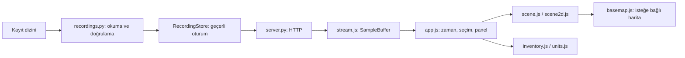

# Görüntüleyicinin veri akışı

Görüntüleyici, disk kayıtlarını doğrulayıp tarayıcıya taşıyan yerel bir HTTP uygulamasıdır. Simülasyon ile ortak Python nesnesi veya uçuş komutu kanalı paylaşmaz. Girdi, nesne CSV'leri ve varsa manifest/olay/hesap yan dosyalarıdır.

## Katmanlar

| Dosya | Sorumluluk |
|---|---|
| `viewer.py` | Argümanlar, dizin deposu, yerel sunucu ve kapanış |
| `recordings.py` | CSV/yan dosya okuma, koordinatlar, sahiplik, kütüphane ve izleme |
| `telemetry.py` | Ölçüm eksikse konum hızı ve ISA Mach tahmini |
| `server.py` | Statik dosyalar ve kayıt yönetimi/veri HTTP uçları |
| `native_picker.py` | Windows klasör seçimi |
| `web/recording-menu.js` | Kütüphane, dizin değiştirme, kayıt açma ve onaylı silme |
| `web/stream.js` | Örnek tamponu, ortak oynatma saati ve interpolasyon |
| `web/app.js` | Kullanıcı tercihleri, zaman çizelgesi, paneller ve analiz bakışı |
| `web/scene.js`, `web/scene2d.js` | 3D/2D çizim ve yardımcı katmanlar |
| `web/aircraft3d.js` | Yerel model geometrileri |
| `web/inventory.js`, `web/units.js` | Envanter sunumu, ölçü birimleri ve ortak etiketler |
| `web/basemap.js` | Harita görsellerini yerel koordinatlara projekte etme ve önbellek |

## Okuma ve normalleştirme

`read_csv()` yeni recorder'ın `time_s/lat_deg/lon_deg/alt_ft` ve kt hız sütunlarını, eski recorder'ın `alt_m` ve ft/s sütunlarını, yerleşik logger'ın `Time/Latitude/Longitude/Altitude` biçimini okur. Feet ve knot değerleri sahne için metre/m-s birimine çevrilir. Jeosantrik `Latitude`, her satırda ham kaynaktan jeodeziğe çevrilir. Dosya değiştirilmez.

Zaman ve ilk konum zorunludur. Sonlu olmayan değer, geriye giden zaman, geçersiz koordinat, negatif hız veya yinelenen sütun hata üretir. Aynı zamanlı satırlardan sonuncusu kullanılır. Seyrek boş alanlar önceki değeri taşıyabilir; eksik yönelim için bilinirlik bayrakları tutulur.

`assemble()`, bütün örnekleri ortak zamana göre sıralar ve WGS84 ECEF'ten yerel doğu/kuzey koordinatları üretir. Referans ilk uygun uçak örneğidir. 3D sahne `x=doğu`, `y=irtifa`, `z=-kuzey` kullanır. İrtifa kayıttaki referansta korunur; yerel ECEF up bileşeniyle değiştirilmez.

Ölçülen TAS ve Mach önceliklidir. TAS yoksa `telemetry.py` son yaklaşık bir saniyedeki ECEF hareketinden konum hızı türetir. Mach yoksa mevcut hız ve standart atmosfer sıcaklığından tahmin üretir. Kaynak, birim ve referans ayrıntıları [ortak veri sözleşmesindedir](../docs/veri_info/SIMULASYON_VERI_REFERANSI.md).

## Sahiplik, olay ve hesap bağlama

Özel recorder dosya adında ajan ve slot anahtarını taşır. Füze sahipliği önce bu anahtardan çözülür; yoksa aynı takımda tek olası taşıyıcı aranır. Belirsiz mühimmat ayrı tutulur ve uyarılır. Boş mühimmat CSV'leri envantere girer, uçuş izi oluşturmaz.

`events.jsonl`, olayları zaman ve sıra numarasına göre sıralar; ilk 5000 olay tutulur. `missile_hit`/`missile_lost`, ajan ve slot üzerinden envantere bağlanır. Kayıt aralığının bitişi sonuç yerine kullanılmaz.

`calculations.csv`, uçak anahtarı ve tam eşit ölçüm zamanı ile örneğe bağlanır. Hedef kimliği görüntüleyici nesne kimliğine çözülür. Eşleşmeyen satır gösterilmez ve uyarılır. Bir hesabı arayüzün kendi geometrisiyle yeniden üretmek veya en yakın zamana başlamak yerine kaydedilmiş değer korunur.

Yeni `_nm`/`_kt` hesap alanları korunur; çizim katmanları için metre/m-s
karşılıkları okuma sırasında eklenir. Eski `_m`/`_mps` hesap dosyaları da okunur.

## Dizin izleme ve geçerli veri değişimi

İmza, nesne CSV'leri ile üç yan dosyanın ad, boyut ve son değiştirilme zamanından oluşur. Varsayılan yoklama `0.25 s`, sakinleşme süresi `2 s`'dir. Dosyalar okunduktan sonra imza tekrar karşılaştırılır. Tam ve geçerli sonuç geldiğinde örnekler, nesneler, kayıt adı ve oturum kimliği birlikte değiştirilir.

Boş/yazılmakta olan kayıtta bekleme sürer. Okuma hatasında eski geçerli örnekler korunur ve hata bildirilir. CSV'de kesin tamamlanma işareti olmadığı için uzun yazım duraklaması ayırt edilemez. Bütün örnekler bellekte tutulur; büyük kayıtlar bellek kullanımını artırır.

## HTTP sözleşmesi

Sunucu varsayılan `127.0.0.1:8765` adresine bağlanır. POST istekleri JSON nesnesi ister; gövde sınırı 64 KiB'dir. Tarayıcı Origin gönderirse aynı origin kontrol edilir.

| Uç | İşlev |
|---|---|
| `GET /api/state?after=...&session=...` | Metadata ve en fazla 2000 örneklik parça |
| `GET /api/recordings` | Kütüphane dizini ve bir alt seviyedeki kayıtlar |
| `POST /api/directory` `{path}` | Listelenecek dizini değiştirir; açık uçuşu değiştirmez |
| `POST /api/choose-directory` `{}` | Windows klasör seçimi; iptal mevcut dizini korur |
| `POST /api/open` `{id}` | Katalogdaki bir kaydı sakinleşme/doğrulama yoluyla açar |
| `POST /api/delete` `{id}` | Katalogdaki kaydın CSV ve yan dosyalarını diskten siler |

Silme kayıt dosyalarıyla sınırlıdır; başka dosyalar korunur. Katalog kökü kaldırılmaz; boş bir alt kayıt klasörü kaldırılabilir. Arayüz silmeden önce onay ister. Hiçbir HTTP ucu uçuş komutu uygulamaz.

Veri paketi `schema_version=3`, `source="tacview-csv"` taşır. `session` geçerli veri sürümünü, `cursor` gönderilen örnek sonunu, `sequence` toplam örnek sayısını belirtir. Paket ayrıca bounds, kayıt adı/yolu, uyarılar, envanter, olaylar, manifest özeti ve harita referansını içerir. Oturum değişirse eski cursor geçersiz olur ve aktarım baştan başlar.

## Tarayıcı zamanı ve çizim

`SampleBuffer` tekrar gelen sequence değerlerini atlar, bütün örnekleri izlere ayırır. `ReplayClock`, gerçek zaman farkını oynatma hızıyla çarpar ve kayıt sınırlarında tutar. Konum/ölçüm alanları doğrusal, heading ve roll en kısa açı üzerinden interpolasyon görür. Gaz hedefi ve `calc` önceki örnekten korunur; sürekli yeni taktik hesap üretilmez.

Uçaklar ilk ölçümlerinden önce görünmez; son ölçümden sonra son konumları işaretlenir. Füzeler yalnız kendi ölçüm aralıklarında oynatılır. Tercih açıkken bitmiş füzenin son konumu ayrıca soluk çizilebilir. İz çiziminde ikili arama, önbellek ve nokta azaltma kullanılır; ham oynatma örnekleri silinmez.

Analiz bakışı seçili uçak, seçili füzenin taşıyıcısı veya uygun dost uçaktır. Hedef çizgisi, radar açısı ve WEZ halkaları kayıtlı C++ değerlerinden çizilir. 2D/3D yalnız gösterim seçimidir; hesap kaynağını değiştirmez.

## Harita katmanı

`basemap.js`, ilk uçak referansıyla aynı ECEF/yerel doğu-kuzey dönüşümünü kullanır. Görünen bölge için Web Mercator görselleri seçilir; yükleme eşzamanlılığı ve bellek önbelleği sınırlıdır. İstekler doğrudan tarayıcıdan OpenStreetMap'e gider. Katman kapalıyken yeni istek başlatılmaz; harita hatası mevcut uçuş verisini etkilemez.

Harita, 0 m zemin üzerindeki coğrafi görseldir. Arazi yüksekliği, jeoit dönüşümü veya fizik verisi değildir.
