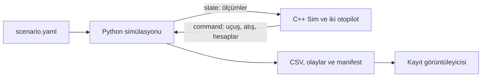

# BVR Fight Project

[HTML teknik rehber](docs/PROJE_REHBERI.html): mimariyi, UML diyagramlarını, kullanım kılavuzlarını ve veri alanlarını tarayıcıda incele.

BVR Fight Project, iki uçağın görüş ötesi hava muharebesini BVRGym/JSBSim üzerinde çalıştıran bir simülasyon ve kayıt inceleme projesidir. Python fizik nesnelerini oluşturur ve ilerletir; C++ uçakların taktik kararlarını verir. Ayrı görüntüleyici, uçuş kayıtlarını tarayıcıda 2D ve 3D olarak oynatır.



## Projenin parçaları

| Konum | Sorumluluk |
|---|---|
| [src/sim](src/sim/README.md) | Senaryo yükleme, BVRGym kurulumu, uçuş kontrolü, TCP sunucusu ve kayıt |
| [src/otopilot](src/otopilot/README.md) | Ortak dünya bilgisi, geometri ve angajman hesapları, fighter/hostile otopilotları |
| [BVRGym-Goruntuleyici](BVRGym-Goruntuleyici/README.md) | Kayıt kütüphanesi, zaman çizelgesi, 2D/3D sahne ve analiz katmanları |
| `BVRGym/` | Alt modül olarak kullanılan fizik ve ajan altyapısı |
| `recordings/` | Çalıştırma sırasında Üretilen kayıtlar; Git dışında tutulur |
| [docs](docs/README.md) | Kurulum, mimari ve veri sözleşmesinin konuya göre ayrılmış belgeleri |
| `BVR-Terminoloji.ods` | Hava muharebesi terimleri için yardımcı çalışma tablosu |

## çalıştırma

Windows, Python ortamı ve MinGW/CMake kurulu olmalıdır. İlk kurulum için [çalıştırma kılavuzunu](docs/CALISTIRMA_KILAVUZU.md) kullan. Aşağıdaki komutlar proje kökünden, Python ortamı etkin halde çalıştırılır.

```powershell
cmake -S src/otopilot -B src/otopilot/build -G "MinGW Makefiles"
cmake --build src/otopilot/build
```

Birinci terminal Python sunucusunu açar:

```powershell
python .\src\sim\sim_main.py
```

İkinci terminal C++ istemcisini başlatır:

```powershell
.\src\otopilot\main.exe
```

Kayıtları incelemek için:

```powershell
python .\BVRGym-Goruntuleyici\viewer.py --recording .\recordings
```

Tarayıcıda `http://127.0.0.1:8765` adresini aç ve **Kayıt aç** menüsünden bir oturum seç. Görüntüleyici uçuş komutu üretmez; kayıt menüsündeki silme işlemi seçilen kaydın dosyalarını diskten kaldırabilir.

## Nasıl çalışır?

Python her dış adımın başında iki uçağın ve mühimmatın ölçümlerini gönderir. C++ aynı adım için iki uçuş komutu ve varsa atış emirlerini döndürür. Komut gelene kadar fizik bekler. Python hesapları mevcut ölçümün zamanıyla kaydeder, atışları uygular, ajanları ilerletir ve yeni ölçümü kaydeder.

C++ tarafında `Sim` bu adımı yönetir. `World`, iki uçağın ölçümlerini ve birbirlerine göre hesapları tutar. `OtopilotFighter` ve `OtopilotHostile` kendi karar durumlarına, uçuş komutlarına ve manevra nesnelerine sahiptir.

## Okuma yolları

- Sistemi anlamak: [sistem mimarisi](docs/mimari/BVR_SISTEM_MIMARISI.md).
- Uçak davranışını değiştirmek: [otopilot kullanım rehberi](src/otopilot/KULLANIM.md).
- C++ sınıflarını anlamak: [otopilot mimarisi](docs/mimari/OTOPILOT_MIMARISI.md).
- Mesajları ve kayıt alanlarını Öğrenmek: [veri referansı](docs/veri_info/SIMULASYON_VERI_REFERANSI.md).
- Arayüzü kullanmak: [görüntüleyici rehberi](BVRGym-Goruntuleyici/README.md).
- Doğrulamayı tekrarlamak: [test rehberi](BVRGym-Goruntuleyici/Dogrulama.md).

## Modelin kapsamı

Mevcut C++ dünya modeli `blue` ve `red` kimliklerine sahip iki uçakla çalışır. Uçak ve füze profil etiketleri C++ hesaplarını değiştirir; Python tarafında fizik modeli F-16 ve AIM-120 altyapısıdır. WEZ basitleştirilmiş bir tahmindir; MAR ve DOR fonksiyonları henüz `0` döndürür. Radar çizimi ve pitbull hesabı, gerçek bir radar/sensör simülasyonu anlamına gelmez. Ayrıntılı sınırlar ilgili mimari belgelerinde açıklanır.
