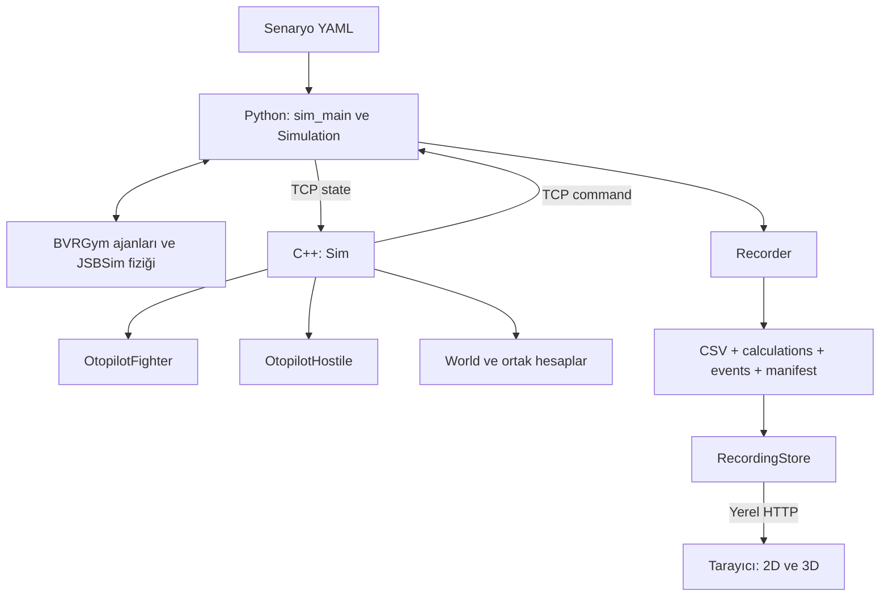

# BVR angajman sisteminin mimarisi

Sistem, fizik durumu üretme, taktik karar verme ve kayıt inceleme görevlerini ayrı bileşenlerde yürütür. Python BVRGym/JSBSim nesnelerinin sahibidir. C++ ölçümlerden karar ve uçuş hedefi üretir. Görüntüleyici kayıt dosyalarını okuyarak aynı karşılaşmayı ortak bir zaman çizelgesinde gösterir.

## Süreçler ve bağlantılar



| Bileşen | Sahip olduğu durum | Ürettiği çıktı |
|---|---|---|
| Python simülasyonu | Ajanlar, fizik modelleri, hedef bağları, son uygulanan komutlar, `tick` | Ölçüm ve fizik ilerlemesi |
| C++ `Sim` | `World`, iki otopilot ve log nesnesi | Aynı `tick` için tek komut mesajı |
| Uçak otopilotları | Ayrı karar adımı, komut ve manevra nesneleri | Kendi uçaklarının uçuş hedefi ve atış emri |
| Kaydedici | Dosya yazıcıları, önceki olay durumu, kayıt metadata'sı | Uçak/füze CSV'leri ve yan dosyalar |
| Görüntüleyici sunucusu | Açık kayıt, kütüphane, doğrulanmış örnekler ve oturum kimliği | Tarayıcıya parçalı kayıt verisi |
| Tarayıcı | Oynatma saati, seçim, kamera ve görünüm tercihleri | Görsel sahne ve analiz panelleri |

Python sunucu, C++ istemcidir. TCP, UTF-8 ve satır başına JSON kullanır. Görüntüleyicinin HTTP sunucusu farklı bir bağlantıdır; simülasyona komut göndermez.

## Bir dış adımın sözleşmesi

```mermaid
sequenceDiagram
    participant P as Python
    participant C as C++ Sim
    participant R as Recorder
    P->>R: Başlangıç ölçümü ve mevcut komutlar
    loop Süre dolana kadar
        P->>C: state(tick=t)
        C->>C: StateReader, World.update, iki otopilot
        C->>P: command(tick=t)
        P->>R: Hesapları mevcut ölçümün zamanıyla yaz
        P->>P: Atışları uygula; ajanları ilerlet; tick artır
        P->>R: Yeni ölçümü ve uygulanan komutları yaz
    end
    P->>C: end(tick=son)
```

C++ komutu beklenirken fizik ilerlemez. İki uçak için uçuş komutları tek mesajda tamamlanır. Python bütün uçuş komutlarını doğruladıktan sonra ajanları sırayla ilerletir. Bu, ortak dış adım düzenidir; her ajan ile kendi füzelerinin iç fizik alt adımları BVRGym tarafından sırayla çalıştırılır.

`calculations.csv` satırı, kararın dayandığı ölçüme aittir. Hareketten sonra yazılan uçak CSV satırı ise bir sonraki ölçümdür. Bu ayrım sayesinde görüntüleyici kararı doğru konumla eşleştirir. Son ölçüm C++'a gönderilmeden süre bitebildiği için son snapshot'ın hesap satırı bulunmayabilir.

## Zaman modeli

JSBSim fizik adımı mevcut modelde yaklaşık `1/120 s`'dir. `Control_time_step=10`, bir iç kontrol çevrimindeki fizik adımı sayısıdır. YAML `sim_time_step`, bu çevrimin kaç kez yineleneceğini belirler:

```text
dış adım süresi ≈ physics_dt × Control_time_step × sim_time_step
```

`sim_time_step=1` için dış komut ve snapshot hızı yaklaşık 12 Hz'dir. `sleep_s` yalnız gerçek zaman beklemesidir; fizik adımını değiştirmez. `tick` dış adım sayacıdır; simülasyon saniyesi değildir. Füzenin kendi saati fırlatmada sıfırlanır; kayıt sıralaması taşıyıcının ortak zamanı ile yapılır.

## Python tarafındaki iş bölümü

`scenario.py` yolları ve temel senaryo doğrulamasını tutar. `bvrgym_setup.py` her ajan için ayarları derin kopyalar; nesneleri model yollarının çözüldüğü BVRGym dizininde oluşturur ve çalışma dizinini geri getirir. Her uçak için ayrı kontrol nesnesi kurulur.

`Simulation` ölçüm okur, tam uçuş komutlarını doğrular, açık atış emrini uygular ve fizik adımını yürütür. `flight_control.py`, yön/irtifa hatasını yatış ve yük faktörü üzerinden kontrol yüzeylerine çevirir. Taktik kararlar C++ tarafındadır; kontrol yüzeylerini C++ doğrudan sürmez.

`sim_main.py` ağ, simülasyon ve kaydı bir araya getirir. `Recorder` ham ölçümü, uygulanan hedefleri ve BVRGym olaylarını yazar; C++ geometrisini yeniden hesaplamaz.

## C++ tarafındaki iş bölümü

`Sim::step`, ölçümü ve önceki komutları okur; `World::update` çalıştırır; iki otopilotu çağırır ve `CommandWriter` ile yanıt oluşturur. `OtopilotFighter` ile `OtopilotHostile` aynı `World` bilgisini ikinci parametrede `const World&` olarak alır. Her biri kendi uçağını ilk parametrede `Aircraft&` ile günceller.

`World` iki uçağın karşılıklı geometrisini, angajman bilgilerini ve havadaki füzelerin hedefe göre durumunu doldurur. `Geometry` kinematikten hesap yapar, `Engagement` profil ile geometriyi birleştirir, `MissileGeometry` füze–hedef hesabını yürütür. Manevralar bu veriden yön hedefi üretir.

Sınıfların ayrıntıları [otopilot mimarisinde](OTOPILOT_MIMARISI.md), geliştirme örnekleri [kullanım rehberinde](../../src/otopilot/KULLANIM.md) bulunur.

## Kayıt ve görüntüleme

Bir oturumda uçak ve füze başına CSV, olaylar için `events.jsonl`, C++ hesapları için `calculations.csv` ve kaynak/birim açıklamaları için `manifest.json` bulunur. Atılmamış füzenin CSV'si yalnız başlıktan oluşabilir; bu dosya mühimmat envanterini temsil eder.

Görüntüleyici tamamlanmış bir kayıt görünümü oluşturur. Dosya imzasını izler, yeterince sakin bir dizini okur, okuma sonunda imzayı tekrar kontrol eder ve geçerli veriyi tek seferde değiştirir. Hatalı kayıtta önceki geçerli ölçümler korunur. Tarayıcı örnekleri oturum ve cursor ile alır; ortak zamanda interpolasyon yapar.

Radar/WEZ ve hedefe göre değerler C++ hesaplarından gelir. Sahnedeki katmanlar, profil ve hesapların çizimidir. Harita katmanı isteğe bağlı OpenStreetMap görselleridir; arazi yüksekliği sağlamaz. Kayıt menüsü, seçilen kayıt dosyalarını kullanıcı onayıyla silebilir; uçuşa kumanda etmez.

## Kimlikler, birimler ve referanslar

Kimlik, görünen ad, takım ve fizik modeli farklı kavramlardır. `blue`/`red` mevcut C++ rolleridir; YAML'daki `type` hesap profilini seçer. Sayısal sözleşmeler ve koordinat ayrıntıları [veri referansında](../veri_info/SIMULASYON_VERI_REFERANSI.md) tanımlanır.

Ölçüm, hesap ve komut ayrı tutulur. Örneğin TAS ölçümdür, WEZ hesaplanır, throttle ise istenen gaz komutudur. Görüntüleyici eksik TAS için konumdan hız tahmini üretebilir; bunu ölçülmüş hava hızı olarak sunmaz.

## Uygulamanın sınırları

- Python ajan listesi esnektir; C++ `World` ve komut yazıcısı iki uçağa göre düzenlenmiştir.
- Bütün uçak profil etiketleri aynı F-16 fiziğini, bütün füze profil etiketleri AIM-120 altyapısını kullanır.
- Geometri yerel düz dünya yaklaşımıdır. Görüntüleyicinin WGS84 ECEF/yerel koordinat dönüşümüyle birebir aynı algoritma değildir.
- WEZ ilk füze slotunun profiline ve hedefin kapanmasına dayanır; kalan uygun füze seçimi veya gerçek bir performans zarfı çözümü değildir.
- MAR ve DOR henüz uygulanmamıştır; `0` döndürür. Pitbull, profil menziline dayalı ve bir kez doğru olduğunda korunan bir tahmindir.
- Atış için kabul/red ve füze kimliği içeren ayrı ağ cevabı yoktur. C++ eşleştirmesi sonraki ölçüme ve atış sırasına dayanır.
- Mevcut otopilotlar elle yazılmış aşama dizileridir. Genel amaçlı taktik planlayıcı veya öğrenen karar sistemi olarak tanımlanmaz.
- Dosya izleme, canlı telemetri protokolü değildir; iki saniyelik sakinlik kesin kayıt tamamlanma işareti değildir.
