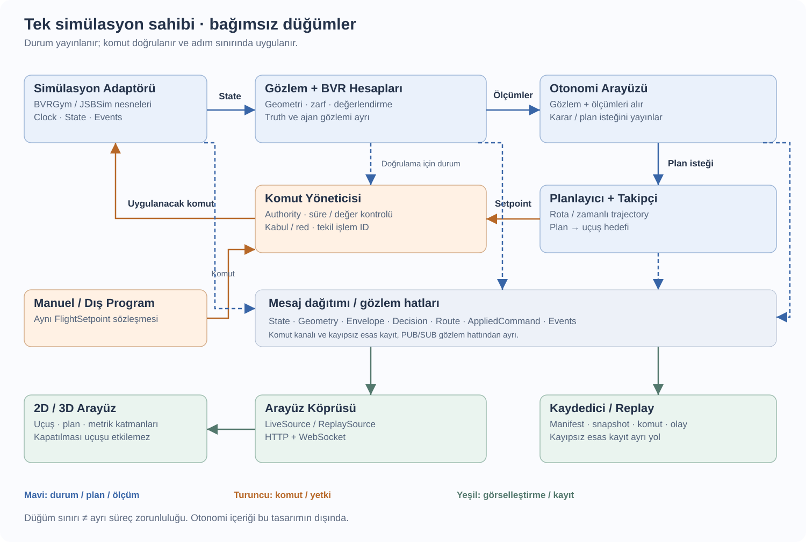
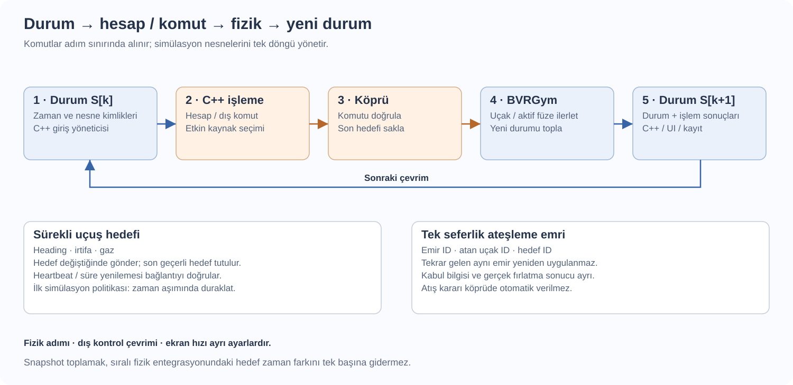
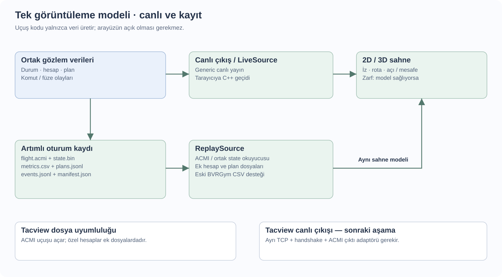

# BVR simülasyon sistemi: mimari değerlendirme ve uygulama planı

**9 Ekim 2026 · Tasarım önerisi v1 · Henüz uygulanmadı**

Bu rapor gönderdiğin mimari çizimini, **BVRGym kullanım** ve **BVR Fight Arayüz** sohbetlerini, Workspace'teki mevcut uçuş ve görüntüleyici kodunu ve [simülasyon veri referansını](../SIMULASYON_VERI_REFERANSI.md) birlikte değerlendirir. Amaç, çalışan simülasyonun durumunu dış bileşenlere vermek ve onların komutlarını simülasyona geri uygulamak; hesapları, planları ve gerçekleşen uçuşu aynı zaman çizgisinde izlemektir. Karar verme veya manevra seçme algoritması bu raporun kapsamına girmez.

## 1. Değerlendirme: çizdiğin mimari kurulabilir mi?

**Evet. Çizdiğin yapının temel ayrımı doğru:** fizik simülasyonu, BVR hesapları, otonomi ve görselleştirme farklı sorumluluklardır. Bunları bağımsız düğümler halinde geliştirebilir; ortak mesaj sözleşmeleriyle bağlayabiliriz. Böylece sen otonomi ve uçuş kodunu değiştirirken arayüzün içini bilmek zorunda kalmazsın. Otonomi kapalıyken de dış komutlarla uçuş devam edebilir.

Burada “düğüm/node”, belirli bir işi yapan ve belirli mesajları alıp üreten bileşen demektir. **Her düğümün ilk günden ayrı program olması gerekmez.** Önce görev ve veri sınırlarını ayırırız; gerektiğinde aynı bileşeni ayrı süreçte çalıştırırız. Bu, tek dosyalı bir örnekten bağımsız düğümlere geçişi kolaylaştırır.

Çiziminde netleştireceğim noktalar:

| Çizimdeki fikir | Değerlendirme | Önerilen düzenleme |
|---|---|---|
| Simülasyon → hesaplayıcı → otonomi → simülasyon | Doğru temel çevrim | Çevrimi zaman, durum kimliği ve komut uygulama sınırıyla tanımla |
| Hesaplayıcı her türlü veri işini yapıyor | İlk denemeye yeter; büyüdükçe ağırlaşır | Hızlı geometri ile pahalı WEZ/zarf hesaplarını ayrı görevler yap |
| Karar → rota → takipçi | Doğru görev ayrımı | Karar, rota ve uçuş komutunu farklı mesajlar olarak yayınla |
| Otonomi doğrudan simülasyona komut veriyor | Manuel komut eklenince iki kaynak çakışabilir | Araya kontrol yetkisi seçimi ve komut doğrulama koy |
| Kaydedici aynı zamanda herkese veri paylaşıyor | Kayıt arızası bütün veri akışını etkileyebilir | Mesaj dağıtımı, kayıt ve arayüz köprüsünü bağımsızlaştır |
| Arayüz her şeyi dinliyor | Doğru | Görselleştirme çekirdek uçuş çevriminin dışında kalsın |
| JSBSim tek başına “dünya” | Fizik için doğru; senaryonun tamamı için eksik | Adaptör BVRGym ajanlarını, envanteri, hedefleri ve olayları da birleştirsin |

En önemli ekleme **Simülasyon Adaptörü**: BVRGym/JSBSim nesnelerine sahip olacak, komutları uygulayacak, modelleri ilerletecek ve birleşik durum yayınlayacak. Diğer düğümlerin `F16BVR` veya JSBSim property adlarını bilmesi gerekmeyecek.

## 2. Şu an elimizde ne var?

| Mevcut parça | Gerçek davranışı | Yeni mimarideki yeri |
|---|---|---|
| `src/agent_ucus.py` | İki `BaseBVRAgent`, başlangıç konfigürasyonu, `[yön, irtifa, gaz]`, döngü, kayıt | Simülasyon adaptörünün başlangıç örneği |
| BVRGym `BaseBVRAgent` | Uçak ve mühimmat oluşturur; dışarıdan verilen action'ı uygular; aktif füzeleri ilerletir | Adaptörün içeride kullandığı nesne |
| `F16BVR.step()` | Heading/irtifa hedefinden PID kumandası üretir, JSBSim'i birkaç alt adım ilerletir | İlk uçuş kontrol yolu |
| JSBSim | Her uçak/füze için fizik durumunu ve sayısal propertyleri tutar | Fizik katmanı |
| `AAMBVR` | Füze durumu, mevcut güdüm, basitleştirilmiş vuruş/lost olayları | İlk füze yürütücüsü; ileride değiştirilir |
| `TacviewLogger` | Ölçümleri RAM'de toplar; `save_logs()` ile CSV yazar | Uyumluluk amaçlı dışa aktarım |
| `BVRGym-Goruntuleyici` | CSV kayıt oynatır; 2D/3D sahne, takip, iz, paneller, tema, zaman kontrolleri var | Sahne ve etkileşimler korunur, canlı kaynak eklenir |

Mevcut viewer canlı çift yönlü simülasyon köprüsü değildir. `/api/state` kayıt verilerini tarayıcıya verir. Uçuş komutu endpoint'i yoktur. Mevcut CSV'de isim/pozisyon/açılar bulunur; hız kimi kayıtlarda konum farkından tahmin edilir. Canlı modda hız ve Mach doğrudan simülasyon verisinden gelir; eski kayıttan türetilen değerler iç veri modelinde **tahmin** olarak korunur.

Mevcut uçuşta otomatik taktik karar, hedef seçimi veya atış bulunmuyor; bunu koruruz. PID uçuş denetleyicisi ile füzenin mevcut güdümü ise içeride çalışmaya devam eder. Bu iki durumun ayrımı önemlidir: taktik kararın dışarıdan gelmesi, fizik kontrol alt döngüsünün kaldırılması anlamına gelmez.

## 3. Önerilen genel mimari



**Mavi hat durum akışı; turuncu hat komut akışıdır.** Arayüz ve kayıt, bu hatları gözlemler. Fizik nesnelerine yalnızca simülasyon adaptörü dokunur. Diyagramdaki bileşenler mantıksal düğümlerdir; başlangıç süreç gruplaması bölüm 15'tedir.

```text
Senaryo / model ayarları
          ↓
Simülasyon Adaptörü ── WorldState ──► Gözlem + Geometri
       ▲                                      ↓
       │                               Otonomi arayüzü
       │                                      ↓
       │                              Karar → Rota → Takipçi
       │                                      ↓
       └── Uygulanan komut ◄── Komut Yöneticisi ◄── Uçuş hedefi
                                  ▲
                          Manuel / dış program

Durum + hesaplar + karar + rota + komut sonucu + olaylar
          ├──► Arayüz Köprüsü ──► 2D / 3D
          └──► Kaydedici ──► Tekrar oynatma / Tacview aktarımı
```

### Düğümlerin görevleri

| Düğüm | Aldığı veri | Ürettiği veri | Sorumluluk sınırı |
|---|---|---|---|
| Senaryo yöneticisi | Senaryo dosyası, başlat/reset isteği | Model/ajan tanımları, başlangıç durumu, oturum manifesti | Uçuş kararı vermez |
| Simülasyon adaptörü | Onaylanmış uçuş komutları, açık silah isteği, sim kontrolü | WorldState, fizik/olay sonuçları, komut uygulama sonucu, Clock | JSBSim/BVRGym nesnelerinin tek sahibi |
| Gözlem adaptörü | WorldState, görünürlük/sensör profili | Ajan başına Observation | İlk aşamada tam durum; sonra sensörlü/kısmi gözlem |
| Geometri hesaplayıcı | Aynı snapshot'taki gözlemler/durumlar | Mesafe, closure, ATA/AA, LOS, HCA, irtifa farkı | Karar vermez; sayısal özellik çıkarır |
| Zarf hesaplayıcı | Uçak/füze modeli, durum, hedef çifti, varsayımlar | WEZ/NEZ tahmini, koşullu menzil, örneklenmiş sınır | Pahalı model hesabı; canlı fiziği ilerletmez |
| Değerlendirme profili | Geometri, zarf, senaryo profili | MAR/DOR/MOR/DR gibi yapılandırılmış değerlendirmeler | Eşik/ölçüm verir; manevra seçmez |
| Otonomi arayüzü | Observation, hesap sonuçları, önceki komut sonucu | DecisionDebug, PlanRequest, açık WeaponCommand isteği | Algoritma burada takılabilir; içerik bu raporda tasarlanmıyor |
| Rota planlayıcı | PlanRequest, durum, uçuş sınırları | PlannedRoute / TimedTrajectory | Planın kaynağı ve geçerliliğini belirtir |
| Rota takipçi | Güncel durum + kabul edilen plan | FlightSetpoint | Planı uygulanabilir hedefe çevirir; BVR kararı vermez |
| Manuel/dış komut kaynağı | Kullanıcı girdisi veya başka program | FlightSetpoint / açık işlem isteği | Aynı sözleşmeyi kullanır |
| Komut yöneticisi | Aday komutlar, kontrol yetkisi, güncel durum | AppliedCommand adayı, kabul/red sonucu | Aktif kaynağı seçer; içerik/aralık/zaman doğrular |
| Mesaj dağıtımı | Topic mesajları | Abonelere mesajlar | Hesap veya kayıt yapmaz |
| Arayüz köprüsü | Durum, hesaplar, planlar, olaylar | Tarayıcı snapshot ve güncellemeleri | Çizim için veri birleştirir; otorite değildir |
| Kaydedici / replay | Esas durumlar, uygulanan komutlar, türetilmiş veriler | Kayıt, manifest, checkpoint, replay akışı | Arayüz açılmadan da kayıt yapar |

Gözlem, geometri ve değerlendirme ilk prototipte aynı **hesaplama süreci** içinde çalışabilir. Rota planlayıcı ve takipçi de ilk etapta tek otonomi sürecinde olabilir. Modül sınırları korunursa ileride ayırmak mesajları değiştirmeyi gerektirmez.

## 4. Düğümleri neyle bağlayalım?

**Önerim: Python + ZeroMQ; tarayıcı tarafında HTTP/WebSocket; mevcut Three.js sahnesi.** İlk adımda aynı süreçte doğrudan fonksiyon çağrısıyla çalışan adaptörü kurar, sonra aynı mesajları ZeroMQ üzerinden taşırız. Mesaj sözleşmesi taşıma yönteminden bağımsız olur.

| Seçenek | Güçlü tarafı | Bu projedeki bedeli | Değerlendirme |
|---|---|---|---|
| Python fonksiyon / kuyruk | Hata ayıklamak kolay, ağ yok | Süreçler arası bağımsızlık sınırlı | İlk adaptör ve matematik kontrolleri için |
| ZeroMQ / `pyzmq` | Topic dağıtımı, mesaj çerçeveleme, farklı süreç/dil bağlantısı | ACK, başlangıç snapshotı, şema ve yaşam döngüsünü biz tanımlarız | Bu aşama için önerilen taşıma |
| ROS 2 / DDS | Topic/service/action, araçlar ve QoS ekosistemi | Ayrı paket/çalışma ortamı ve sürüm uyumluluğu yönetimi | ROS/donanım ekosistemine bağlanma hedefi varsa güçlü alternatif |
| Ham UDP | JSBSim native output ile hemen ölçüm çıkar | Kayıp/sıralama/kimlik/komut cevabı ayrıca çözülür | Uyumluluk ve basit gözlem için; ana komut omurgası için önerilmez |
| HTTP + WebSocket ile her şeyi bağlamak | Tek web teknolojisi, tarayıcı doğal destekler | İç düğümlerin zamanlama ve abonelik yönetimini ayrıca kurarız | Arayüz köprüsüne uygun |
| Sürekli CSV okuma | Mevcut viewer ile uyumlu | Komut, olay ve eşzamanlı canlı çevrim için yetersiz | Replay ve aktarım için kalsın |

“Node” kullanmak ROS kurmamızı zorunlu kılmaz. ROS 2 seçersek aynı mantıksal görevler node, veriler topic, reset/step gibi işlemler service olabilir. QoS uyumunu ayrıca tasarlamak gerekir. Bu projede Windows/Python 3.11 venv'iyle başlayan sade bir geliştirme yolu tercih ettiğim için ZeroMQ öneriyorum; bu bir performans ölçümünün sonucu değil, mevcut yapıya ilişkin mühendislik tercihidir. [ROS 2 QoS kaynak belgesi](https://github.com/ros2/ros2_documentation/blob/jazzy/source/Concepts/Intermediate/About-Quality-of-Service-Settings.rst), [ZeroMQ socket türleri](https://libzmq.readthedocs.io/en/latest/zmq_socket.html).

### Üç ayrı iletişim davranışı

**1. Canlı durum yayını:** PUB/SUB. Geometri, UI ve teşhis en yeni durumu takip eder. Yavaş arayüz eski görüntüleri biriktirip dakikalar geriden gelmemeli; kuyruk sınırı ve son durum seçimi uygulanır. PUB/SUB mesajları bağlantı başlangıcında veya kuyruk dolduğunda kaybolabilir. Bu yüzden abonelik tek başına tam kayıt veya deterministik deney garantisi vermez. [ZeroMQ Guide](https://zguide.zeromq.org/docs/chapter2/).

**2. Komut/işlem kanalı:** İlk sürümde timeout ve yeniden bağlantı yöneten REQ/REP; birden çok istemci ve eşzamanlı istek ihtiyacında ROUTER/DEALER. Uygulama düzeyinde komut ID'si, kabul cevabı ve uygulandı cevabı kullanılır. Sadece TCP veya ZeroMQ kullanmak bir füzenin tam bir kez atılmasını garantilemez; tekrar gelen işlem ID'si aynı kayıtlı sonucu döndürmelidir.

**3. Başlangıç ve toparlanma servisi:** Geç katılan düğüm manifesti, güncel tam snapshotı, kontrol yetkisini ve aktif planı ister; sonra akışa geçer. Akış aboneliği önce açılır, kısa süreli buffer tutulur, alınan snapshotın `tick_id` değerine kadar olan paketler elenir. Bu, snapshot alırken arada kalan güncellemeyi kaçırmayı engeller. Epoch değişiminde hepsi temizlenir.

Native JSBSim UDP çıktısı fizik propertylerini taşımak için hâlâ kullanılabilir. Ana adaptörse Python getter/property erişimini kullanır; ajan adı, takım, sağlık, envanter ve olayları aynı pakete ekler. Böylece her uçağa ayrı port verme gereği ana sistemden kalkar. [JSBSim API](https://jsbsim-team.github.io/jsbsim/python/FGFDMExec.html).

## 5. Mesaj sözleşmeleri: düğümler ne alışveriş yapacak?

Mesajların ilk sürümü UTF-8 JSON olur. Python tarafında `dataclass` veya Pydantic ile doğrulama; ayrı JSON Schema dosyalarıyla dış program desteği sağlanabilir. NumPy ve Python nesne referansları doğrudan gönderilmez: sayılar/liste/ID/null kullanılır. Sonradan MessagePack veya Protobuf'a geçmek mümkün; algoritmalar transport nesnesi yerine bu sözleşmelerle çalışır. PyZMQ özel JSON/byte serileştirmeyi destekler. [PyZMQ serialization](https://pyzmq.readthedocs.io/en/latest/howto/serialization.html).

### Ortak başlık

| Alan | Tip | Anlam |
|---|---|---|
| `schema_version` | int | Mesaj yapısının sürümü |
| `message_type` | string | WorldState, FlightSetpoint vb. |
| `run_id` | string | Bu deney/çalıştırma kimliği |
| `epoch` | int | Reset/yeniden başlangıçta artar; eski paketleri ayırır |
| `producer_id` | string | Mesajı üreten düğüm |
| `sequence` | int | Üretici ve topic başına artan sıra |
| `tick_id` | int | Esas dünya snapshotının adım kimliği |
| `sim_time_s` | float | Ortak senaryo zamanı |
| `source_tick_id` | int/null | Türetilmiş mesajın dayandığı durum |
| `wall_time_utc` | string | Log/teşhis için; fizik hesabında kullanılmaz |
| `frame_id`, `origin_id` | string/null | Koordinat sistemi ve yerel referans |

Saat karşılaştırmalarında simülasyon zamanı kullanılır. Ağ gecikmesini ölçmek için alıcı kendi monotonic saatinde geliş anını tutar; farklı makinelerin monotonic saatlerini birbirinden çıkarmaz. UTC ancak saat eşleştirmesi doğrulanmışsa tek yönlü gecikme ölçümünde kullanılabilir.

### Veri ve topic listesi

| Önerilen topic / servis | İçerik | Üretici → tüketici |
|---|---|---|
| `sim.manifest` / `GetManifest` | Modeller, kimlikler, birimler, dt, kontrol yetenekleri, referans datum, ayar hashleri | Adaptör → tümü |
| `sim.clock` | Zaman, epoch, running/paused/stopped, gerçek zaman katsayısı | Adaptör → tümü |
| `sim.world_state` / `GetSnapshot` | Bütün uçak/aktif füze durumları ve envanter | Adaptör → hesaplar/UI/kayıt |
| `agent.<id>.observation` | Bu ajanın kullanmasına izin verilen gözlem, zaman ve kalite | Gözlem → otonomi |
| `bvr.geometry` | Yönlü own-target çiftlerinin sayısal geometrisi | Geometri → otonomi/UI/kayıt |
| `bvr.envelopes` | Koşullu WEZ/NEZ sınırları, model/varsayım/geçerlilik | Zarf → değerlendirme/UI |
| `bvr.assessment` | MAR/DOR/MOR/DR değerleri, profil ve dayanak | Değerlendirme → otonomi/UI/kayıt |
| `autonomy.decision` | Algoritmanın sağladığı karar etiketi, hedef ID, değerlendirme ve sebep bilgisi | Otonomi → UI/kayıt/planlayıcı |
| `autonomy.route` | Plan ID, route noktaları, kaynak durum, geçerlilik | Planlayıcı → takipçi/UI/kayıt |
| `autonomy.trajectory` | Zamanlanmış rota örnekleri ve beklenen hareket | Planlayıcı → takipçi/UI/kayıt |
| `control.authority` | Uçak başına aktif kontrol kaynağı, mod ve yetki revision'ı | Komut yöneticisi → tümü |
| `control.accepted` | Doğrulanan, sıraya alınan komut | Komut yöneticisi → teşhis/kayıt |
| `control.applied` | Gerçekte uygulanan hedefler, kaynak ve uygulama tick'i | Adaptör → otonomi/UI/kayıt |
| `command.result` | ID, accepted/applied/rejected/expired ve gerekçe | Yönetici/adaptör → gönderen |
| `sim.events` | Spawn, launch, hit/lost, reset, kontrol değişimi, hata | Adaptör/yönetici → tümü |
| `system.health` | Düğüm heartbeat'i, veri yaşı, kuyruk ve gecikme ölçümleri | Her düğüm → izleme/UI |
| `SubmitFlightCommand` | FlightSetpoint veya desteklenen başka kontrol modu | Manuel/takipçi → yönetici |
| `SubmitWeaponCommand` | Tekil fire/target isteği | Manuel/otonomi → yönetici/adaptör |
| `SetAuthority`, `Pause`, `Resume`, `Reset`, `Step` | Açık yaşam döngüsü işlemleri | İstemci → yönetici/adaptör |

Topic isimleri öneridir; bugün çalışan endpoint'ler değildir. Her bilgi herkese zorunlu olarak gönderilmez. Aboneler yalnızca ihtiyacı olan topicleri açar.

### WorldState içinde bulunacak bilgiler

**Dünya:** ortak tick/time, origin/datum, varsa atmosfer profili, mevcut senaryo durumu ve olay sıra imleci. JSBSim'in tek küresel “dünya objesi” varmış gibi davranmayız; adaptör tekil FDM'leri birleştirir.

**Uçak:** sabit ID, görünen ad, takım, model ID, konum, MSL/geodetic yükseklik tanımı, ortak çerçevede yer hızı, NED/gövde hızları gerekiyorsa açık frame etiketi, quaternion ve Euler açıları, gövde açısal hızları, TAS/Mach, AoA, yakıt, yük katsayıları, sağlık, seçili hedef ID, gerçek gaz/kumanda değerleri ve son uygulanmış komut ID'si.

**Mühimmat:** taşıyıcı ID, slot ID, silah model ID, ready/active/spent/hit/lost durumları. Henüz atılmayan mühimmatın FDM başlangıç konumunu dünyada uçan füze olarak göstermeyiz.

**Aktif füze:** benzersiz ID (`blue-1/missile/0` gibi), taşıyıcı/target ID, uçuş durumu, konum/hız/yönelim, ortak senaryo zamanı, ayrı uçuş yaşı, vuruş/lost olayı ve varsa geçerli son hedef mesafesi. Aynı takımda farklı uçakların aynı slot numarası aynı ID değildir.

**Kalite:** `measured_simulation`, `derived`, `estimated`, `configured`, `unavailable` ayrımı. Ölçüm yoksa sayı uydurmayız: `null`, sebep ve kaynak zamanı kullanılır. Alanları bu sınıflarla tanımlayan şema/manifest tutulur; her float'ın yanına aynı metni tekrar koymak gerekmez.

## 6. Komut sistemi: cmd_vel yerine ne kullanalım?

Bir sabit kanatlı uçağa uzayda istenen hız vektörünü vermek, o vektöre fiziksel olarak anında ulaşabileceği anlamına gelmez. Mevcut BVRGym'in doğrudan desteklediği komut **heading + altitude + throttle**. Bu nedenle ilk protokol `FlightSetpoint` olsun. Genel bir kontrol mesajı içinde mod açıkça belirtilsin.

| Kontrol modu | Örnek içerik | İlk sürüm desteği |
|---|---|---|
| `heading_altitude_throttle` | heading_deg, altitude_msl_m, throttle_norm | Var: BVRGym `[heading, altitude, throttle]` |
| `heading_altitude_airspeed` | heading, altitude, TAS hedefi | Hız→gaz denetleyicisi eklenmeden desteklenmez |
| `velocity_ned` | Kuzey/doğu/aşağı hız hedefleri | Uçuş hedeflerine ve sınırlara çeviren ek kontrolcü gerektirir |
| `attitude_rates` | Roll/pitch/yaw rate veya attitude hedefi | Ayrı alt seviye kontrol yolu gerekir |
| `actuator_direct` | Aileron/elevator/rudder/throttle | F16BVR PID'sini bu modda devreden çıkaran adaptör gerekir |
| `follow_plan` | plan_id + revision | Takipçi FlightSetpoint üretir; JSBSim'e rota dosyası verilmez |

Desteklenmeyen modun sessizce başka bir moda çevrilmesi yerine `unsupported_mode` cevabı verilir. Yetenek listesi manifestte yayınlanır. Mevcut PID üzerinden heading/altitude verirken doğrudan aileron yazarsan sonraki PID adımı bunu değiştirebilir; aynı anda iki kontrol yolu kullanılmaz.

### Örnek manuel / dış program komutu

```json
{
  "schema_version": 1,
  "message_type": "FlightSetpoint",
  "run_id": "run-001",
  "epoch": 0,
  "command_id": "manual-104",
  "source_id": "external-console",
  "entity_id": "blue-1",
  "authority_revision": 3,
  "mode": "heading_altitude_throttle",
  "based_on_tick_id": 120,
  "apply_at_tick_id": 121,
  "valid_until_sim_time_s": 12.8,
  "setpoint": {
    "heading_deg": 90.0,
    "altitude_msl_m": 8000.0,
    "throttle_norm": 0.55
  }
}
```

Bu örnek protokol tasarımıdır. `apply_at_tick_id=121` sonraki kontrol aralığının giriş sınırında uygulanmayı ister. Sonuç mesajında gerçek uygulama tick'i, istenen değerler ve etkili değerler bulunur. `accepted` sıraya alındığını, `applied` simülasyon adım sınırında kullanıldığını söyler; ikisi aynı olay değildir.

### Manuel ile otonom komutun birlikte bulunması

Uçak başına bir **aktif kontrol kaynağı** vardır: `manual`, `autonomy`, `script` veya yapılandırılmış `hold`. Son gelen paketin otomatik kazanması yerine `SetAuthority` ile açık geçiş yapılır. Seçilmeyen kaynak adaylarını yayınlayabilir; “önerilen” ve “uygulanan” komut UI'da ayrı görülür. Gölge otonomi modunda algoritma çalışır ve rota önerir ama uçağı yönetmez.

Kontrol değişiminde `authority_revision` artar. Eski revision'a ait kuyruktaki komutlar iptal edilir. Böylece manuel moda geçtikten sonra gecikmiş otonomi paketi tekrar kontrolü alamaz. Mod değişimi, zaman aşımı ve kullanılan fallback olay olarak kaydedilir.

Geçerlilik süresi dolan komuta uygulanacak davranış senaryoda seçilir: ilk manuel prototipte mevcut heading/altitude hedefini kısa süre koruma ve “komut eskidi” durumu; tekrarlanabilir deneyde pause/fail. Ağ thread'i uçuş nesnesine doğrudan dokunmaz. Pause sırasında sim_time ilerlemediği için ayrıca duvar saatiyle heartbeat/kaynak kaybı takibi yapılır; bu bir uçuş kararı değildir.

### Ateşleme ayrı işlem olmalı

Sürekli akan gaz/yön mesajının içinde `fire=true` taşımayız. `WeaponCommand` ayrı ve tekil bir işlem: command_id, shooter_id, target_id, epoch, authority_revision, uygulanacağı tick ve isteğe bağlı slot_id.

Adaptör kimlikleri, yetkiyi ve mühimmat durumunu doğrular; izin verilmiş açık çağrıda `set_target()` ve `launch_missile()` kullanır. ATA/menzil eşiğini mimari gizlice eklemez. Mevcut `BaseBVRAgent` kendi aktif füzesi varken ikinci atışı engelleyebilir; bu yetenek sınırı manifestte ve sonuç cevabında belirtilir. `launch_missile()` açık bir sonuç döndürmediği için adaptör slot durumlarını önce/sonra karşılaştırarak sonucu üretmelidir.

Aynı `command_id` tekrar gelirse yeni atış yapılmaz; önceki sonuç döner. Yeni istek farklı ID taşır. Bu yapı gelecekte dış güdüm/füze kontrolünü de taşıyabilir, fakat ilk sürümün güdümü mevcut AAMBVR'dir.

## 7. Simülasyon akarken çevrim nasıl işleyecek?



`S[k]` tüm ajanların aynı ortak senaryo anındaki durumudur. `u[k]`, bu duruma dayanarak **k→k+1 aralığında** uygulanacak komuttur. Yeni dünya snapshotı bütün ilgili uçaklar ve füzeler ilerledikten sonra yayınlanır.

1. `S[k]` okunur; kimliği ve ortak zamanı sabitlenir.
2. Gözlem/geometri bu snapshot'tan çıkarılır; otonomi veya manuel kaynak komut önerir.
3. Komut yöneticisi kaynağı, epoch'u, hedef tick'i ve geçerliliği doğrular.
4. Adaptör komutları bir sonraki aralığın başında sabitler; aralık ortasında gelen komut sonraki sınıra kalır.
5. Uçaklar/füzeler fizik ve kontrol alt adımlarını tamamlar.
6. `S[k+1]`, uygulanan komut ve olaylar yayınlanır ve kayıt altına alınır.

### İki çalışma modu

| Mod | Davranış | Kullanım |
|---|---|---|
| Yaklaşık gerçek zaman / serbest akış | Adaptör kendi saatinde ilerler; geçerli son komut uygulanır. Geç gelen analitik `source_tick_id` ile görünür | Manuel uçuş, canlı UI, entegrasyon |
| Kilit adımlı / lockstep | Adaptör S[k] için gereken hesap/komut cevabını bekler; sonra sabit sayıda alt adım ilerletir | Deney, algoritma karşılaştırma, test |

Lockstep'i sadece PUB/SUB ile kurmayız. Durum kimliğini taşıyan güvenilir `ComputeStep`/`Step` alışverişi ve tamamlanma bariyeri gerekir. UI bu bariyerin üyesi değildir. Timeout davranışı tanımlıdır; eksik komut varsa deney pause/fail veya kaydedilmiş açık fallback uygular. Gerçek zaman modunun aynı seed ile aynı sonucu vereceği varsayılmaz; ağ geliş sırası fark yaratabilir.

### Mevcut BVRGym zamanlamasına uyum

Mevcut modellerin fizik adımı yaklaşık 1/120 s. Şablonda `Sim_time_step=1`, hazır kontrol tekrar sayısı 10: bir action çağrısı yaklaşık 10 fizik adımı, yani 0.0833 s ilerletir; dış kontrol hızı yaklaşık 12 Hz'dir. Gerçek süre her çağrının öncesi/sonrası model saatinden doğrulanır. Fizik dt'si ile döngü tekrar sayısını karıştırmayız. Bu sürümde tek dış çağrıyla 50 Hz taze durum elde edeceğimizi söyleyemeyiz.

| Katman | İlk hedef | Not |
|---|---|---|
| Fizik | Mevcut yaklaşık 120 Hz simülasyon adımları | Fizik model ayarı korunur |
| Adaptör kontrol/snapshot | Mevcut arayüzle yaklaşık 12 Hz | Sonradan daha ince adım API'siyle değiştirilebilir |
| Geometri | Her dünya snapshotı | Ucuz çift hesapları |
| Zarf/değerlendirme | Başlangıçta 1–2 Hz veya durum anlamlı değişince | Gecikme/validity yayınlanır; ağır iş ayrı worker |
| Otonomi/rota | Algoritma dış sözleşmesinin istediği hız | İçerik tasarlanmıyor; hız yapılandırılır |
| UI | 30–60 çizim frame/s | Yeni fizik ölçüm hızı değil; interpolasyon |
| Kayıt | Esas snapshot ve bütün esas olay/komutlar | Türetilmiş yayınlar kendi hızında eklenir |

Bu hızlar önerilen başlangıç değerleridir; performans ölçümü değildir. Üç boyutlu fizik doğruluğu hız tercihinden bağımsız ayrıca doğrulanır.

### Birden fazla uçak ve füze zamanı

`BaseBVRAgent.apply_action()` önce kendi uçağını, sonra kendi aktif füzelerini ilerletir. Bütün ajanlar sırayla çalıştırıldığında bir füze başka uçağın eski/yeni durumunu çağrı sırasına göre görebilir. Tek snapshotı sonunda almak **bu iç sıralama etkisini tamamen çözmez**.

İlk adaptör aşaması mevcut sıralamayı sabit tutar, zamanları ölçer ve bu sınırlılığı kaydeder. Daha güvenilir çoklu ajan deneyleri için sınırlı bir ince adım adaptörü gerekir: alt adımın başındaki bütün durumları dondur → bütün kontrol/güdüm girdilerini o durumdan hesapla → her FDM'yi bir kez ilerlet → ortak t'ye ulaşınca olayları değerlendir. Bu yol mevcut BVRGym çağrılarını yeniden düzenleyen ayrı bir entegrasyon aşamasıdır; mümkün olduğunca upstream dışındaki adaptörde yapılır. Doğrulanmadan “bütün nesneler eşzamanlı” denmez.

Füze launch/reset sonrasında kendi model saati sıfırdan başlayabilir. Ortak clock adaptöre aittir; füze `launch_sim_time_s` ve `flight_age_s` taşır. Pause/resume fizik zamanını korur; reset epoch artırır, eski komutları, bufferları ve planları temizler. Canlı uçuş durunca son konum tutulur; extrapolasyonla uçak ilerletilmez.

## 8. Koordinatlar ve birimler: ortak sözleşme

Bu bölüm erken çözülürse sonraki düğümlerin çoğu sadeleşir.

| Veri | Çekirdek sözleşme | Arayüzde dönüşüm |
|---|---|---|
| Coğrafi konum | Jeodezik lat/lon derece; yükseklik datum'u açık | Harita/konum gösterimi |
| Yatay/düşey yerel konum | Metre, origin_id ile ENU: east/north/up | 2D ve 3D |
| Dünya hızı | Ortak ENU veya ECEF, m/s | Etiket / vektör |
| Uçuş heading/pitch/roll | Derece; kuzey=0, doğu=90; JSBSim convention belgelenir | Derece |
| Yönelim | `q_body_frd_to_enu_xyzw`, body FRD → ortak ENU | Quaternion interpolasyonu |
| Açısal hız | Frame etiketiyle rad/s | Gerekirse deg/s |
| İrtifa | `altitude_msl_m` ve gerekirse ayrı geodetic/ellipsoid yükseklik | ft veya m |
| Mesafe | m | NM/km |
| Hız | m/s; TAS ile ground speed ayrı | m/s/knot |
| Zaman | s, ortak senaryo saati | s / dakika:saniye |

İki uçağın yerel NED hız bileşenlerini farklı lat/lon'larda doğrudan birbirinden çıkarma. Önce her yerel frame'den aynı ECEF veya ortak ENU frame'ine çevir. Yerel ENU yakın senaryolar için pratiktir; daha geniş alanlarda ECEF/jeodezik hesap kullanılır. Referans origin rastgele her frame'de değiştirilmez; değişirse yeni origin_id ve dönüşüm yayınlanır.

Mevcut `get_lat_gc_deg()` jeosentrik enlemdir. Yeni adaptörde harita/jeodezik hesap için `position/lat-geod-deg` kullanılır. Mevcut geospatial yardımcılarının jeosentrik enlemi jeodezik fonksiyona vermesi aynen taşınmaz. Yükseklik de bağımsızdır: `h-sl` ile `geod-alt` aynı datum kabul edilmez; jeodezik/ECEF dönüşümünde modelin `position/geod-alt-ft` tanımı doğrulanıp kullanılır. Gerçek geoid modeli eklenirse H/N/h dönüşümü ayrıca belirtilir. Görüntüleyicinin şimdiki 0 m MSL yer düzlemi gerçek arazi/AGL değildir.

Three.js'in mevcut yerleşimine uygun görsel dönüşüm `x=east`, `y=up`, `z=-north`. Burun yönü quaternion'dan, hareket yönü dünya hızından çizilir. Rüzgâr/AoA/sideslip nedeniyle burun ile hareket doğrultusu eşit olmak zorunda değildir. [Mevcut yerel veri referansı](../SIMULASYON_VERI_REFERANSI.md).

## 9. Hangi hesapları hangi düğüm yapacak?

### 9.1 Hızlı ve doğrudan geometri

`own` ve `target` aynı snapshot'tan gelir. `r = p_target - p_own`, `R = |r|`, `r_hat = r/R`. `v` değerleri aynı dünya çerçevesindedir. `f_own` ve `f_target` gövde ileri ekseninin dünyadaki birim vektörüdür.

| Ölçüm | Tanım / hesap | Çıktı ve yorum |
|---|---|---|
| Slant range | `R = norm(r)` | m; üç boyutlu mesafe |
| Yatay mesafe | Ortak ENU'da `sqrt(r_e²+r_n²)` | m; slant range ile karışmaz |
| İrtifa farkı | Aynı datum'da target − own | m; pozitif target daha yüksek |
| Closure rate | `(v_own − v_target) dot r_hat` | m/s; yaklaşma pozitif, uzaklaşma negatif |
| LOS azimuth/elevation | `atan2(r_e,r_n)`; `atan2(r_u,horizontal_range)` | deg; dünyanın kuzey/ufuk referansına göre |
| Body LOS azimuth/elevation | LOS'u own body frame'ine döndür | deg; sağ/sol ve yukarı/aşağı bilgisi |
| ATA nose 3D | `acos(clamp(f_own dot r_hat,−1,1))` | 0–180 deg; burun→hedef görüş hattı |
| ATA velocity 3D | `acos(v_own_unit dot r_hat)` | Ayrı alan; burun ATA'sının yerine geçmez |
| AA tail convention | `acos(clamp(f_target dot r_hat,−1,1))` | 0° hedefin arkasında, 180° önünde |
| Heading crossing angle | İki yatay heading'in sarılmış farkı | signed deg; 3D vektör açısı ayrı alan |
| LOS angular speed | `norm(r cross (v_target−v_own))/R²` | rad/s; yeterli mesafede geçerli |
| Instantaneous time-to-close | `R/closure`, closure > 0 ise | s; sabit göreli harekete dayalı gösterge, füze uçuş süresi değil |

ATA'nın burun/sensör ekseni/velocity tanımları ve AA convention'ı kaynaklara göre farklılaşabilir. Sözleşmede `ata_nose_deg`, `ata_velocity_deg`, `aa_tail_deg` gibi isimler kullanılır; yalın `angle` gönderilmez. Sensör/radar modeli olmadan ATA'dan “radar lock var” sonucu üretilmez. Geometri araştırmalarda bu açılarla ifade edilir; burada 3D burun ve velocity varyantlarını açık ayırıyoruz. [MIT air-combat geometry çalışması](https://groups.csail.mit.edu/rrg/papers/jgcd10-jm.pdf), [AA/ATA tanımları içeren araştırma](https://onlinelibrary.wiley.com/doi/abs/10.1155/2014/183401).

**Kendi test convention'ımız:** Aynı doğrultuda hedefin arkasından takipte ATA=0, AA_tail=0; karşılıklı burun buruna yaklaşmada ATA=0, AA_tail=180. Sağ/sol bilgisi acos'ta kaybolur, bunun için ayrıca signed body LOS verilir. Mesafe çok küçük veya hız normu sıfıra yakınsa ilgili sonuç `invalid`/null olur; NaN'ı JSON'a taşımayız.

Geometri **yönlü** çiftler halinde yayınlanır: `blue-1 → red-1` ile `red-1 → blue-1` farklı ATA/AA sonuçları taşır. N uçakta tüm çiftler yaklaşık O(N²); ilk iki uçak için önemsiz, sonra seçilmiş hedef/komşuluk listesi ve shared pair cache kullanılır. Sensörlü modda otonomi hesapları izin verilen gözlemden; değerlendirici UI hesapları truth'tan gelir ve kaynakları ayrı etiketlenir.

### 9.2 WEZ/NEZ: geometriyle aynı türde hesap değil

WEZ tek sabit bir daire değildir. Hangi atıcı/füze/target durumuna, irtifa ve hıza, hedef davranışı varsayımına, güdüme ve başarı ölçütüne göre hesaplandığı gerekir. NEZ de varsayılan hedef cevapları ve uçuş sınırlarıyla tanımlanır; basit bir kısa menzil halkasına bu adı vermeyiz.

| Zarf girdisi | Neden gerekir? |
|---|---|
| Shooter / target aynı andaki konum, hız, yönelim | Başlangıç koşulları |
| Silah model ID ve parametre sürümü | Fizik ve güdüm modelinin kaynağı |
| Atış geometrisi ve launch koşulları | Hesabın hangi şartlarda yapıldığı |
| Target response profile ID | Sabit uçuş / tanımlanmış cevap varsayımı |
| Guidance profile ID | Mevcut AAMBVR veya gelecekte dış güdüm |
| Başarı ölçütü / hit tanımı | Mevcut BVRGym effective radius gibi model kuralı |
| Sayısal çözüm/örnekleme ayarları | Çözünürlük, maliyet ve tekrarlanabilirlik |

Aşamalı sağlayıcı arayüzü önerisi:

1. **Konfigürasyon sağlayıcısı:** Deneme amaçlı belirlediğin çizim/menzil sınırları. `configured` etiketi; doğrulanmış WEZ performansı diye sunulmaz.
2. **Tablo sağlayıcısı:** Ayrı testlerden üretilmiş koşullu lookup tablo, interpolation ve kullanım sınırı.
3. **Model sağlayıcısı:** Kopya simülasyon örneklerinde kısa model roll-out'larıyla sonuç üreten worker. Canlı FDM'yi deneme hesabı için ilerletmez.

Çıktı: model_id/version, own/target/weapon ID, source_tick, hesap zamanı, geçerlilik süresi, varsayımlar, scalar sınırlar ve varsa geometri. Tek sayısal menzil **3D hacim değildir**. Hacim çizmek için altitude/azimuth gibi boyutlarda örneklenmiş alan gerekir. Model yokken boş/`unavailable` görünür; BVRGym configindeki performans parametresini doğrudan kapsamlı WEZ diye adlandırmayız.

### 9.3 MAR, DOR, MOR, DR

Bu adlar sadece iki konumun geometrisinden kesin çıkarılan fizik ölçümleri değildir. Tehdit modeli, uçak performansı, tanımlanan out/abort davranışı, zaman payları ve kullanılan profil gerekir. Mimari bu profilleri takılıp değiştirilebilir tutmalı; otonomi düğümü bu ölçümlerden istediği kararı verebilir.

| Alan | Mimari yaklaşım | Veri kalitesi |
|---|---|---|
| MAR | Threat/aircraft profile + durumdan değerlendirme sağlayıcısı | Profile/model bilgisi zorunlu |
| DOR | Deneyde seçilmiş desired-out profili veya model tabanlı değerlendirme | Hedeflenen değer ve hesaplanan değer ayrı |
| MOR | Kullanılan minimum-out tanımına bağlı sağlayıcı | DOR ile isim benzerliği aynı değer olduğu anlamına gelmez |
| DR | Projede kullanılacak açılım ve operasyonel tanım sözleşmede belirlenir | Tanım onaylanana kadar null/undefined |

Bu rapor herhangi bir uçak/silah için gerçek taktik menzil sayıları önermiyor. İlk uygulanabilir mimaride **hesap eklentisi + profil sözleşmesi + UI desteği** kurulur; geçerli model olmadan fiziksel güvence iddia edilmez. DOR/MAR gibi değerlerin tanımı senaryoda görünür olmalı. DR'nin açılımını varsayarak farklı anlamda formül yazmıyoruz.

Geometri, zarf ve assessment birbirine dayanak ID'si verir. Güncel snapshota karşı iki saniye önce hesaplanmış bir zarf varsa UI'da yaşı görünür; otonomi kendi sözleşmesine göre geçersiz sayabilir. Kayıtta eski hesap bugünkü durumla birleştirilmiş yeni hesap gibi gösterilmez.

## 10. Rota, otonomi çıktısı ve gerçekleşen uçuş

Üç ayrı nesne saklarız:

| Nesne | İçerik | Görsel |
|---|---|---|
| DecisionDebug | Algoritmanın sağladığı etiket, hedef, skor/alternatif/gerekçe gibi açık alanlar | Karar paneli ve zaman işaretleri |
| PlannedRoute | Geometrik waypoint/segmentler, irtifa/hız istekleri | Kesikli plan çizgisi |
| TimedTrajectory | Her örneğin hedef zamanı, konumu, beklenen hız/yönelim | Zamanlı plan; istenirse soluk gelecek uçakları |
| FlightSetpoint / AppliedCommand | Takipçinin veya dış kaynağın istediği ve adaptörün uyguladığı hedef | Komut paneli / hedef vektörü |
| ActualTrack | Gerçekte ölçülen durum geçmişi | Düz uçuş izi |

Route her noktasına zaman eklenmiş trajectory ile aynı şey değildir. Zamanlama gerekmeyen ilk deneme waypoint route olabilir. Takipçi daha sonra trajectory'ye geçebilir. Arayüz algoritma kodunu anlamaz; verilen planı, ID'sini ve geçerliliğini çizer.

Plan sözleşmesi: `plan_id`, `revision`, `entity_id`, `source_tick_id`, `generated_at_sim_time_s`, `valid_from/valid_until`, `frame_id/origin_id`, amaç/target ID, segmentler, kabul/iptal durumu, gerekiyorsa expected states. Yeni plan eski planı açıkça supersede eder. Reset veya kontrol değişiminde eski plan görünür geçmişte kalabilir fakat uygulanmaz.

Güncel komut, planlanan yön, uçağın burnu ve gerçek hız doğrultusu ayrı gösterilebilir. Bu ayrım “komutu gönderdim ama uçak dönmüyor” sorununda hangi katmanın geciktiğini anlamamızı sağlar. CommandResult, AppliedCommand ve ölçülen heading aynı grafikte izlenir.

## 11. Arayüzde 2D ve 3D gösterim



Mevcut F-16/füze görselleri, 2D/3D seçimi, kamera takibi, ölçek cetveli, paneller, tema ve kayıt kontrolleri yeniden kullanılabilir. Ana değişiklik veri kaynağını **LiveSource** ve **ReplaySource** olarak ayırmak, aynı ViewModel'e çevirmek ve analitik katman eklemek olur. CSVSource eski kayıtları desteklemeye devam eder; alanı olmayan kayıtlar “bilgi yok” gösterir.

| Katman | 2D | 3D |
|---|---|---|
| Durum | Uçak/füze, heading, hız vektörü, gerçek iz | Konum/quaternion, altitude, gerçek iz |
| Geometri | LOS, yatay ATA/AA yayları, closure ve range etiketi | LOS hattı, burun ekseni, 3D açı/etiket |
| WEZ | Tanımlı altitude düzlemindeki sınır veya açık projeksiyon | Gerçek örneklenmiş hacim varsa yüzey; yoksa açıkça kesit |
| MAR/DOR/MOR/DR | Pair/profile bağımlı range işaretleri veya sınır çizgileri | Tanımı destekliyorsa mesafe yüzeyi; değilse LOS üzerinde işaret |
| Plan | Kesikli waypoint/segment çizgisi | İrtifalı kesikli rota, zamanlı trajectory |
| Komut | Hedef yön/hız işaretleri ve değerler | Vektör/altitude hedefi ve değerler |
| Karar | Aktif karar/plan/hedef paneli | Aynı ortak panel |

Her WEZ'i uçağın etrafına aynı yarıçaplı küre çizerek temsil etmeyiz. Bir 3D zarfın 2D gösterimi “altitude slice” veya “ground projection” olarak etiketlenir; ikisi farklıdır. Kullanıcı hangi own-target çifti için hesap gösterildiğini seçer. Bir pair'e özgü zarf tüm düşmanlara ait evrensel alan gibi çizilmez.

UI hesaplayıcıdan sayı ve geometry primitive alır: polyline, polygon, surface/mesh, ray, label. Modelin fizik hesabını JavaScript içinde yeniden yapmaz; yalnızca dünya→ekran dönüşümü, birim gösterimi ve çizim geometrisi yapar. Büyük meshler için ayrı binary transfer sonradan eklenebilir. Metrik/veri kaynağı sürümü panelde görülebilir.

### Akıcı hareket ve veri kesilmesi

Canlı modda 100–250 ms civarı ayarlanabilir buffer ve iki snapshot arasında konum interpolasyonu/quaternion slerp önerilir. Bu görsel gecikmedir; karar düğümü interpolasyonlu UI verisi kullanmaz. Hesaplar aynı `source_tick` ile bağlanır; eski analitik sadece uygun yaş/quality etiketiyle gösterilir. Farklı verilerden oluşan ekran, hangi anda çizildiğini bilir.

Paket gelmiyorsa en son doğrulanmış konumda durulur; bağlantı yaşı gösterilir. Uçağı velocity extrapolation ile süresiz ilerletmeyiz. Pause bildirimi geldiyse bufferdaki son durumun zamanı sabitlenir. Launch/hit/reset gibi ayrık olaylar interpolasyona sokulmaz; tanımlı event zamanında uygulanır. Arayüzün interpolasyonlu hareketi fizik çıktısını değiştirmez.

**Canlı izlemeyi duraklatma ile simülasyonu duraklatma ayrı kontrollerdir.** Mevcut Space davranışı replay'de oynatma kontrolü olarak korunur. Live'da Space görüntü bufferını dondurabilir; simülasyon pause için ayrı açık kontrol kullanılır. Böylece UI'ı durduran kullanıcı farkında olmadan dış algoritmanın dünyasını dondurmaz. Replay geriye sarma, canlı simülasyona eski komutları tekrar yollamaz.

## 12. Kaydedici ve tekrar oynatma

Kaydediciyi mesaj bus'ı veya arayüzün zorunlu ebeveyni yapmıyoruz. Kayıt hizmeti bağımsız; **esas durum/uygulanan komut/olay için kayıpsız kayıt yolu** ayrıca gerekir. PUB/SUB dinleyerek bütün paketlerin kaydedildiği iddia edilemez.

İlk sürüm: adaptörün bounded kayıt kuyruğuna snapshot/komut/event eklemesi; disk writer append-only JSONL yazması. Kuyruk dolarsa deney modunda pause/fail, canlı modda belirlenen açık hata/eksik kayıt olayı üretilir; sessiz kayıp yoktur. Arazi/yoğun mesh gibi büyük içerik ayrı dosya, mesajda hash/reference olabilir. Analitik ve plan üreticileri için de üretici yazımı veya ACK'li record-service kullanılır; lossless gereken akışlar sırf gözlem PUB kanalına bırakılmaz.

```text
recordings/run-001/
  manifest.json        # Senaryo, model/config hash, sürüm, seed, datum
  world.jsonl          # Zamanlı esas snapshotlar
  commands.jsonl       # İstek + kabul/red + gerçek uygulama
  events.jsonl         # Launch/hit/reset/authority vb.
  analytics.jsonl      # Geometri/zarf/profil sonuçları ve dayanakları
  plans.jsonl          # Kararlar, rota revision'ları ve trajectory
  index.json           # Arama imleçleri / tamamlanma ve kayıp bilgisi
  exports/tacview/     # Sonradan oluşturulan uyumlu CSV
```

İlk etapta JSONL kolay incelenir; replay'de zaman indexi/checkpoint eklenir. Büyük ve uzun kayıt ihtiyacında MCAP değerlendirilebilir: kanal/şema/zaman yapısı ve indeksleme formatta bulunur. MCAP'a geçiş de kayıt alma yolunu kendiliğinden kayıpsız yapmaz. [MCAP format specification](https://mcap.dev/spec).

Replay snapshot, analitik, karar ve planı **kaydedildiği haliyle** oynatır. Sonradan yeni metric provider ile aynı uçuşu yeniden değerlendirirsek ayrı analysis_run_id üretiriz; eski sonucunu değiştirmeyiz. Tacview CSV ekosistemi korunur ama tam deneyin tek ana kaydı değildir.

İki farklı tekrar kavramı: veri replay'i kaydedilen durumları çizer; fizik resimulation'ı aynı başlangıç/model/config/komut çizelgesini yeniden çalıştırır. İkinci durumda sayısal tolerans, seed, işlem sırası ve sürüm doğrulanmadan bit düzeyinde eşitlik vaat etmeyiz.

## 13. Simülasyon kontrolü ve hatalar

| Durum | Planlanan davranış |
|---|---|
| UI kapanır | Simülasyon ve otonomi devam eder |
| Kaydedici kapanır | Kayıt politikasına göre açık hata veya deney pause; UI'dan bağımsız |
| Otonomi heartbeat'i kaybolur | Aktif authority için timeout politikası, olay ve gerekirse hold/pause |
| Eski epoch'tan mesaj gelir | Reddedilir |
| Geç komut gelir | Geçerliliğe ve çalışma moduna göre red veya sonraki açık sınır; uygulama tick'i raporlanır |
| Komut iki kez gelir | Aynı ID'nin önceki sonucu; tek yan etki |
| Gaz/irtifa değeri model aralığı dışında | Sözleşmedeki reject/clamp politikası; etkili değer UI ve logda |
| Bir model diğerinden fazla ilerler | Zaman uyumsuzluğu görünür; strict modda adım tamamlanmış sayılmaz |
| Zarf hesabı yetişmez | Geometri/uçuş devam eder; eski sonuç yaş/geçerlilik etiketi taşır |
| Reset yapılır | Epoch değişir; plan/komut/cache temizlenir; yeni tam snapshot |
| Sim durur ama son paket elde kalır | Clock stopped/stale; yeni hareket üretilmez |

Komut aralığı config/manifestte tutulur. Mevcut F16 configinde 3000–12000 m ve throttle 0.2–0.69 sınırları var; şablondaki 0.99 isteği ile etkili davranış aynı varsayılmaz. JSBSim normalized throttle'ın genel aralığı ile BVRGym ayarının sınırı ayrılır. Adaptör bunu okuyup doğrular; hangi sınırın hangi katmanda uygulandığı test edilir.

## 14. Mevcut kaynaklarda entegrasyon öncesi kontrol edilecekler

Bu maddeler yeni bir otonomi algoritması değildir; veri ve fizik bağlantısının doğru olması için gereklidir.

| Konu | Şu anki kaynak bulgusu | Plan |
|---|---|---|
| Jeosentrik/jeodezik enlem | Getter ve geospatial yardımcıları convention karıştırabiliyor | Adaptörde normalize konum; geometri testleri |
| `get_u()` | Öneksiz `u-fps` okuyor | `velocities/u-fps` doğrulanmış property erişimi |
| Füze başlangıç hızı | `launch()` Mach'ı reset'in m/s alanına geçiriyor | Füze deneyinden önce minimal düzeltme/override ve test |
| Paylaşılan config | Modül veya nested config paylaşımı başka ajanı etkileyebilir | Ajan/füze başına deep-copy ve hash |
| Füze event anlamı | active, alive, target_hit/lost farklı; bazı loss çağrıları kapalı | Olay adaptörü bu gerçek davranışı açık dönüştürür |
| Çoklu ajan zamanlaması | Ajan başına uçak+füze sıralı ilerleme | İlk etapta sınırı kaydet; sonra ince adım eşitleme |
| Logger dosya isimleri | Aynı takım/slot füze adları çakışabilir; save klasörü temizleyebilir | Esas kayıtta benzersiz ID; Tacview export ayrı |
| Model etiketi | Görsel AIM-120 etiketi fizik model adı/gerçek varyant doğruluğunu garantilemez | model_id/config hash ile ayır |

BVRGym bir submodule/vendor bağımlılığı olarak ayrı tutulabilir. İlk hedef dış adaptör ile çalışmak. Fizik/güdüm veya adım API'sine dokunmak gereken değişiklikler az ve sürümlü tutulur; gizli monkey-patch yerine açık adapter extension ya da ayrı upstream patch kaydı kullanılır. [Yerel veri kaynak incelemesi](../SIMULASYON_VERI_REFERANSI.md).

## 15. Teknoloji ve klasör önerisi

| Katman | Başlangıç seçimi |
|---|---|
| Simülasyon | Mevcut Python 3.11 venv + mevcut JSBSim/BVRGym |
| Sözleşme | Python typed structures + JSON Schema; Pydantic isteğe bağlı |
| İç iletişim | pyzmq; yerel TCP endpointleri; epoch/ID/ACK uygulama katmanında |
| Hızlı hesap | NumPy + doğrulanmış pymap3d dönüşümleri |
| Zarf hesabı | Ayrı worker + model/lookup provider arayüzü |
| UI köprüsü | FastAPI/uvicorn HTTP + WebSocket veya mevcut sunucunun ayrı live extension'ı |
| Görsel | Mevcut Three.js + 2D canvas sahnesi |
| Kayıt | JSONL + manifest/index; sonra ihtiyaç varsa MCAP |
| Yapılandırma | Senaryo JSON/YAML + XML/model yolları; algoritma configi ayrı |

WebSocket için FastAPI bir seçenek; mevcut Python standart HTTP sunucusuna bu desteğin kendiliğinden gelmediği dikkate alınır. İlk migration'da replay API korunabilir, canlı gateway ayrı process/port olabilir; tek web uygulamasına sonradan birleşir. Yeni paketlerin kesin sürümleri kurulum sırasında venv üzerinde doğrulanıp kilitlenir; bu raporda paket kurulmadı. [FastAPI WebSocket belgesi](https://fastapi.tiangolo.com/advanced/websockets/).

```text
Workspace/
  BVRGym/                      # mevcut bağımlılık
  BVRGym-Goruntuleyici/         # mevcut sahne ve replay; live source eklenir
  src/
    bvr_system/
      contracts/               # Mesajlar, birimler, schema, capability
      simulation/              # BVRGymAdapter, Clock, Registry, Scheduler
      transport/               # InProcess / ZeroMQ; domain'den bağımsız
      observations/            # Truth ve ileride sensör gözlemi
      metrics/                 # Geometri, zarf, değerlendirme providers
      control/                 # Authority, Validation, Results
      planning/                # Route/trajectory ve follower arayüzleri
      autonomy/                # Senin algoritmana bağlanan giriş/çıkış
      recording/               # Writer, replay, Tacview export
      gateway/                 # UI live veri köprüsü
  scenarios/                   # Spawn, model, kontrol, profil ayarları
  tests/                       # Bağlantı, zaman, geometri, yaşam döngüsü
  recordings/                  # run_id bazında kayıtlar
  docs/                        # Mimari, schema ve veri sözlüğü
```

Bu klasörler öneridir; şimdi oluşturulup çalışan sistemmiş gibi sunulmuyor. `agent_ucus.py` sade eğitim örneği olarak kalabilir; yeni çekirdeğin karmaşıklığını oraya doldurmayız.

### İlk süreç yerleşimi

1. **SimCore:** adaptör, saat, komut authority/doğrulama, güvenilir esas kayıt writer'ı. Bir süreçte küçük mantıksal modüller; JSBSim'in tek sahibi.
2. **Analytics:** observation/geometri/değerlendirme; pahalı zarf için gerektiğinde worker. Strict deneyde request-response adım hesabına da katılabilir.
3. **Autonomy/ExternalClient:** senin komut üreten kodun; karar/plan/takipçi arayüzleri. Manuel istemci bundan bağımsız aynı kontrol sözleşmesini kullanır.
4. **ViewerGateway:** akışları tarayıcıya sunar; CSV replay de kalır.

Mesaj bus proxy'si gerekirse ayrı küçük process. İlk iki yayıncı için proxy şart değil; endpointler konfigürasyonda tanımlanıp subscriber birden fazla endpoint'e bağlanabilir. Gereksiz erken süreç bölünmesi yerine ölçülen ihtiyaçla ayırırız.

## 16. Düğüm düğüm uygulama planı

**Her aşamanın somut kabul ölçütü var.** Böylece otonomi kodu henüz yokken sistemi kurup kontrol edebiliriz.

| Aşama | Yapılacak iş | Kabul ölçütü / gösterilecek sonuç |
|---|---|---|
| 0 — Sözleşme | ID, frame/birim, WorldState, FlightSetpoint, Clock ve Result yapıları | Örnek JSON'lar doğrulanır; capability ve reset kuralları anlaşılır |
| 1 — Adaptör | Mevcut iki BaseBVRAgent'i headless çekirdeğe bağla; tek sahibi ve tick/time oluştur | UI olmadan iki uçak; aynı adımda snapshot; konum/hız/property eşleşir |
| 2 — Dış komut çevrimi | Snapshot servis + telemetri + komut kanalı; authority/ACK | İkinci terminalden heading değişir; command_id ve applied tick görünür; eski epoch reddedilir |
| 3 — Kayıt / replay | Esas durum/komut/event kaydı; reset/ID ve index | Çökme/sonlandırmada açık tamamlanma durumu; playback doğru; duplicate komut yan etkisiz |
| 4 — Canlı UI | LiveSource; mevcut 2D/3D sahneye WorldState | Sim durunca uçak durur; UI kapansa sim devam eder; measured hız kullanılır |
| 5 — Geometri | Range, closure, LOS, ATA, AA, HCA ve kalite | Bilinen geometrilerde doğru işaret/değer; iki view aynı pair'i gösterir |
| 6 — Plan görünümü | Dışarıdan örnek route/trajectory/decision mesajı; actual-plan ayrımı | Otonomi algoritması olmadan plan çizilebilir; revision ve reset temizliği işler |
| 7 — Takipçi bağlantısı | Plan→FlightSetpoint adapter/follower arayüzü | Aynı authority ile manuel/plan arasında geçiş; önerilen ve uygulanan hedef ayrılır |
| 8 — Zarf/profil altyapısı | WEZ provider, MAR/DOR/MOR/DR sözleşmeleri, null/age, 2D kesit | Configured sınır test etiketiyle çizilir; model yoksa unavailable; pahalı iş fiziği bloklamaz |
| 9 — Füze doğrulaması | Başlangıç hız uyuşmazlığı, olay/ID, launch ACK, ileride guidance extension | Tekil atış; aynı command tekrarında ikinci atış yok; yaş/ortak zaman doğru |
| 10 — İnce adım / deney | Çoklu ajan substep eşitlemesi; lockstep bariyeri; seed/config kayıtları | Aynı koşullarda aynı komut uygulama çizelgesi ve toleranslı fizik sonuçları |
| 11 — Senin otonomin | Observation+metrics giriş, karar/plan/setpoint çıkış sözleşmesine bağlama | UI kodu ve JSBSim property isimleri algoritmana sızmaz |

İlk çalışır hedef **1→2→3→4**: “iki uçak headless koşsun, dışarıdan komut alsın, veri kaydı yapılsın, mevcut arayüz canlı izlesin”. Ardından geometri ve plan katmanları gelir. WEZ hesap modelinin doğrulanması daha sonra yapılabilir; veri ve görsel sözleşmesi önceden hazır olur.

Bu plan için takvim vermek yerine aşama kabul ölçütleri kullanıyorum; zarf modeli ve ince adım uyumu ilk live bridge'den belirgin ölçüde daha çok doğrulama gerektirir.

### Mimariyi doğrulayacak kontroller

- Heading 359→1 geçişi, kuzey/doğu vektörleri, ENU/NED/Three.js eksenleri.
- Aynı yön takip, burun buruna yaklaşma, yanal geçiş: ATA/AA/closure convention'ı.
- Sıfır hız/yakın mesafe için geçersiz geometri, NaN yerine null.
- UI geç açılınca manifest/snapshot; yeniden bağlantı ve buffer sırası.
- Authority değişimi, eski revision, duplicate fire, stale setpoint.
- Pause/resume/reset ve epoch; sim stop durumunda ileri extrapolasyon olmaması.
- Esas kayıt kuyruk taşması ve açık kayıp/tamamlanma davranışı.
- Plan revision/iptal, analytic source_tick, replay'de komut gönderilmemesi.
- Aktif füze saati/taşıyıcı ID, aynı takımda birden fazla taşıyıcı.
- Lockstep adım sırası ve çoklu FDM saat eşitliği; canlı mod gecikmeleri ayrıca ölçülür.

## 17. Tasarım kararı olarak önerdiğim başlangıç

**Mevcut BVRGym'in etrafına küçük bir SimCore adaptörü kurmak; onu ortak mesaj sözleşmesiyle dış programlara bağlamak; mevcut viewer'a canlı veri kaynağı eklemek.** Uçak oluşturma ve komut uygulama bilgisi adaptörde kalır. Senin kodun gözlem/hesap mesajı alır, standart komut veya rota mesajı üretir. Arayüz aynı kanalları dinler; plan ve fizik izini birlikte çizer.

İlk sürüm için önerilen varsayımlar: heading/altitude/throttle kontrol modu, uçak başına açık authority, JSON mesajlar, gerçek zaman ve lockstep ayrımı, yaklaşık mevcut 12 Hz snapshot, measured/derived ayrımı, bağımsız replay ve lossless esas kayıt. ROS 2'ye ihtiyaç doğarsa sözleşmeleri koruyarak taşıma adaptörü değişir.

İleride kesinleştirilecek tanımlar: DR açılımı, MAR/DOR/MOR profillerinin senaryodaki anlamı, WEZ/NEZ başarı/target-response varsayımları ve algoritmanın hangi gözlemleri görebileceği. Bu cevapları beklemeden adaptör, komut çevrimi, live UI ve geometri altyapısı kurulabilir; tanımsız hesaplar null kalır.

## 18. Kaynaklar ve doğrulama kapsamı

**Yerel inceleme:** `src/agent_ucus.py`; `BVRGym/jsb_gym/agents/agents.py`; `simObjects/aircraft.py`, `missiles.py`, `FDMObject.py`, `config/f16_config.py`; `utils/geospatial.py`, `loggers.py`; görüntüleyici `README.md`, `viewer.py`, `server.py`, `web/stream.js`, `scene.js`, `scene2d.js`; docs veri listeleri. **BVR Fight Arayüz** ve **BVRGym kullanım** sohbetlerinin ilgili son bölümleri okundu. Gönderdiğin çizim tasarım girdisi olarak değerlendirildi.

**Resmî uygulama belgeleri / araştırma kaynakları:**

- [JSBSim Python API](https://jsbsim-team.github.io/jsbsim/python/FGFDMExec.html): model durumu, property ve zaman erişimi.
- [ZeroMQ socket türleri](https://libzmq.readthedocs.io/en/latest/zmq_socket.html) ve [mesajlaşma davranışları](https://zguide.zeromq.org/docs/chapter2/): transport seçiminin dayanağı.
- [PyZMQ serialization](https://pyzmq.readthedocs.io/en/latest/howto/serialization.html): JSON/özel byte şeması.
- [ROS 2 QoS kaynak belgesi](https://github.com/ros2/ros2_documentation/blob/jazzy/source/Concepts/Intermediate/About-Quality-of-Service-Settings.rst): alternatif mimari. ROS dokümantasyon sitesi erişim koruması nedeniyle resmî kaynak deposu kullanıldı.
- [FastAPI WebSockets](https://fastapi.tiangolo.com/advanced/websockets/): tarayıcı köprüsü seçeneği.
- [MCAP specification](https://mcap.dev/spec): daha büyük kayıt formatı seçeneği.
- [MIT Air Combat Strategy](https://groups.csail.mit.edu/rrg/papers/jgcd10-jm.pdf), [Ma ve diğerleri, geometri tanımları](https://onlinelibrary.wiley.com/doi/abs/10.1155/2014/183401): açı convention'larının dayanağı; bu rapor algoritmalarını uygulamıyor.

Bu çalışma mimari analizi ve planlamadır. Uçuş/arayüz kaynakları değiştirilmedi; yeni bridge, komut protokolü, zarf modeli veya otonomi düğümü uygulanıp çalıştırılmadı. Hız ve buffer değerleri başlangıç önerileridir. Diyagramlar görev/veri ilişkilerini gösterir; gerçek silah performans verisi içermez.
