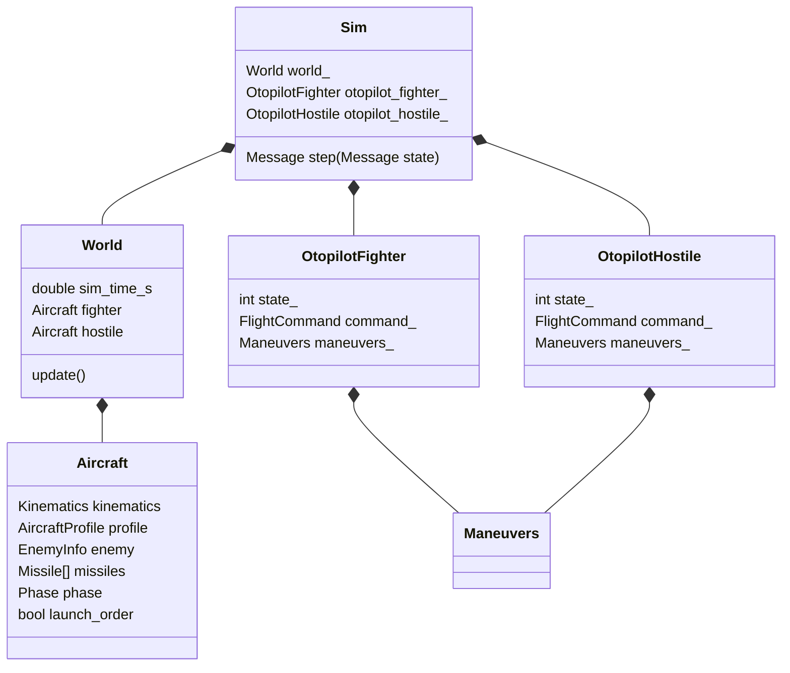

# C++ otopilot mimarisi

C++ uygulaması ölçümden komuta giden bir dış kontrol adımını yürütür. Fizik modelini ilerletmez; yön, irtifa ve gaz hedefleri ile tek adımlık atış emirleri üretir. İki uçağın kararları ayrı nesnelerde yaşar, fakat aynı karşılaşmanın `World` verisini kullanır.

[Tam sınıf UML ve üye envanteri](../PROJE_REHBERI.html#otopilot-uml), `src/otopilot` altındaki bütün sınıf, struct ve enum tanımlarını kaynak kodundan çıkarır. Her değişken tipi, başlangıç ifadesi ve erişimiyle; her metot tam imzasıyla gösterilir. Sahiplik, kalıtım, tür kullanımı ve kimlikle kurulan hedef ilişkisi ayrı gösterilir. Aşağıdaki diyagram yalnız ana nesne sahipliğinin özetidir.

## Nesne sahipliği



`main.cpp`, bir `Connection` ve bir `Sim` oluşturur. Bunlar program boyunca yaşar. Her ölçüm için aynı `Sim::step()` çağrıldığı için otopilotların karar durumu korunur. Otopilotları her adımda yeniden oluşturmak aşama sayaçlarını sıfırlar.

## Adımın sırası

`Sim::step()` beş iş yapar:

1. `StateReader::read_world()` ölçümü mevcut nesnelere okur.
2. İki uçağın son uygulanmış `FlightCommand` değerlerini okur.
3. `world_.update()` ile ortak hesapları doldurur.
4. İki ayrı otopilotu çalıştırır.
5. `CommandWriter::write()` ile aynı `tick` için yanıtı oluşturur.

```cpp
const FlightCommand fighter_command = otopilot_fighter_.step(
    world_.fighter, world_, fighter_current);

const FlightCommand hostile_command = otopilot_hostile_.step(
    world_.hostile, world_, hostile_current);
```

İlk parametre değiştirilebilir kendi uçağıdır. İkinci parametre bütün dünyaya `const World&` görünümü sağlar. Üçüncü parametre Python'un son uyguladığı komuttur. Hostile'in mevcut taktiği dünya parametresini kullanmaz; iki otopilot aynı çağrı sözleşmesine sahiptir.

Her otopilot `command_ = current` ile başlar. Manevralar bu komutu kopyalayarak yalnız ilgili alanları değiştirir. İrtifa ve gazın istenmeden sıfırlanması böylece önlenir.

## Ölçüm ve hesaplanan veri

| Yapı | İçerik / sahibi |
|---|---|
| `Kinematics` | Python'dan okunan konum, yönelim, TAS, Mach ve NED hız |
| `AircraftProfile` | C++ tip tablosundan gelen yük, radar, performans ve irtifaya bağlı out katsayıları |
| `EnemyInfo` | Karşı uçağa göre geometri ve angajman hesapları |
| `Missile` | Slot/profil, C++ atış bilgisi, Python kimliği/durumu ve kinematik |
| `MissileTargetInfo` | Füzenin hedefine göre mesafe, kapanma, kalan süre ve pitbull tahmini |
| `FlightCommand` | Yön hedefi, irtifa hedefi ve gaz komutu |
| `Phase` | Kayda/görüntüleyiciye çıkan aşama etiketi |

`state_` ile `Phase` aynı değildir. `state_` karar akışının iç adımıdır; birden fazla adım aynı aşamayı kullanabilir. `Phase` sabit sayılarla dışarı çıkar: `0 Hold`, `1 Fire`, `2 Out`, `3 In`, `4 Crank`, `5 Notch`.

## World hesapları

`World::update()` önce fighter→hostile ve hostile→fighter geometrilerini doldurur. `Geometry`, yalnız `Kinematics` kullanarak mesafe, bearing, ATA, aspect, LOS ve kapanma hesaplar. `Engagement`, bu sonuçlar ve profillerle WEZ/MAR/DOR alanlarını doldurur.

Sonra iki tarafın havadaki füzeleri için hedef hesabı yapılır. `read_missile_info(own, target)` adına rağmen JSON okumaz; hesaplanan `missile.target` alanlarını günceller. Yalnız kinematiği gelen, havadaki ve `target_id` değeri verilen uçağın kimliğiyle eşleşen füzeler işlenir. Hedef, bugün çağrıdaki diğer uçaktır; kimlikten genel bir uçak araması yapılmaz.

Mesafe için füze ve hedef konumu, kapanma için iki hız gerekir. `time_to_go_s = range / closure`; kapanma pozitif değilse `-1` döner. Pitbull, profil eşiğine girildiğinde doğru olur ve sonraki adımlarda korunur. Son olarak iki uçağın `me_in_enemy_wez` alanı karşı tarafın hesap sonucundan kopyalanır.

## Füze slotları ve atış yaşam döngüsü

İlk ölçümde her uçağın mühimmat sayısı Python mesajından sayılır. Slot tipleri `AircraftProfile.loadout` listesinin başından alınır. Python sayısı yük listesini aşarsa program durur. Slot listesi uçuş sırasında büyütülmez/küçültülmez.

`Aircraft::fire_missile(FOX3)` o tipteki ilk atılmamış slotu işaretler, `fire_order` verir ve `launch_order=true` yapar. Henüz Python kimliği eşleşmemiş bir önceki atış varsa yeni atış istemez. Havadaki, kimliği eşleşmiş füze başka bir atışı engellemez.

`CommandWriter` atış bayrağını `{id, target_id}` emrine çevirir. Python hazır ilk fizik slotunu fırlatır. Sonraki ölçümde `StateReader`, Python füzesini önce bilinen kimlikten; yeni bir kimlikse henüz eşleşmemiş en eski C++ atışından bulur. `target_id`, durum, sonuç ve kinematik buraya okunur. C++ tarafından işaretlenmemiş bir atış eşleşmezse yok sayılır.

`launch_order` her yeni ölçümde sıfırlanır. Uçuş hedefleri kalıcı, atış emri tek adımlıktır. `last_fired()` hiç atış yoksa `nullptr` döner. `has_active_missile_against(target)`, hedef kimliği eşleşen `InFlight` füzeler arasında arama yapar; yalnız son atılan füzeye bakmaz.

## Manevralar

`Maneuver::compute(const Aircraft&, const FlightCommand&)`, yeni bir uçuş hedefi döndürür. Hangi manevranın seçileceğini ilgili otopilot belirler. Her otopilot ayrı `Maneuvers` üyesi tuttuğu için manevra hafızası paylaşılmaz.

| Manevra | Mevcut uygulama |
|---|---|
| `Hold` | Mevcut hedef komutunu aynen korur; anlık burun yönünü yeni hedef yapmaz |
| `In` | Hedef yönünü düşmanın bearing değerine ayarlar |
| `Out` | Düşmanın ters yönünü `wrap_180(bearing - 180)` ile ister |
| `Crank` | Radar yarım açısından 5° içeride hedef ATA üretir; P düzeltmesini anlık heading'e ekler |
| `Notch` | Bearing işaretine göre `bearing - 90` veya `bearing + 90` ister |

`CrankSide::Right`, hedef ATA'yı negatif yapar; düşman burnun solunda kalır. `Left` için hedef ATA pozitiftir. Mevcut notch taraf seçimi mutlak bearing işaretine dayanır; en kısa dönüş veya genel tehdit optimizasyonu yapmaz.

## Mevcut karar dizileri

Her `case` mevcut aşamanın komutunu üretir ve gerekiyorsa sonraki `state_` değerini yazar. Yeni aşamanın davranışı sonraki dış adımda çalışır.

| Fighter adımı | İş ve geçiş koşulu |
|---|---|
| 0 | Hold; düşman WEZ'e girince 1 |
| 1 | FOX3 atış isteği; 2 |
| 2 | Sağ crank; kendi son füzesi pitbull olduğunda, hostile'in son füzesinin hedef mesafesi yaklaşık 6.47948 NM altına indiğinde veya kendi son füzesi uçuşta olmadığında 3 |
| 3 | Notch, gaz `0.99`; fighter'a karşı aktif hostile füzesi kalmadığında veya hostile'in son füzesinin hedefe kapanması yaklaşık 97.1922 kt altına indiğinde 4 |
| 4 | In; `abs(ATA) < 45` ve düşman WEZ'de olduğunda 5 |
| 5 | İkinci FOX3 atış isteği; 6 |
| 6 | In; mevcut kodda `abs(ATA) < 175` olduğunda 7 |
| 7 | Hold |

| Hostile adımı | İş ve geçiş koşulu |
|---|---|
| 0 | Hold; düşman WEZ'e girince 1 |
| 1 | FOX3 atış isteği; 2 |
| 2 | Sağ crank; son atılan füze pitbull olduğunda veya artık uçuşta değilse 3 |
| 3 | Out; `abs(ATA) > 175` olduğunda 4 |
| 4 | Hold |

Bu diziler mevcut deneme taktikleridir. Atış adımları `fire_missile()` başarısız olsa da ilerler; otomatik yeniden deneme veya mühimmat bittiğinde alternatif taktik yoktur. Bazı geçişler `last_fired()` sonucunu doğrudan kullanır; bunlar önceki atışın mevcut olduğu varsayımına dayanır. Gaz notch'ta değişir ve başka bir aşama değiştirmedikçe sonraki komutlarda korunur.

## Uçağa ait out mesafesi hesabı

`Aircraft::get_out_distance()`, TAS ve profilin `out_g` değerinden koordineli dönüş yarıçapı üretir. İrtifaya bağlı `out_distance_factor` tablosu bir düzeltme katsayısı sağlar. Mevcut uygulama üç irtifa noktasını kullanır; noktalar arasında doğrusal interpolasyon, aralık dışında uç katsayı uygulanır:

```text
out_distance = k(altitude) × TAS² / (9.81 × sqrt(out_g² - 1))
```

Bu bir yaklaşık model hesabıdır. Tablonun üç sıralı ve farklı irtifa noktası içermesi, `out_g > 1` olması gerekir. Mevcut `Out` manevrası yalnız ters yön hedefi üretir; bu mesafe hesabını otomatik kullanmaz. `CalculationWriter` da bu değeri henüz ayrı alan olarak dışarı çıkarmaz.

## Giriş/çıkış sınırı

JSON anahtarlarını `StateReader`, `CommandWriter` ve `CalculationWriter` bilir. Model, manevra ve hesap sınıfları C++ nesneleriyle çalışır. `CalculationWriter` uçak başına hesapları ve radar/WEZ çizim parametrelerini çıkarır; füze hedef hesabı şu an bu dosyaya ayrı satır olarak yazılmaz.

`Connection` Windows TCP ayrıntılarını saklar. Mesaj sırası `state(t) → command(t)` şeklindedir. İstemci `end` alınca döngüden çıkar. Satır sonu mesaj sınırıdır; parçalı alım/gönderim ve 1 MiB sınırı uygulanır.

## Hesapların anlamı ve sınırları

`Geometry` ortalama Dünya yarıçaplı yerel düz dünya yaklaşımı kullanır. Pozitif ATA hedefin burnun sağında olduğunu, pozitif kapanma mesafenin azaldığını belirtir. WEZ şu formülle ilk slotun profiline dayanır:

```text
flight_time_s = 3600 × missile.max_range_nm / missile.speed_kt
max_nm = missile.max_range_nm + enemy_closing_kt × flight_time_s / 3600
```

Hız pozitif değilse ek terim uygulanmaz. WEZ testi açık aralıktır: `min_nm < range_nm < max_nm`. İlk slot atılmış olsa da hesap aynı profili kullanır. Profildeki `max_g`, `max_mach` veya radar menzili bütün kararlara otomatik kısıt koymaz. MAR, düşman WEZ'i ile out mesafesi, NM'ye çevrilmiş patlama yarıçapı ve offset toplamıdır. DOR, MAR'a in mesafesini ekler. İrtifa ft, mesafeler NM, hızlar kt ve süreler saniyedir.

Bu parametreler uygulama modelidir; farklı profil seçimi Python fiziğini değiştirmez. Koordinat ve birim ayrıntıları [veri referansındadır](../veri_info/SIMULASYON_VERI_REFERANSI.md).
