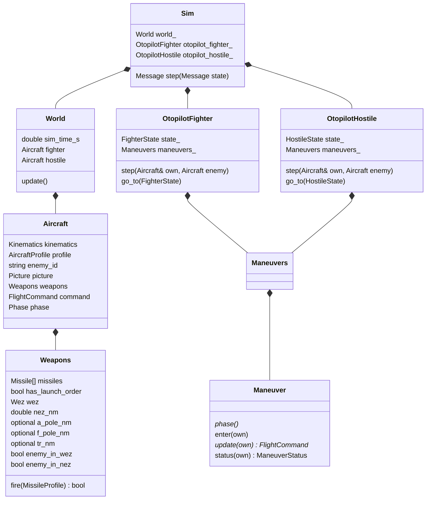

# C++ otopilot mimarisi

C++ uygulaması ölçümden komuta giden dış kontrol adımını yürütür. Fizik modelini ilerletmez; yön, irtifa, gaz ve g sınırı hedefleri ile tek adımlık atış emirleri üretir. İki uçağın kararları ayrı otopilot nesnelerinde yaşar, ama aynı `World` verisini kullanır.

Kod kuralları (katmanlar, isimlendirme, birimler, "değer yok" durumu): [KOD_STANDARTLARI.md](../../src/otopilot/KOD_STANDARTLARI.md). Pratik örnekler: [KULLANIM.md](../../src/otopilot/KULLANIM.md).

## Katmanlar

| Klasör | Görev | Yazdığı veri |
|---|---|---|
| `io/` | JSON ↔ C++ | `Aircraft`'ın ölçüm alanları, `command` (Python'un son uyguladığı) |
| `model/` | Veri tipleri, `World::update` | `enemy_id`, `picture`, füzelerin `target` bilgisi |
| `calculations/` | Saf hesap (`geometry::`, `turn::`, `engagement::`, `missile_geometry::`, `missile_flight::`) | Hiçbir şey; sonuç döndürür |
| `control/` | Karar ve manevra | `command`, `phase`, atış emri |
| `common/` | Birim, açı, NED vektörü, LLA/ECEF | — |

Hesap fonksiyonları `picture`'ı okumaz; ihtiyaç duydukları ara sonuçları parametre olarak alır. Hesap sırası yalnız `World::update` içinde durur. Karar ve manevra kodu ise hesap yapmaz, yalnız `picture`'ı okur.

## Nesne sahipliği



`main.cpp` bir `Connection` ve bir `Sim` oluşturur; ikisi de program boyunca yaşar. Her ölçüm için aynı `Sim::step()` çağrıldığından otopilotların durumu ve manevraların hafızası korunur.

## Adımın sırası

```cpp
StateReader::read_world(state.data, world_);              // ölçüm + own.command (Python'un son uyguladığı)
world_.update();                                          // düşman ataması, füze bilgisi, picture
otopilot_fighter_.step(world_.fighter, world_.hostile);   // command, phase, atış emri
otopilot_hostile_.step(world_.hostile, world_.fighter);
return CommandWriter::write(state.tick, world_);
```

## Veri

| Yapı | İçerik | Yazan |
|---|---|---|
| `Kinematics` | konum, yönelim, TAS, Mach, NED hız | StateReader |
| `AircraftProfile` | ana silah (`main_weapon`), yük, radar, out g'si ve payı | StateReader (tip değişince) |
| `MissileProfile` | füze menzili, hızı, pitbull ve patlama yarıçapı; R_cold ve Rmax uyumları; uçuş eğrisi (`glide`) | `missile_profiles.hpp` (sabit tablo) |
| `Weapons` | füze slotları, atış emri; ana silahımın WEZ'i, NEZ'i, A/F-pole'u, TR'si, düşman WEZ/NEZ'imde mi | StateReader, `weapons.fire`, World::update |
| `Missile` | slot/profil, atış bilgisi, Python kimliği/durumu, kinematik, `target` (hedefe göre) | StateReader, `weapons.fire`, World::update |
| `Picture` | atanmış düşmana göre geometri, out planı, kaçış: R_cold, NEZ, MAR, DOR, `threat` | World::update |
| `ThreatInfo` | bana gelen en acil düşman füzesinin bana göre durumu | World::update |
| `FlightCommand` | yön, irtifa, gaz, isteğe bağlı g sınırı; setter'lar aralığı korur | StateReader, otopilot |
| `Phase` | kayda çıkan aşama: `0 Hold`, `1 Fire`, `2 Out`, `3 Commit`, `4 Crank`, `5 Beam`, `6 Recommit` | otopilot (aktif manevradan) |

"Olmayabilen" sayılar `std::optional` tipindedir: tehdit (bana gelen füze yoksa `threat`), füze yetişemiyorsa `f_pole_nm`. WEZ, R_cold, NEZ, MAR ve DOR her uçağın profilindeki `main_weapon`'dan hesaplandığı için her zaman vardır. Kayda olmayan değerler 0 olarak yazılır.

## World hesapları

`World::update()` şu sırayla çalışır:

1. **Düşman ataması.** 1v1'de sabit: blue → red, red → blue. Çok uçaklı yapıya geçilirse yalnız burası değişir.
2. **Füze bilgileri.** Her uçağın havadaki füzeleri için hedefe göre mesafe, kapanma ve pitbull hesaplanır. Pitbull bir kez true olunca öyle kalır.
3. **Picture.** Her iki uçak için:
   - geometri (`geometry::`)
   - out planı (`engagement::out_plan` → `turn::to_heading`)
   - düşmanın ana silahının (`enemy.profile.main_weapon`) R_cold uyumuyla R_cold, NEZ ve MAR
   - DOR: DR + düşmanın 180° In dönüşü boyunca yaklaştığı yol + out payı (0,5 NM)
   - tehdit: düşmanın bana gelen füzelerinden bana en yakın olanı
4. **Weapons.** Her iki uçak için kendi ana silahıyla (`own.profile.main_weapon`):
   - WEZ ve `enemy_in_wez`
   - A-pole, F-pole ve TR
   - NEZ: düşmanın gözünden kaçış NEZ'i (`engagement::nez_nm(enemy, own)`: düşmanın benden out planı ve füzemin R_cold uyumu); `enemy_in_nez` = WEZ iç sınırı < menzil ≤ NEZ. 1v1'de bu, düşmanın kendi `picture.nez_nm`'ine eşittir.
5. **`me_in_enemy_wez`.** Karşı tarafın `weapons.enemy_in_wez` sonucundan kopyalanır.

## Dönüş ve out planı

`turn::to_heading(own, hedef_yön, g, bitiş_hızı)` kısa taraftan, sabit g ile seviye dönüşü hesaplar ve sonucu `TurnResult` olarak döndürür. Hız dönüş boyunca doğrusal değişir kabul edilir; yarıçap ve süre ortalama hızla hesaplanır.

```text
r  = V² / (g · √(n² − 1))
Δt = |Δψ| · r / V
yer değişimi (s = +1 sağ, −1 sol):  kuzey = s·r·(sin ψ1 − sin ψ0),  doğu = s·r·(cos ψ0 − cos ψ1)
```

Out planı, düşmanın bearing'i + 180°'ye yapılan dönüştür. Kaçış hızı şimdilik şu anki TAS kabul edilir. Dönüşte düşmana yaklaşma = R − |LOS − yer değişimi|. Commit ve recommit hesapları da aynı fonksiyon üzerine kurulur.

## Manevralar ve karar

Manevra yaşam döngüsü: her otopilotun `Maneuvers` nesnesi son uçurulan manevrayı tutar. `fly()` ilk kullanımda veya manevra nesnesi değişince `enter(own)` çağırır; aynı manevra sürerken tekrarlamaz. Araya başka manevra girip geri dönülürse yeniden giriş yapılır. `update(own)` her step, `status(own)` → `Running` / `Done`.

| Manevra | Faz | Davranış | Bitişi |
|---|---|---|---|
| `Hold` | Hold | ölçülen yön ve irtifayı hedef yapar, gaz aynı | sürekli |
| `Fire` | Fire | komutu değiştirmez | sürekli |
| `Out` | Out | bearing − 180, girişte kilitlenen alçalma, tam gaz, out g'si | \|ATA\| > 177° → Done |
| `In` | In | yön = bearing | sürekli |
| `Crank` | Crank | gimbal − 5° hedef ATA, LOS hızı kadar ileri alınır; `in_radar_sight()` sorgusu (düşman radar konisinde mi, \|ATA\| < gimbal). Taraf `enter()`'da `crank_side_for` ile seçilir (`side()` ile okunur): düşman hangi taraftaysa o tarafta kalır | sürekli |
| `Beam` | Beam | bearing ∓ 90; taraf burnuma göre seçilir (düşman sağımdaysa sola, solumdaysa sağa), dönüş hep 90°'den kısa | sürekli |

`Otopilot` bir durum makinesidir; fighter ve hostile aynı sınıfı kendi görev konseptiyle (`Mission`: hedef, risk, L&L) kullanır. Her step önce kesintiler çalışır (ABORT; ardından bana gelen güdümlü füze → karşı atış, TRADE ya da DEFEND), sonra o fazın `step_*` fonksiyonu manevrasını `maneuvers_.fly` ile uçar ve `decide::` kararına göre geçiş yapar. Geçiş yalnız `go_to` ile yapılır. Kesinti geçişinde yeni faz aynı step uçulur; fazın kendi geçişinde sonraki step. Taahhüt bitince (savunma, destek, kovalama) anlık `reassess` yeni fazı seçer. Geçiş koşulları `control/conditions.hpp`, karar kuralları ve eşikleri `control/decisions.cpp` içindedir.

Fazlar: Commit, Shot (atış emri), Support, Trade, Defend, Out, Cold, Recommit, Chase, Abort. Kurallar, metrikler (TRADE süreleri, kaçış payı) ve geçiş şeması [KARAR_TASARIMI.md](../../src/otopilot/control/KARAR_TASARIMI.md)'de; şemalı hali [KARAR_AKISI.html](../KARAR_AKISI.html).

Destek kuralı: pitbull olmamış füze, atan uçak hedefi radar gimbal'ı içinde tuttukça güdümlüdür (`MissileTargetInfo::is_guided`, bir kez kopunca dönmez). Güdümünü kaybetmiş füze tehdit sayılmaz. BVRGym'de bu kural yoktur; C++ kararları kural varmış gibi verir.

Aynı komutla alınan son uçuşun akışı (`recordings/show_wez`; bu kayıt WEZ dış sınırı Rmax uyumuna geçmeden önce alındı, yeni formülle yeniden koşturulmadı):

| t (s) | Olay |
|---|---|
| 0 | İki F-16 40 NM'den birbirine doğru (In); düşman fighter'ın WEZ'indedir |
| 0.2 | Fighter 39.9 NM'den atar, crank'e girer |
| 97 | Fighter'ın füzesi hostile'ın 1.4 km yanından geçer (isabet yarıçapı 300 m): ıskalar |
| 106.5 | Fighter MAR'a girer (10.93 ≤ 10.95), out yapar; hostile aynı step'te (fighter kendi MAR'ına girdi) atar ve out yapar |
| 117 | Fighter'ın füzesi Mach 1'in altına düşer, kaybolur |
| 121 / 127 | Fighter'ın / hostile'ın out'u biter |
| 157 | Hostile'ın füzesi fighter'a en çok 4.7 km yaklaşıp kaybolur: MAR'da dönen fighter kurtuldu |

Bu eski kayıtta fighter'ın atış kuralı yalnız "düşman WEZ'imde" idi; mevcut durum makinesini temsil etmez.

Bilinmesi gerekenler:
- BVRGym füzesi 6 km'de burun buruna, manevra yapmayan hedefi yalnız ~12 NM'ye kadar vurur; daha uzakta tırmanıp dalma (loft) sonrası 0.3–1.9 km ile ıskalar. Dönen hedefi daha yakından da ıskalayabilir. WEZ'in dış sınırı (Rmax) "erişim" sınırıdır, isabet menzili değil ([wez_formulu.md](../../src/otopilot/calculations/wez_formulu.md)); WEZ'e girer girmez atmak isabet getirmez.
- Gelen füzeye karşı "kalan süre" (mesafe / kapanma) füze yavaşladıkça ve biz döndükçe zıpladığı için savunma tipi seçiminde kullanılmaz. Yerine kaçış payı (`missile_geometry::escape_margin_nm`, `picture.threat_escape_margin_nm`) kullanılır; kalan süre yalnız TRADE kıyaslarında ve notch anında.

## Füze slotları ve atış yaşam döngüsü

- **Slotların kurulması:** İlk ölçümde her uçağın mühimmat sayısı Python mesajından sayılır, slot tipleri `AircraftProfile.loadout`'un başından alınır. Python'daki sayı yük listesini aşarsa program durur.
- **Atış emri:** `own.weapons.fire(AIM120C)` o profildeki ilk atılmamış slotu işaretler, `fire_order` verir ve `weapons.has_launch_order` bayrağını true yapar. Henüz Python kimliği eşleşmemiş bir önceki atış varsa yeni atış istemez.
- **Eşleştirme:** `CommandWriter` bayrağı `{id, target_id}` emrine çevirir. Sonraki ölçümde `StateReader` Python füzesini önce bilinen kimlikten, yeni bir kimlikse henüz eşleşmemiş en eski C++ atışından bulur.
- **Sorgular:**
  - `last_fired()`: son atılan füze
  - `weapons.active_missile()`: havadaki son füze
  - `weapons.has_active_missile_against(target_id)`
  - `picture.threat`: bana gelen en acil düşman füzesi

## Giriş/çıkış sınırı

- **JSON'u bilen sınıflar:** Yalnız `StateReader`, `CommandWriter` ve `CalculationWriter`.
- **Kayıt sütun adları:** Şimdilik eski adlarıyla korunuyor: `rate_of_closure_kt` (= `closure_kt`), `enemy_closing_kt` (= `enemy_closure_kt`), `stern_wez_nm` (= `r_cold_nm`).
- **Bağlantı:** `Connection` Windows TCP ayrıntılarını saklar. Mesaj sırası `state(t) → command(t)` şeklindedir.

## Hesapların sınırları

- **Geometri:** Ortalama Dünya yarıçaplı yerel düz dünya yaklaşımı kullanılır.
- **WEZ:** Uçak profilindeki ana silahtan hesaplanır (füze slotlarına bakılmaz). İç sınır füzenin en kısa menzilidir. Dış sınır Rmax, BVRGym taramasından çıkmış bir uyumdur ve düşmanın bana doğru hız bileşeniyle uzar ([wez_formulu.md](../../src/otopilot/calculations/wez_formulu.md)):

```text
Rmax = füzenin kendi yolu + düşmanın füze uçarken bana doğru aldığı yol
     = (a + b·ln h) · (1 + k·(V_atan − 583 kt)) + enemy_closure_kt × (c + d·ln h) / 3600
```

  Aspect'e değil düşmanın o anki hız vektörüne bakar. Profildeki `max_range_nm` hesaplarda kullanılmaz.
- **R_cold:** BVRGym füzesine karşı yapılan kaçış taramasından elde edilen üstel bir uyumdur ([r_cold_formulu.md](../../src/otopilot/calculations/r_cold_formulu.md)).
- **A/F-pole ve TR:** Atış öncesi bilgi olarak, ölçülmüş füze uçuş tablosundaki sürelerle hesaplanır; havada füze veya `speed_kt` sabiti kullanılmaz. A-pole aktifleşmede, F-pole isabette iki uçak arası mesafedir; TR tablodan `A_pole(TR) = DOR` çözümüdür. Sonuçlar `Weapons` ve hesap kaydına yazılır. [Formüller](../../src/otopilot/calculations/pole_tr_formulleri.md).
- **Füze uçuş modeli:** `missile_flight::glide_...` fonksiyonları A/F-pole ve TR hesaplarına süre sağlar ([fuze_ucus_tablosu.md](../../src/otopilot/calculations/fuze_ucus_tablosu.md)). WEZ kendi Rmax uyumunu kullanır. C++ tablo modeli hâlâ Mach 1'de kesilir; BVRGym'deki 0,5 Mach eşiği henüz aktarılmamıştır.
- **DR:** `engagement::dr_nm(own, enemy)` = R_cold + notch beklemesi boyunca düşmanın yaklaşması + out payı. Süre `dr_notch_time_s` (varsayılan 15 s), pay mevcut `out_offset_nm` (0,5 NM). Hız, düşmanın anlık LOS yaklaşma bileşenidir; gelecekteki dönüşü öngörülmez. `Picture::dr_nm` ve hesap kaydındaki `dr_nm` alanına yazılır. Ayrıntı: [DR formülü](../../src/otopilot/calculations/dr_formulu.md).
- **DOR:** DR + anlık `enemy_closure_kt` ile 180° In dönüşünde yaklaşma + `out_offset_nm` (0,5 NM). In süresi mevcut TAS ve `out_g` ile hesaplanır. İlk Out süresi eklenmez; ileri simülasyon veya sayısal mesafe araması yapılmaz. MAR hesabı ve state geçişleri aynı kalır.
- **Havadaki düşman füzesi:** `picture.threat` bana gelen en yakın füzeyi verir, ama taktikler onu kullanmaz; karar yalnız MAR'a dayanır. MAR "füze henüz atılmadı" varsayımıyla hesaplandığı için önceden atılmış bir füzeye karşı yeterli değildir. Kaçış payı (`escape_margin_nm`) bunun için planlandı.
- **Profiller:** Profil seçimi Python fiziğini değiştirmez. Birim ve koordinat ayrıntıları [veri referansındadır](../veri_info/SIMULASYON_VERI_REFERANSI.md).
