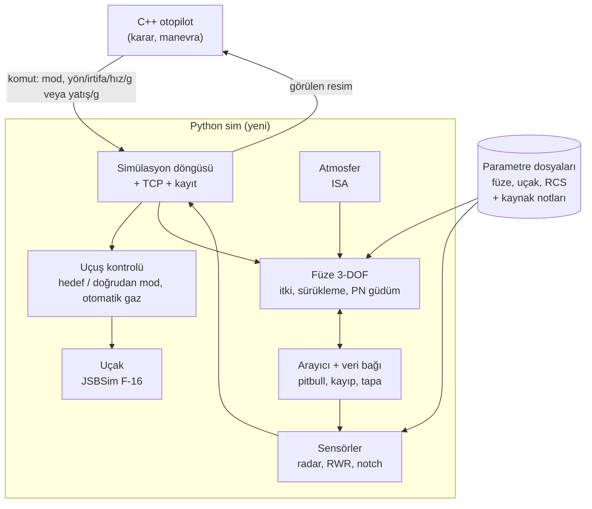
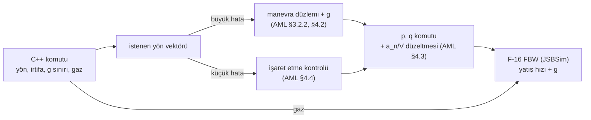
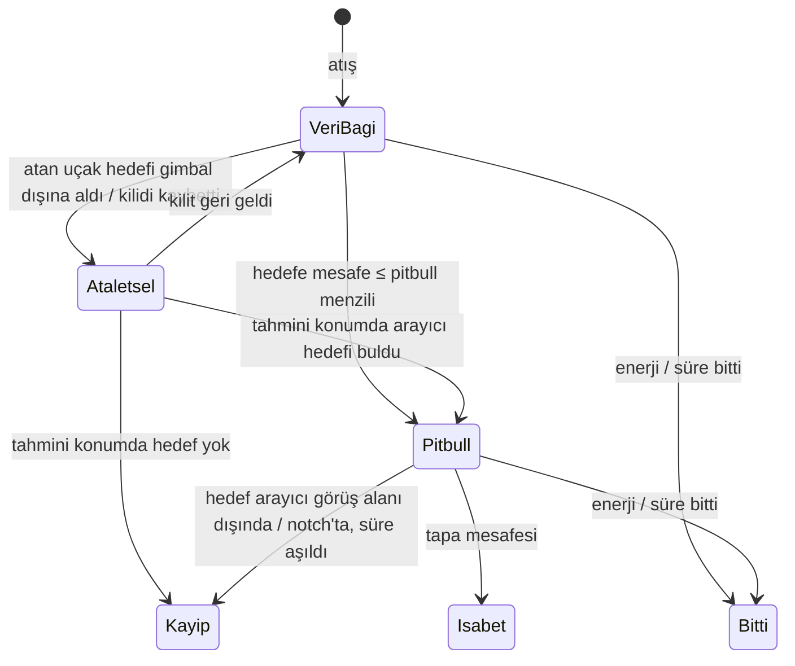

# Simülasyon yenileme planı

Durum (2026-11-12): **Faz 0 tamam** (`docs/veri_info/FUZE_VERI_TABLOSU.md`). **Faz 1 tamam:** `src/simulator/` iskeleti + NASA AML uçuş kontrolü (`src/simulator/flight_control/TASARIM.md`); C++ ile uçtan uca çalışıyor. **Faz 2–3 (füze):** altyapı ve fizik tamam. Güdüm, arayıcı ve tapa fonksiyonlarını kullanıcı yazacak (`src/simulator/weapons/TASARIM.md`).

Bu plan BVRGym bağımlılığını kaldırıp kendi simülasyon katmanımızı kurmayı anlatır. JSBSim uçağı uçurmaya devam eder. Füze, sensör, isabet ve uçuş kontrolü bizim kodumuz olur. Her parçanın verisi ve formülü nereden geldiği yazılı biçimde gelir.

> **EN ÖNEMLİ KURAL: kafadan değer yok.** Tasarımda ya da kodda bir veri, sayı, eşik ya da kural gerektiğinde:
> 1. İlk iş FlightGear'a bakılır: OPRF, OPRF F-16 paketi, JSBSim modelleri.
> 2. Orada yoksa diğer dayanaklı kaynaklara bakılır: resmi yayın, akademik çalışma, BMS belgeleri.
> 3. Hiçbir yerde yoksa değer uydurulmaz; durum bildirilir ve birlikte incelenir.
>
> Her değer kaynağıyla birlikte yazılır (§5).

> **Kapsam:** Bu plan sürerken C++ otopilot (`src/otopilot`) **değişmez**. Komut ve durum sözleşmesi bugünkü haliyle kalır. C++ değişikliği gerektiren eklemeler (hız komutu, doğrudan mod, görülen resim) sim doğrulandıktan sonraki aşamaya bırakılır.

## 1. Sonunda ortaya ne çıkacak

| Bugün | Plan sonunda |
|---|---|
| Füze BVRGym'in 6-DOF JSBSim modeli. X-15 motor dosyası, ~69 kg, Mach 1→1.3'te sürükleme 13 kat düşüyor. | Kendi 3-DOF füze modelimiz. Kütle, iki kademeli itki, Mach'a bağlı sürükleme, **dönüşte enerji kaybı**. Her sayının kaynağı tabloda. |
| Füze hedefi her an kusursuz biliyor. Pitbull, veri bağı, arayıcı yok. | Pitbull'a kadar atan uçağın radar ölçümleriyle güdülür; ölçüm gelmezse tahmine uçar. 10 NM'de kendi arayıcısına geçer; görüş alanı dışına kaçan hedef kaybedilir. Notch, pitbull öncesinde uçak radarını, dolayısıyla veri bağını kırar. |
| 300 m'de kesin vuruş. Mach 1 altında yapay kayıp kuralı. | Yakınlık tapası. Füze enerjisi bitince ya da hedefi kaybedince düşer. |
| Radar ve RWR yok. C++ gerçek veriyi görüyor. | RCS'e bağlı radar menzili, gimbal, doppler notch, RWR uyarısı. C++ yalnız **gördüğünü** bilir (anahtarla açılır). |
| Uçuş kontrolü BVRGym'in otopilot nesnesine yamalı. | NASA AML yöntemiyle kurulan uçuş kontrolü (manevra düzlemi + g, işaret etme kontrolü), F-16 FBW'nin üstünde. Bugünkü komutlarla çalışır; hız komutu ve doğrudan mod C++ aşamasına hazır kurulur. |
| C++'taki R_cold, R_max, yetişme süresi uyumları eski füzeye göre. | Aynı dış ölçüm betikleriyle yeni füzeye göre yeniden ölçülür. |

Kısaca: uçak aynı JSBSim F-16 olarak kalır. Füze ve sensörler gerçekçi ve şeffaf olur. Otopilotun crank, notch, destek gibi kararları sim'de **gerçek bir etki** yaratır. Bugün bu kararların füzeye hiçbir etkisi yok.

## 2. Hedef mimari



| Katman | Nerede | Ne kullanır | Kaynak |
|---|---|---|---|
| Uçak hareketi | Python → JSBSim | F-16 XML (BVRGym'den kopya, GPL) | JSBSim F-16 modeli (NASA rüzgâr tüneli verisi) |
| Uçuş kontrolü | Python, kendi kodumuz | JSBSim F-16 FBW üstünde AML katmanları: manevra düzlemi + g, işaret etme kontrolü, gövde hızı komutları | NASA AML (CR-4160, CR-145004), §3.2 |
| Füze hareketi | Python, kendi kodumuz | 3-DOF nokta kütle | OPRF formülleri, kamuya açık AIM-120 verisi |
| Arayıcı, veri bağı, tapa | Python, kendi kodumuz | Kurallar | OPRF + BMS husky/pitbull yapısı |
| Radar, RWR, notch | Python, kendi kodumuz | Kurallar + formüller | OPRF radar kuralları + RCS tablosu |
| Karar | C++ (değişmez) | Görülen resim | — |

**OPRF kullanım ilkesi:** OPRF FlightGear'ın Nasal diliyle yazılmış ve FlightGear'a bağlı; doğrudan dahil edilemez. Yalnız formül ve kuralları okunup kendi kodumuzda yeniden yazılır, kaynağı belgede gösterilir. Satır satır kopyalanmadığı için GPL yükümlülüğü doğmaz. JSBSim F-16 dosyaları ise kopyalanır ve GPL lisanslarıyla birlikte tutulur.

**BVRGym'den kalan:** yalnız JSBSim'i başlatma bilgisi ve F-16 model dosyaları. `jsb_gym` paketi, füze XML'i ve ajan sınıfları kullanılmaz.

## 3. Uçuş kontrolü

### 3.1 Komut sözleşmesi (C++ → Python)

**Bu planda:** sözleşme bugünkü gibi kalır: `heading_deg`, `altitude_m`, `throttle`, `g_limit`. C++'a dokunulmaz.

**Sonraki aşama** (sim doğrulandıktan sonra, C++ değişikliği gerektirir):

| Mod | Alanlar | Kim kullanır |
|---|---|---|
| `target` (varsayılan) | `heading_deg`, `altitude_m`, `speed` (Mach ya da kt) **veya** `throttle`, `g_limit` | Bugünkü bütün manevralar: commit, crank, out, beam, drag, recommit |
| `direct` | `bank_deg`, `g`, `speed` **veya** `throttle` | Tam kontrol isteyen manevralar: split-S, notch'ta tam yatış, ileride BFM |

- `speed` verilirse otomatik gaz devreye girer. `throttle` verilirse doğrudan uygulanır. İkisi birlikte verilmez.
- Python iç döngüleri bu iki moda göre katmanlı kurulur. Böylece sonraki aşamada yalnız mesaj genişler.

### 3.2 Uçuş kontrolü: NASA AML yapısı (karar 2026-11-12)

Uçuş kontrolü bugünkü `flight_control.py`'ye bağlı kalmadan **NASA AML'nin yayımlanmış yöntemiyle** kurulur (CR-4160 bölüm 3–4, CR-145004). AML'nin Fortran kodu raporlarda yalnız taranmış (OCR) ve kısmi listeler halinde var. Doğrudan çalıştırılamaz; yöntem raporlardan yeniden yazılır.

**AML'den alınan katmanlar:**

| AML katmanı | Ne yapar | Bizdeki karşılığı |
|---|---|---|
| Manevra komutu üçlüsü | Manevra düzlemi (ρ), yük faktörü, gaz (CR-4160 §4.2) | Pilot katmanının çıktısı. C++'ın yön/irtifa/g sınırı/gaz komutundan üretilir. |
| Manevra düzlemi kavramı | Hız vektörünün bir sonraki adımda içinde olması istenen yarım düzlem (CR-4160 §3.2.2) | Büyük yön değişimleri: istenen yön (yön + irtifadan) ile hız vektörü düzlemi tanımlar; g, `g_limit`'ten. |
| İstenen tutumdan gövde hızları | Düzlem + g → istenen tutum → p, q, r. Sert dönüşte q_kom'a hız vektörü dönüşü (a_n/V) eklenir (CR-4160 §4.3). | Yatış hızı ve yunuslama hızı komutları |
| İşaret etme (pointing) kontrolü | Burnu istenen yöne doğrudan yatış ve yunuslama hızı komutuyla çevirir. Manevra düzlemi yaklaşımı ince yöneltmede yetersiz kaldığı için eklenmiş (CR-4160 §4.4). | Küçük yön hataları ve son hizalama (crank açısı tutma, ince düzeltme) |
| Yük faktörü seçimi | Köşe hızının üstünde azami g, altında sürdürülebilir g (CR-4160 §3) | Bu planda g C++'tan gelir. Kural sonraki aşamada değerlendirilir. |

**AML'den alınmayanlar:**

- **F-4 için yazılmış kanatçık düzeyi kontrol sistemi** (CR-145004). Yerini JSBSim F-16'nın kendi fly-by-wire'ı alır. F-16 FBW zaten AML'nin çıktısı olan büyüklükleri istiyor: yatış hızı ve g.
- **WVR karar mantığı** (BFM alt programları). Kararı C++ veriyor.



**Açık noktalar:**

- **Kazançlar.** AML raporu, işaret etme kontrolünün kazançlarının yeni bir uçak için yeniden bulunması gerektiğini söylüyor. F-16 için bulunacak kazançların kaynağı ölçüm olacak. Kural gereği yöntem ve sonuç kullanıcıyla birlikte değerlendirilir.
- **Yunuslama hızı → g çevrimi.** AML p, q üretiyor; F-16 FBW yunuslamada g istiyor. Çevrim n ≈ V·q/g + cos θ·cos φ, uçuş mekaniğinin standart bağıntısı.
- **Büyük/küçük hata eşiği.** AML'de geçiş koşulu raporlardan çıkarılacak; bulunamazsa ölçülür ve bildirilir.
- **Otomatik gaz.** Sonraki aşamada (hız komutu) TECS yapısı.

### 3.3 Doğrulama: amaç ölçütleri

Eski uçuşların birebir tekrarı aranmaz. Manevranın amacı korunmalı. Sayılar öneridir, ilk ölçümden sonra kesinleşir.

| Manevra | Ölçüt (öneri) |
|---|---|
| Out (180° dönüş, g sınırı 6–7) | Dönüş süresi bugünküyle aynı mertebede; irtifa kaybı sınırlı; dönüş sonunda yön ±2° içinde, aşma yok |
| Crank (sabit açı kayması) | Hedef açısı ±2° içinde tutulur; hız ve irtifa korunur |
| Küçük yön düzeltmesi | Salınım/titreşim yok; yön hatası birkaç saniyede kapanır |
| İrtifa tutma | ±50 m |
| Hız tutma | ±0.02 Mach, art yakıcı geçişinde salınım yok |
| Doğrudan mod | İstenen yatış ±3°, istenen g ±0.3 g |

Ölçüm dış betikle yapılır, ölçüm için koda alan eklenmez. Sonuçlar görüntüleyicide izlenir.

### 3.4 Örnek alınabilecek sistemler (2026-11-12 araştırması)

| Sistem | Ne var | Bizim için |
|---|---|---|
| **OPRF F-16 otopilotu** (`Systems/jsb-autoflight.xml`, Josh Davidson 2021, GPL) | Gerçek F-16 otopilot modları: yön seçme, irtifa tutma, yatış/yunuslama tutma. **JSBSim XML sistemi olarak yazılmış**, yani JSBSim içinde çalışıyor. Zincir: yön hatası → yatış hedefi (hıza göre kazanç tablosu) → yatış hatası → en uygun yatış hızı → PID → F-16 FBW yatış hızı komutu. Yunuslama tarafında da aynı yapı. | **İç döngü yapısı için doğrudan referans.** Ama otopilot seyir içindir: yatış en fazla 30° (hıza göre 20–30°), muharebe dönüşü yok. Bazı girdileri FlightGear özelliklerinden geliyor (`/instrumentation/...`); doğrudan yüklenirse bunların karşılanması gerekir. |
| **OPRF F-16 JSBSim modeli** (`Systems/jsb-controls.xml` FBW, `jsb-aerodynamics-block*.xml`, `jsb-propulsion-block*.xml`, `jsb-mass-*.xml`) | BVRGym'in F-16'sından (Erik Hofman) çok daha ayrıntılı: blok bazında aerodinamik, motor ve kütle; ayrıntılı FBW (g ve hücum açısı sınırlayıcı dahil). FBW kaynakları dosyada belirtilmiş: g sınırı +8.0 (AD-A189-675, DTIC raporu), −4 / −10 (ICAS-90-5.10.2). | **İncelenmesi gereken büyük fırsat.** Uçak modelini de güncelleyebiliriz. Risk: FlightGear özelliklerine ve Nasal sistemlerine bağımlılık. Faz 1'de ayrıca incelenir, sonuç kullanıcıyla değerlendirilir. |
| **OPRF F-16 fizibilite testi (2026-11-12)** | `f16b50.xml` FlightGear'sız JSBSim'de **uçuyor**, ama ~180 FlightGear property'si (elektrik, hidrolik, `ada189675` vb.) elle sabitlenmeli. Bazı denemelerde JSBSim yerel çöküşü (0xC0000409). Model BVRGym'inkinden yavaş. Düz uçuş trimli (60 s'de −37 m). FBW: çubuk → kuvvet → g komutu (−1 → ~10.9 g komut, 8.3 g sınır) ve yatış hızı (tam çubuk → 324°/s), ölü bantlı. BVRGym F-16: trimsiz (60 s'de −6.3 km dalış), tam çubuk 4.1 g / 181°/s. | **Karar: şimdilik BVRGym F-16.** OPRF'e geçiş tahmini 1–2 gün; riskler: sabitlenen property'ler, çökme, hız. Kullanıcıya karar olarak sunulacak. Betikler: scratchpad `oprf_f16_fdm/`, `t1.py`, `t2.py`. |
| **OPRF `mig28.nas`** (F-16 paketi, eğitim düşmanı) | Kinematik bir düşman: Mach ve irtifaya göre azami dönüş ve ivme tabloları (`turnMax`, `accMax`). JSBSim kullanmıyor. | Uçuş kontrolü için değil. Dönüş performansı tabloları kıyas verisi olabilir. |
| **CMO** | Kinematik harekât modeli; kontrol yasası yok. | Uçuş kontrolü için örnek değil. |
| **Bugünkü `flight_control.py`** | Muharebe dönüşü: g sınırlı sert dönüş, yatış/g ilişkisi, g doygunluğu. | Muharebe kısmı buradan taşınır. İnce yatış kontrolü OPRF yapısıyla yeniden kurulur; bugünkü 2,4 Hz titreşim sorununun hedefi bu. |
| **NASA AML** (Adaptive Maneuvering Logic; Langley/Dryden; NASA CR-145004 1976, CR-4160 1988) | Muharebe yapay zekâsının uçuş kontrolü. **Komut üçlüsü: manevra düzlemi (≈ yatış), yük faktörü, gaz.** Yatış kontrolü: küçük hatada doğrusal, büyük hatada en yüksek yatış hızıyla bang-bang. Yük faktörü seçimi: köşe hızının üstünde azami g, köşe hızında ya da altında sürdürülebilir g (enerji kaybını önlemek için). Sert dönüşte yunuslama hızı komutuna hız vektörünün dönüşü eklenir (q_kom += a_n/V); eklenmezse uçak istenen g'ye ulaşamıyor. | **En doğrudan referans.** Hedef mimarimizin "doğrudan mod"u (yatış + g + gaz) AML'nin komut üçlüsüyle birebir aynı. Bugünkü sert dönüş / ince ayar ayrımımızın kaynaklı karşılığı. Bugünkü "g'ye ulaşamama" (elevator doygunluğu) sorununa kaynaklı bir düzeltme. |
| **ArduPilot ArduPlane** (açık kaynak, GPL-3) | Açı hatası → zaman sabitiyle istenen açısal hız → hız döngüsü (PID), yatış hızı sınırı. Boylamsal: **TECS**, yani gaz toplam enerjiyi (irtifa + hız), yunuslama enerji dengesini kontrol eder. | Yatış döngüsünün yapısı (açı → hız, zaman sabiti, hız sınırı) için ikinci kaynak. TECS, sonraki aşamadaki hız komutu ve otomatik gaz için referans: hız ve irtifa birbirini bozmadan tutulur. |
| **DARPA AlphaDogfight** (JHU APL, 2020) | JSBSim'de yüksek doğruluklu F-16. Yapay zekâ ajanları uçağın **uçuş kontrol sistemine doğrudan girdi** veriyor (çubuk + gaz). | Bizim yaklaşımı doğruluyor: F-16 FBW'nin üstünde "pilot katmanı". |

**Sonuç: hepsinde ortak katmanlar**

```
manevra / seyrüsefer  →  hedef tutum (yatış + g ya da hücum açısı)  →  açısal hız döngüsü  →  FBW / kanatçıklar
                                                                          gaz: toplam enerji (TECS) ya da doğrudan
```

**Seçilen yol (2026-11-12):** NASA AML entegre edilir (§3.2). OPRF otopilotu ve ArduPilot yatış döngüsü ikincil referans; TECS sonraki aşamada otomatik gaz için. Bugünkü `flight_control.py` referans alınmaz.

Kaynakta karşılığı olmayan kazanç ya da eşik çıkarsa uydurulmaz. Ölçümle belirlenir ve kullanıcıyla birlikte değerlendirilir.

## 4. Füze modeli (3-DOF)

### 4.1 Hareket denklemleri

Füze bir nokta kütle. Durumu: konum, hız V, yol açısı γ, yön ψ, kütle m.

| Büyüklük | Formül |
|---|---|
| Hız değişimi | m·dV/dt = T − D − m·g·sin γ |
| Dönüş | Güdümden gelen yanal ve dikey ivme komutu; **G sınırı** ve **mevcut kaldırma** (CL_max·q·S) ile kesilir |
| Sürükleme | D = q·S·(Cd0(M) + Cdi) |
| Sıfır kaldırma sürüklemesi | Cd0(M): ses altı / ses civarı / ses üstü parçalı eğri (OPRF `drag()`) × füzeye özel katsayı; motor yanarken × plume katsayısı (AIM-120 için ~0.6) |
| Dönüş sürüklemesi | CL = n·m·g / (q·S), Cdi = CL² / (π·e·AR) |
| Kütle | Yanma süresince itici tükenir: dm/dt = −T / (Isp·g0) |
| Atmosfer | ISA: yoğunluk ve ses hızı irtifadan |

Füze ancak bu durumlarda biter:
- enerji tükenince: hız, güdüm için en düşük hızın altına iner;
- uçuş süresi (batarya) dolunca;
- hedefi kaybedince;
- tapa tetiklenince.

Mach 1 gibi yapay kayıp kuralı kalkar. Gerekirse ölçümle yeniden değerlendirilir.

### 4.2 Güdüm

- Orta evre ve son evre: PN (gerçek PN, yerçekimi telafili), kazanç N parametre.
- Loft: uzun menzilde yükselip süzülme. Parametreli, kapatılabilir.

### 4.3 Arayıcı, veri bağı, pitbull, tapa



| Kural | Parametre | Kaynak |
|---|---|---|
| Veri bağı: atan uçağın radarı hedefi izledikçe, füze her yeni radar ölçümünü alır | radar gimbal, izleme durumu | OPRF `missile-code.nas` `guide()` → `guidance == "sample"` |
| Ölçümler arasında ya da veri bağı koptuğunda: son ölçülen konum + hız × geçen süre ile tahmine uçar (irtifa son değerde tutulur) | — | OPRF `guide()` (dead-reckon) |
| Atan uçakta hiç iz yoksa füze güdümsüz kalır (`free`) | — | OPRF `guide()` |
| Pitbull: **füze–hedef mesafesi < 10 NM** olunca güdüm kendi radar arayıcısına geçer | `pitbull_range_nm` = 10 | OPRF `station-manager.nas` (AIM-120 uçuş içi fonksiyonu, "AIM-120: Pitbull"); BMS `FighterPitbull` kıyas |
| Pitbull sonrası arayıcı: hedef görüş alanı (toplam 135°, ±67.5°) ve arayıcı menzili içinde olmalı; değilse güdüm durur, `reaquire` açıksa yeniden yakalamayı dener | `seeker-field-deg`, `detect-range-nm` (AIM-120'de tanımsız → `max-fire-range-nm` = 38.8 NM), `reaquire` | OPRF `checkForGuidance()` |
| Arazi görüş hattı engellerse güdüm durur | — | OPRF `checkForLOS()` (bizde düz yer: kapsam dışı) |
| Notch arayıcıyı kırar mı? **OPRF'te hayır**: füze arayıcısında RCS ve doppler kontrolü yok, notch yalnız uçak radarını etkiliyor (dolayısıyla pitbull öncesi veri bağını) | — | OPRF `missile-code.nas` (doppler/clutter referansı yok) |
| Tapa: yakınlık mesafesi | `max-report-distance` = 65 (birim doğrulanacak) | OPRF `f16-payload.xml` |

**Karar (2026-11-12):** Füze arayıcısında şimdilik notch yok (OPRF gibi). Gerçek aktif radar arayıcıları doppler'e dayandığı için bu bir sadeleştirme; ileride kaynak bulunursa yeniden değerlendirilir.

**Pitbull mesafesinin tanımı:** OPRF'te 10 NM, füzenin **hedefin olduğunu sandığı yere** olan uzaklıktır, gerçek hedefe değil. Bu uzaklık `dist_curr_direct`, `t_coord_sampled`'a göre ölçülür; yani veri bağıyla gelen ya da tahmin edilen konuma. Destek kesilip hedef manevra yaptıysa füze yanlış yerde aktif olur.

### 4.4 Sensörler

| Sensör | Kural | Kaynak |
|---|---|---|
| Radar tespit | R_tespit = R_ref · (σ / σ_ref)^(1/4); gimbal içinde; hedef görüş hattında | Radar denklemi; RCS: OPRF tablosu (F-16 ≈ 2 m²) |
| Doppler notch | Aşağı bakışta (hedefin arkası yer) ve hedefin araziye göre radyal hızı < ~30 kt ise görünmez | OPRF `checkClutter` |
| RWR | Düşman radarı bana kilitliyse uyarı; düşman füzesi pitbull olduysa füze uyarısı | Genel kural; ayrıntı uygulamada |
| Chaff (isteğe bağlı) | Kandırılma olasılığı = (1 − direnç); burun füzeye dönükse %70 daha az | OPRF |

Yer modeli düz kabul edilir. "Aşağı bakış" hedefin benden alçakta olmasıyla tanımlanır. Arazi maskelemesi kapsam dışıdır.

**Görülen resim:** sensör katmanı açılınca C++ her uçağın yalnız kendi radarının ve RWR'ının gördüğünü alır. Gerçek veri / görülen veri arasında anahtarla geçilir. Böylece sensörlerin karar üzerindeki etkisi ayrıca ölçülebilir.

## 5. Veri: neyi nereden, nasıl alıyoruz

Her parametre bir **veri tablosunda** tutulur (Faz 0 çıktısı). Her satırda değer, birim, kaynak ve güven düzeyi yazar. Güven düzeyleri:

- **resmi:** üretici ya da ordu yayını;
- **açık analiz:** akademik ya da teknik rapor;
- **topluluk:** OPRF, BMS, DCS tahmini;
- **tahmin:** bizim varsayımımız.

### 5.1 Füze (AIM-120)

OPRF değerleri F-16 paketinin `Systems/f16-payload.xml` dosyasındaki `<aim-120>` bloğundan (AIM-120B) alınır. 2026-11-12'de okundu.

"Bulunan değer" sütunu, kaynakta şu ana kadar bulunan değeri gösterir. Kesin değer değildir: Faz 0'da kaynaklar karşılaştırılır, Faz 2'de menzil tablolarıyla kalibre edilebilir. Değişirse yeni değer nedeniyle birlikte yazılır.

| Veri | Bulunan değer | Nereden | Nasıl alınır | Güven |
|---|---|---|---|---|
| Atış kütlesi | 291 lb (OPRF); C-5/6/7 için 356 lb (Donanma) | OPRF `weight-launch-lbs`; Donanma bilgi dosyası | Dosyadan okuma; varyanta göre seçim | resmi / topluluk |
| İtici kütlesi | 130 lb | OPRF `weight-fuel-lbm` | Dosyadan okuma | topluluk |
| Harp başlığı | 44 lb | OPRF `weight-warhead-lbs` | Dosyadan okuma | topluluk |
| 1. kademe itki / süre | 2700 lbf / 10 s | OPRF `thrust-lbf-stage-1`, `stage-1-duration-sec` | Dosyadan okuma | topluluk |
| 2. kademe itki / süre | 280 lbf / 18 s | OPRF `thrust-lbf-stage-2`, `stage-2-duration-sec` | Dosyadan okuma | topluluk |
| Özgül itki (kontrol) | ≈ 246 s | Hesap: (2700·10 + 280·18) / 130 | Tutarlılık kontrolü; katı yakıt için makul | türetilmiş |
| Kesit alanı | 0.2739 ft² (çap ≈ 7 in) | OPRF `cross-section-sqft`; resmi çap | Dosyadan okuma, resmi çapla karşılaştırma | resmi / topluluk |
| Boy | 12 ft | Donanma bilgi dosyası | — | resmi |
| Sürükleme katsayısı (taban) | 0.3 | OPRF `drag-coeff` | Dosyadan okuma; Cd0(M) eğrisinin çarpanı | topluluk |
| Cd0(M) eğri biçimi | Parçalı formül | OPRF `missile-code.nas` → `drag()` | Formül yeniden yazılır | topluluk |
| Plume katsayısı | ~0.6 | OPRF yorumu (NPS tezine atıf) | Atıf yapılan tez bulunup doğrulanır | açık analiz (doğrulanacak) |
| Dönüş sürüklemesi | CL²/(π·e·AR), e = 0.85, AR = 8 varsayılan | OPRF `drag()` | Formül yeniden yazılır; AR geometriyle kontrol | topluluk |
| Azami G | 30 | OPRF `max-g` | Dosyadan okuma | topluluk |
| Güdüm için en düşük hız | Mach 0.6 | OPRF `min-speed-for-guiding-mach` | Dosyadan okuma | topluluk |
| Kendini imha / batarya süresi | 110 s | OPRF `self-destruct-time-sec` (kendi notu: "guess") | Dosyadan okuma | tahmin |
| Kurulma süresi | 1.6 s | OPRF `arming-time-sec` | Dosyadan okuma | topluluk |
| Tapa mesafesi | 65 (birim kodda doğrulanacak) | OPRF `max-report-distance` | Kodda birimi doğrulanır | topluluk |
| Arayıcı görüş alanı | 135° (toplam) | OPRF `seeker-field-deg` | Dosyadan okuma | topluluk |
| Pitbull menzili | 10 NM (füze–hedef) | OPRF `libraries/station-manager.nas` (AIM-120 uçuş içi fonksiyonu); BMS `FighterPitbull` kıyas için | Koddan okuma | topluluk |
| Arayıcı menzili | 38.8 NM (`detect-range-nm` tanımsız, `max-fire-range-nm`'e düşüyor) | OPRF `missile-code.nas` + `f16-payload.xml` | Koddan okuma | topluluk |
| Husky (HPRF) koşulları | Yapı: açı, kapanma, menzil | BMS DLZ belgesi | Belgeden; sayılar BMS `.dat` | topluluk |
| PN kazancı | 3 (varsayılan) | OPRF `proportionality-constant` | Kod varsayılanı | topluluk |
| Menzil kıyas tabloları | İrtifa × hız × hedef açısı | BMS/DCS topluluk tabloları; telif çözülürse CMO | Arama ve derleme | topluluk |

### 5.2 Uçak ve sensörler

| Veri | Nereden | Nasıl alınır | Güven |
|---|---|---|---|
| F-16 aerodinamik ve motor modeli | JSBSim F-16 (`BVRGym/aircraft/f16/f16.xml`) | Dosyalar kopyalanır | açık analiz (NASA verisi) |
| RCS (ön görünüş) | OPRF `radar/rcs_mand.nas` (F-16 = 2 m²) | Tablodan okuma | topluluk |
| Radar referans menzili, gimbal | Kamuya açık APG-68 verileri; OPRF F-16 radar ayarı | Arama + OPRF F-16 radar dosyası | açık / topluluk |
| Doppler notch eşiği | OPRF `radar-system.nas` (`doppler_speed_kt` = 30) | Koddan okuma | topluluk |
| Chaff olasılığı | OPRF `missile-code.nas` (`chaff-resistance` = 0.85) | Koddan okuma | topluluk |

CMO, BMS ve DCS verisi koda **veri olarak girmez**; yalnız kıyas tablosunda referans olur. Tek istisna: pitbull ve husky sayıları için başka açık kaynak bulunamazsa BMS değeri "topluluk" güveniyle kullanılır.

### 5.3 Uyarı: bu değerler gerçek değil

OPRF'in AIM-120 motor değerlerinin yanında "The python program" notu var; değerler bir hesap aracından türetilmiş. Aynı dosyada AIM-7 değerleri "authentic" diye işaretli, AIM-120 değerleri değil. Gerçek AIM-120 motor verisi kamuya açık değil. Bu yüzden:

1. OPRF değerleri **başlangıç** olarak alınır.
2. Model menzil tablolarıyla kıyaslanır.
3. Sapma varsa en belirsiz parametreler (itki, sürükleme çarpanı) kalibre edilir.
4. Her değişiklik veri tablosuna nedeniyle yazılır.

## 6. C++ tarafına etkisi

| Konu | Ne olur |
|---|---|
| Komut mesajı | `mode`, `speed`, `bank_deg`, `g` alanları eklenir; mevcut manevralar `target` modunda kalır |
| Durum mesajı | Sensör fazında füze güdüm durumu (veri bağı / pitbull) ve "görülen resim" alanları eklenir |
| `missile_profiles.hpp` uyumları | R_cold, R_max, yavaşlama, yetişme süresi: dış betikle yeni füzeye göre yeniden ölçülür |
| `calculations/` formülleri | Sabit yavaşlama varsayımı (`escape_margin_nm`, `catch_time_left_s`) ölçümle sınanır. Biçim değişmesi gerekirse yalnız onayla değişir. |
| Karar eşleşmeleri | Yeni sim'de K1–K5 eşleşme koşuları tekrarlanır |

## 7. Fazlar

| Faz | İş | Çıktı | Bitti sayılması için |
|---|---|---|---|
| **0. Veri** | AIM-120 (ve ileride R-77) parametrelerini kaynaklarıyla toplamak; menzil kıyas tablolarını bulmak | `docs/veri_info/` altında füze veri tablosu | Her model parametresinin bir değeri ve kaynağı var |
| **1. Sim iskeleti + uçuş kontrolü** | BVRGym'siz döngü: JSBSim F-16 doğrudan; yeni uçuş kontrolü; komut sözleşmesi genişler. Kayıt ve görüntüleyici formatı korunur. | Füzesiz uçuş | 3.3'teki amaç ölçütleri sağlanıyor |
| **2. Füze kinematiği** | 3-DOF model, PN, loft, enerji bitimi | Tek füze uçuşları | Hız–zaman eğrisi makul; menzil tablosu referanslarla kıyaslanmış, sapma açıklanmış |
| **3. Arayıcı + veri bağı + tapa** | 4.3'teki durum makinesi | Füze olayları kayıtta (veri bağı koptu, pitbull, kayıp) | Crank'te gimbal dışı → güdüm kopuyor; notch'ta pitbull füze kaybediyor (senaryo testi) |
| **4. Uyumların yeniden ölçümü** (sonraki aşama: C++) | Dış betikle tarama; C++ profil katsayıları ve formül biçimi sim doğrulandıktan sonra | Güncel `missile_profiles` + ölçüm raporu | Eşleşme koşuları yeni sim'de çalışıyor |
| **5. Sensörler** | Radar, RWR, notch (sim içinde); C++'a "görülen resim" aktarımı sonraki aşama | Görülen/gerçek resim kıyası | Notch radarı kırıyor; RWR kilit ve pitbull'u bildiriyor |
| **6. Chaff** (isteğe bağlı) | Olasılıksal chaff | — | — |

Sıra mantığı: önce uçak (her şey onun üstünde), sonra füze fiziği (kararların çoğu buna bağlı), sonra füzenin hedefi nasıl izlediği, sonra uçağın neyi gördüğü. Faz 4, Faz 2'den sonra bir kez, Faz 3'ten sonra bir kez daha koşulabilir.

## 8. Önerilen dosya düzeni (taslak)

```
src/sim/
  sim_main.py, simulation.py, connector.py, recorder.py   # döngü, TCP, kayıt (uyarlanır)
  flight_control.py        # yeniden yazılır: hedef/doğrudan mod, otomatik gaz
  physics/aircraft.py      # JSBSim F-16 sarmalayıcı
  physics/atmosphere.py    # ISA
  weapons/missile.py       # 3-DOF füze + PN
  weapons/seeker.py        # veri bağı, pitbull, kayıp, tapa
  sensors/radar.py, sensors/rwr.py
  data/missiles/aim120.yaml   # parametreler + kaynak notları
  data/aircraft/f16.yaml      # RCS, radar
  jsbsim_data/                # F-16 XML ve motor dosyaları (GPL, lisans notuyla)
```

## 9. Açık sorular ve riskler

- **Düşman tarafı:** şimdilik iki taraf da F-16 + AIM-120. Yapı farklı uçak ve füzeye hazır kurulur; R-77 ve ikinci uçak verisi Faz 0'ın ikinci turu.
- **İtki verisinin belirsizliği:** AIM-120 motorunun gerçek itki ve süresi kamuya açık değil. Model en çok burada tahmine dayanır; menzil tablolarıyla kalibre edilir.
- **Veri bağı ve notch ayrıntısı:** gerçek davranış gizli. Kurallar sadedir ve parametreler belgede yazılıdır.
- **Performans:** Python'da füze ve sensör hesapları hızlı tarama için yeterli olmalı; olmazsa sıcak noktalar ölçülüp optimize edilir.
- **Otopilot tahmini bilerek ayrı:** füzenin "gerçek" modeli yalnız sim'de (Python) bulunur. Otopilot bu modeli bilmez; tahminlerini gerçek atış kontrol bilgisayarları gibi uyumlar ve formüllerle yapar (Faz 4'te ölçülür). Böylece tahmin ile gerçek arasındaki fark da gerçekçi olur ve ölçülebilir.

## 10. Kaynaklar

- OPRF (FlightGear muharebe sistemi, GPL-2.0+): [NikolaiVChr/OpRedFlag](https://github.com/NikolaiVChr/OpRedFlag). `emesary-damage-system/nasal/missile-code.nas` (füze), `radar/radar-system.nas` (radar, notch), `radar/rcs_mand.nas` (RCS).
- OPRF F-16 paketi: [NikolaiVChr/f16](https://github.com/NikolaiVChr/f16). `Systems/f16-payload.xml` (AIM-120B, AIM-7 vb. füze parametreleri), `Systems/jsb-autoflight.xml` (otopilot), `Systems/jsb-controls.xml` (FBW), `Nasal/station-manager.nas` (AIM-120 pitbull).
- NASA AML: [CR-145004 (1976): bank ve hücum açısı komutlu muharebe uçuş kontrolü](https://ntrs.nasa.gov/api/citations/19760020159/downloads/19760020159.pdf), [CR-4160 (1988): kural tabanlı hava muharebesi simülasyonu](https://ntrs.nasa.gov/api/citations/19890018022/downloads/19890018022.pdf), [CR-2582 (1975): AML genel tanım](https://ntrs.nasa.gov/api/citations/19750022744/downloads/19750022744.pdf).
- ArduPilot: [TECS ayar kılavuzu](https://ardupilot.org/plane/docs/tecs-total-energy-control-system-for-speed-height-tuning-guide.html), [yatış/yunuslama kontrolcüsü](https://ardupilot.org/plane/docs/roll-pitch-controller-tuning.html).
- DARPA AlphaDogfight: [JHU APL Technical Digest](https://www.jhuapl.edu/technical-digest/issues/vol-36-no-2-2022/alphadogfight-trials-bringing-autonomy-air-combat), [arXiv 2105.00990](https://arxiv.org/pdf/2105.00990.pdf) (JSBSim F-16, FCS'ye doğrudan girdi).
- BMS: `docs/Dokuman/BVR dokuman/aim-120_dlz_update__apg-68.pdf` (husky/pitbull, A/F-pole), `BMS-Training-Manual (1).pdf` §18.5–18.6 (TR, MSR, MAR, DOR).
- AIM-120 kamuya açık veri: [ACC bilgi formu](https://www.acc.af.mil/Portals/92/Docs/Fact%20Sheets%20-%202020%20Update/AIM-120_Formatted.pdf), [Donanma bilgi dosyası](https://www.navy.mil/Resources/Fact-Files/Display-FactFiles/Article/2168352/aim-120-advanced-medium-range-air-to-air-missile-amraam).
- BVRGym (GPL-3.0): `BVRGym/`. F-16 modeli `BVRGym/aircraft/f16/f16.xml` (Erik Hofman, GPL).
- CMO: [geliştirici yanıtı, füze modeli](https://forums.matrixgames.com/viewtopic.php?p=4755512), [War Planner](https://command.matrixgames.com/?p=5500). Yalnız doğrulama referansı.
