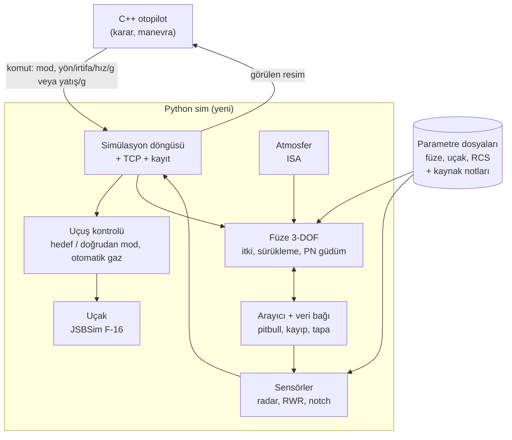
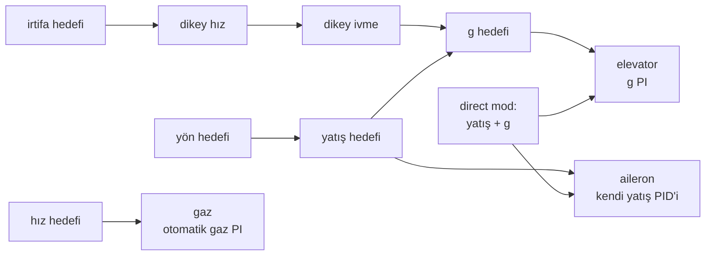
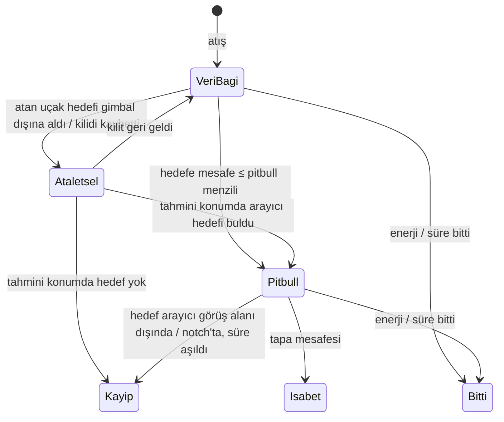

# Simülasyon yenileme planı

Durum: **taslak plan**, uygulanmadı. Tarih: 2026-11-12.

Bu plan BVRGym bağımlılığını kaldırıp kendi simülasyon katmanımızı kurmayı anlatır. JSBSim uçağı uçurmaya devam eder. Füze, sensör, isabet ve uçuş kontrolü bizim kodumuz olur. Her parçanın verisi ve formülü nereden geldiği yazılı biçimde gelir.

## 1. Sonunda ortaya ne çıkacak

| Bugün | Plan sonunda |
|---|---|
| Füze BVRGym'in 6-DOF JSBSim modeli. X-15 motor dosyası, ~69 kg, Mach 1→1.3'te sürükleme 13 kat düşüyor. | Kendi 3-DOF füze modelimiz. Kütle, iki kademeli itki, Mach'a bağlı sürükleme, **dönüşte enerji kaybı**. Her sayının kaynağı tabloda. |
| Füze hedefi her an kusursuz biliyor. Pitbull, veri bağı, arayıcı yok. | Pitbull'a kadar atan uçağın radarına bağlı (gimbal dışına çıkarsa güdüm kopar), sonra kendi arayıcısı. Notch arayıcıyı kırabilir. |
| 300 m'de kesin vuruş. Mach 1 altında yapay kayıp kuralı. | Yakınlık tapası. Füze enerjisi bitince ya da hedefi kaybedince düşer. |
| Radar ve RWR yok. C++ gerçek veriyi görüyor. | RCS'e bağlı radar menzili, gimbal, doppler notch, RWR uyarısı. C++ yalnız **gördüğünü** bilir (anahtarla açılır). |
| Uçuş kontrolü BVRGym'in otopilot nesnesine yamalı. | Kendi katmanlı uçuş kontrolümüz. Hedef modu (yön/irtifa/hız) + doğrudan mod (yatış/g). Hız komutu ve otomatik gaz. |
| C++'taki R_cold, R_max, yetişme süresi uyumları eski füzeye göre. | Aynı dış ölçüm betikleriyle yeni füzeye göre yeniden ölçülür. |

Kısaca: uçak aynı JSBSim F-16 olarak kalır. Füze ve sensörler gerçekçi ve şeffaf olur. Otopilotun crank, notch, destek gibi kararları sim'de **gerçek bir etki** yaratır. Bugün bu kararların füzeye hiçbir etkisi yok.

## 2. Hedef mimari



| Katman | Nerede | Ne kullanır | Kaynak |
|---|---|---|---|
| Uçak hareketi | Python → JSBSim | F-16 XML (BVRGym'den kopya, GPL) | JSBSim F-16 modeli (NASA rüzgâr tüneli verisi) |
| Uçuş kontrolü | Python, kendi kodumuz | JSBSim F-16 kontrol bilgisayarı üstünde yatış/g/gaz döngüleri | Bugünkü `flight_control.py` deneyimi |
| Füze hareketi | Python, kendi kodumuz | 3-DOF nokta kütle | OPRF formülleri, kamuya açık AIM-120 verisi |
| Arayıcı, veri bağı, tapa | Python, kendi kodumuz | Kurallar | OPRF + BMS husky/pitbull yapısı |
| Radar, RWR, notch | Python, kendi kodumuz | Kurallar + formüller | OPRF radar kuralları + RCS tablosu |
| Karar | C++ (değişmez) | Görülen resim | — |

**OPRF kullanım ilkesi:** OPRF FlightGear'ın Nasal diliyle yazılmış ve FlightGear'a bağlı; doğrudan dahil edilemez. Yalnız formül ve kuralları okunup kendi kodumuzda yeniden yazılır, kaynağı belgede gösterilir. Satır satır kopyalanmadığı için GPL yükümlülüğü doğmaz. JSBSim F-16 dosyaları ise kopyalanır ve GPL lisanslarıyla birlikte tutulur.

**BVRGym'den kalan:** yalnız JSBSim'i başlatma bilgisi ve F-16 model dosyaları. `jsb_gym` paketi, füze XML'i ve ajan sınıfları kullanılmaz.

## 3. Uçuş kontrolü

### 3.1 Komut sözleşmesi (C++ → Python)

| Mod | Alanlar | Kim kullanır |
|---|---|---|
| `target` (varsayılan) | `heading_deg`, `altitude_m`, `speed` (Mach ya da kt) **veya** `throttle`, `g_limit` | Bugünkü bütün manevralar: commit, crank, out, beam, drag, recommit |
| `direct` | `bank_deg`, `g`, `speed` **veya** `throttle` | Tam kontrol isteyen manevralar: split-S, notch'ta tam yatış, ileride BFM |

- `speed` verilirse otomatik gaz devreye girer. `throttle` verilirse doğrudan uygulanır. İkisi birlikte verilmez.
- Bugünkü manevralar `target` modunda değişmeden çalışır; C++'ta yalnız mesaj yapısı genişler.

### 3.2 İç döngüler (Python)



- Yön → yatış ve irtifa → dikey ivme → g mantığı bugünkü `flight_control.py`'den taşınır. Sert dönüş, koordineli dönüş, g doygunluğu bu mantıkta zaten çözülmüş durumda.
- BVRGym'in roll PID'i ve ikincil roll PID'i yerine tek ve kendi yatış kontrolümüz yazılır. Bugünkü 2,4 Hz titreşim sorunu bu tasarımın ölçütü olarak baştan ele alınır.
- Otomatik gaz: hız hatasından gaz PI'si, art yakıcı bölgesi dahil.

### 3.3 Doğrulama: amaç ölçütleri

Eski uçuşların birebir tekrarı aranmaz. Manevranın amacı korunmalı. Sayılar öneridir, ilk ölçümden sonra kesinleşir.

| Manevra | Ölçüt (öneri) |
|---|---|
| Out (180° dönüş, g sınırı 6–7) | Dönüş süresi bugünküyle aynı mertebede; irtifa kaybı sınırlı; dönüş sonunda yön ±2° içinde, aşma yok |
| Crank (sabit açı kayması) | Hedef açısı ±2° içinde tutulur; hız ve irtifa korunur |
| Küçük yön düzeltmesi | Salınım/titreşim yok; yön hatası birkaç saniyede kapanır |
| İrtifa tutma | ±50 m |
| Hız tutma | ±0.02 Mach, art yakıcı geçişinde salınım yok |
| Doğrudan mod | İstenen yatış ±3°, istenen g ±0.3 g |

Ölçüm dış betikle yapılır, ölçüm için koda alan eklenmez. Sonuçlar görüntüleyicide izlenir.

## 4. Füze modeli (3-DOF)

### 4.1 Hareket denklemleri

Füze bir nokta kütle. Durumu: konum, hız V, yol açısı γ, yön ψ, kütle m.

| Büyüklük | Formül |
|---|---|
| Hız değişimi | m·dV/dt = T − D − m·g·sin γ |
| Dönüş | Güdümden gelen yanal ve dikey ivme komutu; **G sınırı** ve **mevcut kaldırma** (CL_max·q·S) ile kesilir |
| Sürükleme | D = q·S·(Cd0(M) + Cdi) |
| Sıfır kaldırma sürüklemesi | Cd0(M): ses altı / ses civarı / ses üstü parçalı eğri (OPRF `drag()`) × füzeye özel katsayı; motor yanarken × plume katsayısı (AIM-120 için ~0.6) |
| Dönüş sürüklemesi | CL = n·m·g / (q·S), Cdi = CL² / (π·e·AR) |
| Kütle | Yanma süresince itici tükenir: dm/dt = −T / (Isp·g0) |
| Atmosfer | ISA: yoğunluk ve ses hızı irtifadan |

Füze ancak bu durumlarda biter:
- enerji tükenince: hız, güdüm için en düşük hızın altına iner;
- uçuş süresi (batarya) dolunca;
- hedefi kaybedince;
- tapa tetiklenince.

Mach 1 gibi yapay kayıp kuralı kalkar. Gerekirse ölçümle yeniden değerlendirilir.

### 4.2 Güdüm

- Orta evre ve son evre: PN (gerçek PN, yerçekimi telafili), kazanç N parametre.
- Loft: uzun menzilde yükselip süzülme. Parametreli, kapatılabilir.

### 4.3 Arayıcı, veri bağı, pitbull, tapa



| Kural | Parametre | Kaynak |
|---|---|---|
| Veri bağı, atan uçağın radarı hedefi izledikçe sürer | radar gimbal, izleme durumu | BMS DLZ belgesi, OPRF `telemetry` |
| Veri bağı koparsa son bilinen konum + hızla tahmine uçar | — | OPRF / genel |
| Pitbull: mesafe eşiği (ileride husky/HPRF ayrı) | `pitbull_range_nm` | BMS (`FighterPitbull`), kamuya açık ~10 NM tahmini |
| Arayıcı görüş alanı ve izleme hızı | `seeker_fov_deg`, `seeker_rate_dps` | OPRF parametreleri |
| Notch: arayıcı da radar gibi doppler'e bağlı | 4.4 ile ortak kural | OPRF |
| Tapa: yakınlık mesafesi | `fuze_radius_m` | OPRF / kamuya açık |

### 4.4 Sensörler

| Sensör | Kural | Kaynak |
|---|---|---|
| Radar tespit | R_tespit = R_ref · (σ / σ_ref)^(1/4); gimbal içinde; hedef görüş hattında | Radar denklemi; RCS: OPRF tablosu (F-16 ≈ 2 m²) |
| Doppler notch | Aşağı bakışta (hedefin arkası yer) ve hedefin araziye göre radyal hızı < ~30 kt ise görünmez | OPRF `checkClutter` |
| RWR | Düşman radarı bana kilitliyse uyarı; düşman füzesi pitbull olduysa füze uyarısı | Genel kural; ayrıntı uygulamada |
| Chaff (isteğe bağlı) | Kandırılma olasılığı = (1 − direnç); burun füzeye dönükse %70 daha az | OPRF |

Yer modeli düz kabul edilir. "Aşağı bakış" hedefin benden alçakta olmasıyla tanımlanır. Arazi maskelemesi kapsam dışıdır.

**Görülen resim:** sensör katmanı açılınca C++ her uçağın yalnız kendi radarının ve RWR'ının gördüğünü alır. Gerçek veri / görülen veri arasında anahtarla geçilir. Böylece sensörlerin karar üzerindeki etkisi ayrıca ölçülebilir.

## 5. Veri: neyi nereden alıyoruz

Her parametre bir **veri tablosunda** tutulur (Faz 0 çıktısı). Her satırda değer, birim, kaynak ve güven düzeyi yazar.

| Veri | Birincil kaynak | Başlangıç / eksik için | Doğrulama |
|---|---|---|---|
| Füze boyutları, kütle | ABD Hava Kuvvetleri ve Donanma AIM-120 bilgi formları (C-5/6/7: 356 lb, 12 ft) | — | — |
| İtki kademeleri, yanma süreleri, itici kütlesi | Açık akademik kaynaklar (NPS tezleri, Fleeman) | OPRF/FlightGear AIM-120 tanımı (topluluk tahmini) | Hız–zaman eğrisi, menzil tabloları |
| Sürükleme | OPRF formül yapısı + Fleeman | OPRF katsayıları | Menzil tabloları |
| Pitbull, arayıcı | BMS DLZ belgesi (yapı), OPRF (parametre adları) | Kamuya açık tahminler | Mantık testi |
| RCS | OPRF RCS tablosu | Kamuya açık tahminler | — |
| Radar referans menzili | Kamuya açık APG-68 tahminleri | — | — |
| Menzil tabloları (irtifa × hız × hedef açısı) | BMS/DCS topluluk tabloları; telif çözülürse CMO | — | Modelimizin çıktısı bunlarla kıyaslanır |
| Uçak hareketi | JSBSim F-16 | — | — |

CMO, BMS ve DCS verisi koda **veri olarak girmez**. Yalnız kıyas tablosunda referans olur.

## 6. C++ tarafına etkisi

| Konu | Ne olur |
|---|---|
| Komut mesajı | `mode`, `speed`, `bank_deg`, `g` alanları eklenir; mevcut manevralar `target` modunda kalır |
| Durum mesajı | Sensör fazında füze güdüm durumu (veri bağı / pitbull) ve "görülen resim" alanları eklenir |
| `missile_profiles.hpp` uyumları | R_cold, R_max, yavaşlama, yetişme süresi: dış betikle yeni füzeye göre yeniden ölçülür |
| `calculations/` formülleri | Sabit yavaşlama varsayımı (`escape_margin_nm`, `catch_time_left_s`) ölçümle sınanır. Biçim değişmesi gerekirse yalnız onayla değişir. |
| Karar eşleşmeleri | Yeni sim'de K1–K5 eşleşme koşuları tekrarlanır |

## 7. Fazlar

| Faz | İş | Çıktı | Bitti sayılması için |
|---|---|---|---|
| **0. Veri** | AIM-120 (ve ileride R-77) parametrelerini kaynaklarıyla toplamak; menzil kıyas tablolarını bulmak | `docs/veri_info/` altında füze veri tablosu | Her model parametresinin bir değeri ve kaynağı var |
| **1. Sim iskeleti + uçuş kontrolü** | BVRGym'siz döngü: JSBSim F-16 doğrudan; yeni uçuş kontrolü; komut sözleşmesi genişler. Kayıt ve görüntüleyici formatı korunur. | Füzesiz uçuş | 3.3'teki amaç ölçütleri sağlanıyor |
| **2. Füze kinematiği** | 3-DOF model, PN, loft, enerji bitimi | Tek füze uçuşları | Hız–zaman eğrisi makul; menzil tablosu referanslarla kıyaslanmış, sapma açıklanmış |
| **3. Arayıcı + veri bağı + tapa** | 4.3'teki durum makinesi | Füze olayları kayıtta (veri bağı koptu, pitbull, kayıp) | Crank'te gimbal dışı → güdüm kopuyor; notch'ta pitbull füze kaybediyor (senaryo testi) |
| **4. Uyumların yeniden ölçümü** | Dış betikle tarama, C++ profil katsayıları; formül biçimi kontrolü | Güncel `missile_profiles` + ölçüm raporu | Eşleşme koşuları yeni sim'de çalışıyor |
| **5. Sensörler** | Radar, RWR, notch, görülen resim (anahtarlı) | Görülen/gerçek resim kıyası | Notch radarı kırıyor; RWR kilit ve pitbull'u bildiriyor |
| **6. Chaff** (isteğe bağlı) | Olasılıksal chaff | — | — |

Sıra mantığı: önce uçak (her şey onun üstünde), sonra füze fiziği (kararların çoğu buna bağlı), sonra füzenin hedefi nasıl izlediği, sonra uçağın neyi gördüğü. Faz 4, Faz 2'den sonra bir kez, Faz 3'ten sonra bir kez daha koşulabilir.

## 8. Önerilen dosya düzeni (taslak)

```
src/sim/
  sim_main.py, simulation.py, connector.py, recorder.py   # döngü, TCP, kayıt (uyarlanır)
  flight_control.py        # yeniden yazılır: hedef/doğrudan mod, otomatik gaz
  physics/aircraft.py      # JSBSim F-16 sarmalayıcı
  physics/atmosphere.py    # ISA
  weapons/missile.py       # 3-DOF füze + PN
  weapons/seeker.py        # veri bağı, pitbull, kayıp, tapa
  sensors/radar.py, sensors/rwr.py
  data/missiles/aim120.yaml   # parametreler + kaynak notları
  data/aircraft/f16.yaml      # RCS, radar
  jsbsim_data/                # F-16 XML ve motor dosyaları (GPL, lisans notuyla)
```

## 9. Açık sorular ve riskler

- **Düşman tarafı:** şimdilik iki taraf da F-16 + AIM-120. Yapı farklı uçak ve füzeye hazır kurulur; R-77 ve ikinci uçak verisi Faz 0'ın ikinci turu.
- **İtki verisinin belirsizliği:** AIM-120 motorunun gerçek itki ve süresi kamuya açık değil. Model en çok burada tahmine dayanır; menzil tablolarıyla kalibre edilir.
- **Veri bağı ve notch ayrıntısı:** gerçek davranış gizli. Kurallar sadedir ve parametreler belgede yazılıdır.
- **Performans:** Python'da füze ve sensör hesapları hızlı tarama için yeterli olmalı; olmazsa sıcak noktalar ölçülüp optimize edilir.
- **Otopilot tahmini:** füze modeli Python'da olduğu için C++ tahminleri uyumlarla yapılmaya devam eder (Faz 4). İleride modelin C++'a taşınması ayrı bir karardır.

## 10. Kaynaklar

- OPRF (FlightGear muharebe sistemi, GPL-2.0+): [NikolaiVChr/OpRedFlag](https://github.com/NikolaiVChr/OpRedFlag). `emesary-damage-system/nasal/missile-code.nas` (füze), `radar/radar-system.nas` (radar, notch), `radar/rcs_mand.nas` (RCS).
- BMS: `docs/Dokuman/BVR dokuman/aim-120_dlz_update__apg-68.pdf` (husky/pitbull, A/F-pole), `BMS-Training-Manual (1).pdf` §18.5–18.6 (TR, MSR, MAR, DOR).
- AIM-120 kamuya açık veri: [ACC bilgi formu](https://www.acc.af.mil/Portals/92/Docs/Fact%20Sheets%20-%202020%20Update/AIM-120_Formatted.pdf), [Donanma bilgi dosyası](https://www.navy.mil/Resources/Fact-Files/Display-FactFiles/Article/2168352/aim-120-advanced-medium-range-air-to-air-missile-amraam).
- BVRGym (GPL-3.0): `BVRGym/`. F-16 modeli `BVRGym/aircraft/f16/f16.xml` (Erik Hofman, GPL).
- CMO: [geliştirici yanıtı, füze modeli](https://forums.matrixgames.com/viewtopic.php?p=4755512), [War Planner](https://command.matrixgames.com/?p=5500). Yalnız doğrulama referansı.
