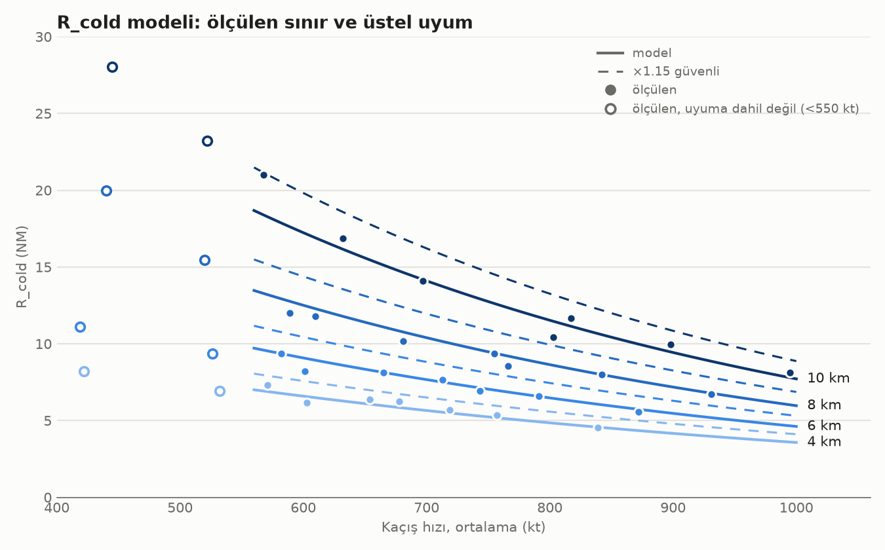
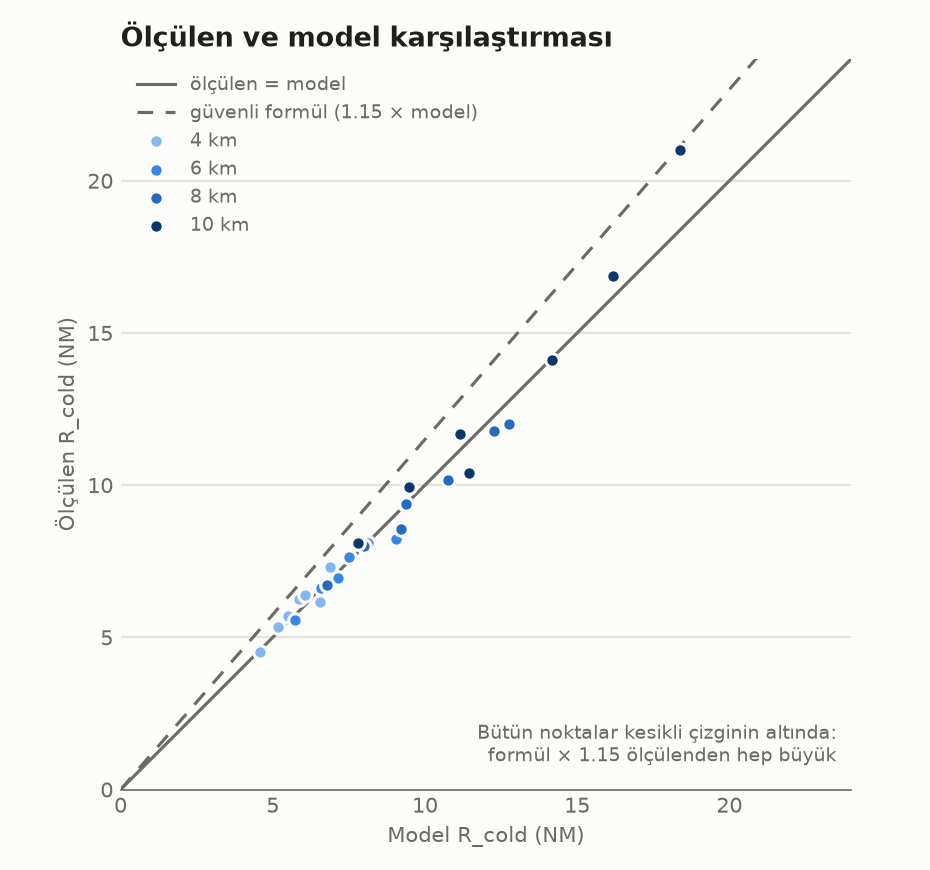

# R_cold formülü: nasıl bulundu

R_cold: düşman füzeyi attığı anda kuyruğumuzu dönmüş kaçıyor olsaydık, füzenin bize yetişebileceği en büyük mesafe (NM). MAR ve NEZ hesapları bu değerin üzerine kurulur.

## Sonuç

```
x = h − 10          h: irtifa, km
y = V_kaçış − 700   V_kaçış: out sonrası kaçış hızı, kt

R_cold = exp( 2.646 + 0.1523·x − 0.00201·y − 0.00008·x·y )   NM
R_cold_güvenli = 1.15 · R_cold
```

Geçerli aralık: **h = 4–10 km**, **V_kaçış = 570–1000 kt**.





Grafikler, veri (`r_cold_olcumler.csv`) ve çizim betiği `r_cold_grafikler/` klasöründedir. Yeniden üretmek için: `python src/otopilot/calculations/r_cold_grafikler/r_cold_grafik.py`

"Vurdu" tanımı, BVRGym'in isabet tanımından geniştir; ayrıntısı aşağıda. Amaç, füzenin kendi güdüm hatası yüzünden ıskaladığı atışlarda da uçağı vurulmuş saymaktır.

## Neden tablo yerine formül

Eski hesap, 10 km'de ölçülmüş tek bir Mach–mesafe tablosundan (`AIM120C_GLIDE_TABLE_10KM`) okuyordu. Şimdiki BVRGym füzesinde bu tablo tutmuyor:

- **Füze loft yapıyor.** Hedef 15 km'den (`dive_at`) uzaksa füze 15 km irtifaya tırmanıyor, yaklaşınca dalıyor. Bu yüzden Mach tek yönlü azalmıyor: tepede düşüyor, dalışta tekrar artıyor. Aynı Mach'a iki farklı mesafe karşılık gelebiliyor.
- **Kaçan hedefe karşı füze hiç dalmıyor.** Hedefe 15 km'ye kadar yaklaşamıyor; seyir irtifasında yavaşlayıp Mach 1'in altına düşünce kayboluyor (`target_lost_below_mach = 1.0`).

Bir uçuş kaydında (`manuveur_test_3`, 4 km) tablo R_cold'u gerçeğin yaklaşık 2 katı verdi. Bu yüzden R_cold doğrudan kaçış senaryosunda ölçüldü.

## Ölçüm düzeni

- C++ kullanılmadı. Python `Simulation` sınıfı sabit komutlarla, kayıt alınmadan koşturuldu.
- İki uçak da aynı irtifada ve 180° yönünde başladı:
  - **Red (atan):** kuzeyde, 300 m/s (583 kt), gaz 0.45. Füzeyi ilk adımda attı.
  - **Blue (kaçan):** güneyde, kuyruğu red'e dönük (ATA 180). Düz uçarak kaçtı.
- Füze tamamen BVRGym ayarlarıyla uçtu, tek fark fırlatma hızı düzeltmesi:
  - `dive_at = 15 km`, `alt_cruise = 15 km`
  - `target_lost_below_mach = 1.0`, `effective_radius = 300 m`
  - Füze, atan uçağın gerçek hava hızıyla (m/s) başlatıldı.
- Füzeyi kaybettiren yalnız iki koşul var: Mach < 1 ve irtifa < 0.

| Değişken | Değerler |
|---|---|
| İrtifa | 4, 6, 8, 10 km |
| Blue başlangıç hızı | 220, 300, 380 m/s |
| Blue gazı | 0.3, 0.6, 1.0 |

Toplam 36 senaryo var. Formüldeki V_kaçış, füze uçtuğu süre boyunca blue'nun **ortalama** hava hızıdır.

## "Vurdu" tanımı

BVRGym'de isabet, füzenin hedefe 300 m'den (`effective_radius`) fazla yaklaşmasıdır. Ancak füzenin PN güdümü (N = 2), özellikle dönen hedefe karşı, enerjisi yeterken bile hedefin yanından geçebiliyor. Örneğin `r_cold_test_1` kaydında Hostile'ın füzesi KZL'nin 604 m yanından M1.53 (957 kt) hızla geçti ve isabet sayılmadı.

Bu analizde bir atış, şu ikisinden biri olursa vurdu sayıldı:

1. BVRGym isabet verdi, **ya da**
2. Füze uçuşu boyunca hedefe **1 NM'den (1852 m) fazla yaklaştı** ve o anda **Mach > 1** idi.

Mach koşulu, füzenin artık kaybolduğu anda yapılan yakın geçişlerin isabet sayılmasını önler.

### Etkisi

- **Gaz 0.3 ile kaçışta değişiklik yok.** Sınırdaki son atışlar zaten gerçek isabetti.
- **Gaz 0.6 ve 1.0 ile kaçışta sınır 0.8–1.4 NM uzadı.** Yeni sınırda füzenin hedefe en yakın geçişi 1650–1850 m.
- Düz kaçışta, sınırın ötesinde en yakın geçiş mesafesi, atış mesafesi arttıkça düzgün şekilde büyüyor. Yani füze orada sıçrayarak ıskalamıyor; hedefe yetişemiyor. Bu kriter düz kaçış için kabaca 1 NM'lik bir güvenlik payı ekliyor. Dönüş sırasındaki gerçek güdüm ıskalamalarını da kapsıyor.

Sonucun mesafeye göre tek yönlü olduğu ayrıca kontrol edildi. 4, 8 ve 10 km'de 5–20 NM arası 0.5 NM adımla tarandı. Sınıra kadar her atış isabet, ötesinde her atış ıskalama çıktı; arada karışık bölge yok. Bu nedenle sınır ikiye bölme yöntemiyle bulundu: 0.5–30 NM arası, 0.15 NM hassasiyet.

## Erişim kriteriyle yeniden ölçüm

WEZ taramasında (`wez_formulu.md`) aynı senaryo "isabet değil erişim" kriteriyle yeniden ölçüldü. 36 sonucun hepsi aşağıdaki **Eski R** sütunuyla 0.15 NM içinde aynı çıktı. Bu tablodaki veriler ve formül değiştirilmedi; yeni ölçüm `wez_grafikler/wez_olcumler_ana_cold_v2.csv` dosyasında, karşılaştırma grafiği `wez_grafikler/r_cold_eski_yeni.png`.

## Ölçülen veri

`Eski R`: yalnız BVRGym isabeti. `Yeni R`: yukarıdaki genişletilmiş tanım; formül bu sütundan çıkarıldı. `En yakın`: yeni sınırdaki atışın hedefe en yakın geçişi.

| h (m) | Blue hızı (m/s) | Gaz | Eski R (NM) | Yeni R (NM) | Kaçış ort. (kt) | En yakın (m) |
|---|---|---|---|---|---|---|
| 4000 | 220 | 0.3 | 8.22 | 8.22 | 422 | 297 |
| 4000 | 220 | 0.6 | 6.49 | 7.30 | 571 | 1657 |
| 4000 | 220 | 1.0 | 5.34 | 6.26 | 678 | 1825 |
| 4000 | 300 | 0.3 | 6.95 | 6.95 | 532 | 294 |
| 4000 | 300 | 0.6 | 5.57 | 6.38 | 654 | 1686 |
| 4000 | 300 | 1.0 | 4.53 | 5.34 | 757 | 1671 |
| 4000 | 380 | 0.3 | 6.15 | 6.15 | 603 | 296 |
| 4000 | 380 | 0.6 | 4.88 | 5.69 | 719 | 1759 |
| 4000 | 380 | 1.0 | 3.73 | 4.53 | 839 | 1717 |
| 6000 | 220 | 0.3 | 11.10 | 11.10 | 419 | 296 |
| 6000 | 220 | 0.6 | 8.45 | 9.37 | 582 | 1697 |
| 6000 | 220 | 1.0 | 6.84 | 7.64 | 713 | 1760 |
| 6000 | 300 | 0.3 | 9.37 | 9.37 | 526 | 294 |
| 6000 | 300 | 0.6 | 7.30 | 8.11 | 665 | 1751 |
| 6000 | 300 | 1.0 | 5.80 | 6.61 | 791 | 1738 |
| 6000 | 380 | 0.3 | 8.22 | 8.22 | 601 | 293 |
| 6000 | 380 | 0.6 | 6.15 | 6.95 | 743 | 1712 |
| 6000 | 380 | 1.0 | 4.76 | 5.57 | 872 | 1691 |
| 8000 | 220 | 0.3 | 19.97 | 19.97 | 440 | 294 |
| 8000 | 220 | 0.6 | 10.87 | 11.79 | 610 | 1830 |
| 8000 | 220 | 1.0 | 8.57 | 9.37 | 755 | 1669 |
| 8000 | 300 | 0.3 | 15.48 | 15.48 | 520 | 299 |
| 8000 | 300 | 0.6 | 9.37 | 10.18 | 681 | 1765 |
| 8000 | 300 | 1.0 | 7.18 | 7.99 | 842 | 1685 |
| 8000 | 380 | 0.3 | 12.02 | 12.02 | 589 | 295 |
| 8000 | 380 | 0.6 | 7.64 | 8.57 | 766 | 1851 |
| 8000 | 380 | 1.0 | 5.92 | 6.72 | 931 | 1742 |
| 10000 | 220 | 0.3 | 28.04 | 28.04 | 445 | 299 |
| 10000 | 220 | 0.6 | 15.60 | 16.86 | 632 | 1740 |
| 10000 | 220 | 1.0 | 10.87 | 11.68 | 817 | 1669 |
| 10000 | 300 | 0.3 | 23.20 | 23.20 | 522 | 297 |
| 10000 | 300 | 0.6 | 12.71 | 14.10 | 697 | 1850 |
| 10000 | 300 | 1.0 | 9.03 | 9.95 | 898 | 1804 |
| 10000 | 380 | 0.3 | 21.01 | 21.01 | 568 | 300 |
| 10000 | 380 | 0.6 | 9.49 | 10.41 | 803 | 1706 |
| 10000 | 380 | 1.0 | 7.30 | 8.11 | 995 | 1681 |

## Formülün çıkarılması

1. **Biçim.** Her irtifada `ln(R_cold)` ile V_kaçış arasındaki ilişki neredeyse doğrusal çıktı. İrtifa için de üstel biçim fiziksel olarak tutarlı: füzeyi yavaşlatan sürükleme hava yoğunluğuyla orantılı, yoğunluk da irtifayla üstel olarak düşüyor. Model:

   ```
   ln(R_cold) = a + b·x + c·y + d·x·y
   ```

2. **Uyum.** Logaritma alınınca model doğrusal regresyona dönüşüyor; en küçük kareler yöntemiyle (`numpy.linalg.lstsq`) çözüldü. Yalnız V_kaçış ≥ 550 kt olan 28 nokta kullanıldı. Daha yavaş kaçışta R_cold çok hızlı büyüyor (10 km'de 28 NM'ye kadar) ve bu noktalar gerçekçi hızlardaki uyumu bozuyordu.

3. **Merkezleme.** x = h − 10 ve y = V − 700 alındı. Böylece sabit terim doğrudan okunabiliyor: 10 km ve 700 kt'de R_cold = e^2.646 ≈ 14.1 NM.

Uyum hatası: ortalama 0.42 NM. Formülün R_cold'u olduğundan küçük verdiği (tehlikeli yöndeki) en büyük hata 2.6 NM. Ölçülen / formül oranı 0.91–1.14 arasında.

### Katsayıların anlamı

| Katsayı | Değer | Anlamı |
|---|---|---|
| a | 2.646 | 10 km ve 700 kt'de R_cold ≈ 14.1 NM |
| b | 0.1523 /km | Her 1 km irtifa R_cold'u ×1.16 büyütür; 6.6 km'de e katı. Atmosfer yoğunluğunun ölçek yüksekliğine (~7–8 km) yakın. |
| c | −0.00201 /kt | 10 km'de her +100 kt kaçış hızı R_cold'u ×0.82'ye indirir. |
| d | −0.00008 | Hız etkisi irtifayla biraz güçlenir: hız katsayısı 4 km'de −0.0015, 10 km'de −0.0020. |

## Güvenlik çarpanı

Formülün en çok eksik tahmin ettiği nokta, 10 km'de hızlı başlayıp gaz 0.3 ile yavaşlayan kaçış: ölçülen 21.0 NM, formül 18.4 NM. Ortalama hız aynı olsa bile yavaşlayan uçak daha kolay vuruluyor.

Ölçülen / formül oranı en fazla 1.14. Formül **1.15** ile çarpıldığında 28 noktanın hepsi güvenli tarafta kalıyor.

## Sınırlar

- **Atan uçak sabitti** (583 kt, gaz 0.45). Daha hızlı ya da daha yüksekten atış R_cold'u büyütür; bu etki formülde yok.
- **İki uçak aynı irtifadaydı.** h, ortak irtifadır; irtifa farkının etkisi ölçülmedi.
- **Ölçüm aralığı 4–10 km ve 570–1000 kt.** Bu aralığın dışı tahmindir.
- **V_kaçış ortalama hızdır.** C++'taki `get_after_out_speed_kt()` anlık TAS döndürür. Out'tan sonra art yakıcıyla hızlanılacağı için bu güvenli taraftadır.
- **"Vurdu" eşiği (1 NM) bir seçimdir.** Düz kaçışta sonucu kabaca eşik kadar kaydırır. Eşik değişirse tarama yeniden yapılmalıdır.
- **Katsayılar bu BVRGym füzesine ve ayarlarına özgüdür.** Füze modeli, `dive_at`, `target_lost_below_mach` ya da fırlatma hızı değişirse tarama tekrarlanmalıdır.
