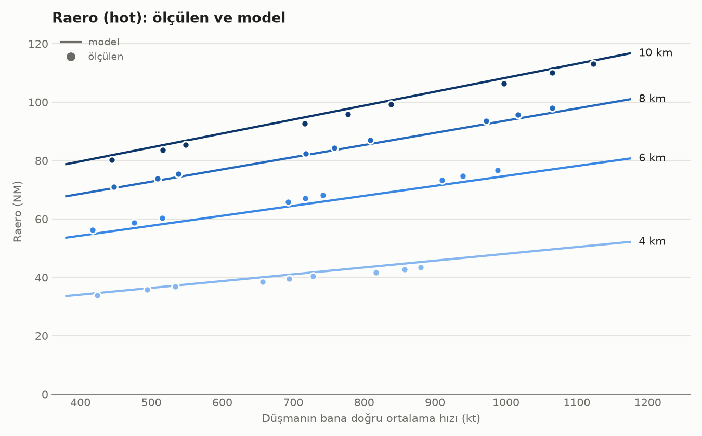
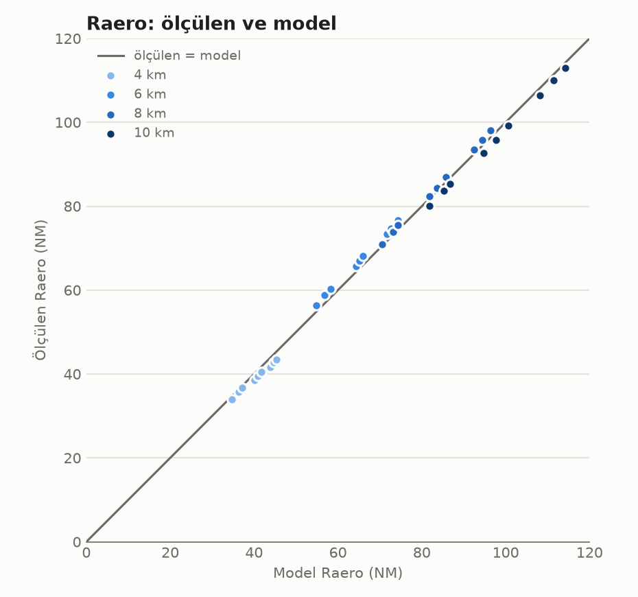

# WEZ formülü (Rmax): nasıl bulundu

WEZ'in dış sınırı **Rmax** (eski adı Rmax1; BMS'in yeni DLZ terminolojisinde **Raero**): füzenin azami kinematik menzili. BMS AMRAAM DLZ tanımıyla: *"atılabilecek en uzak atış; hedefin manevra yapmadığı ve füzenin kusursuz olduğu varsayılır"* (`docs/Dokuman/BVR dokuman/aim-120_dlz_update__apg-68.pdf`, s. 75). Yani isabet değil **erişim** ölçülür: füze hedefe enerjisi bitmeden ulaşabiliyor mu.

Kodda: `engagement::wez` → `weapons.wez.max_nm`. Katsayılar `model/missile_profiles.hpp` içindeki `AIM120C_R_MAX`.

## Sonuç

```
Rmax = R_m + V · t / 3600                                    NM

R_m = (a + b·ln h) · (1 + k·(V_atan − 583 kt))                füzenin kendi gittiği yol, NM
t   =  c + d·ln h                                             uçuş süresi, s

h      : atan uçağın irtifası, km
V      : düşmanın bana doğru hızı, kt (+ geliyor, − kaçıyor)
V_atan : atan uçağın hava hızı, kt

a = −29.595   b = 39.193   c = −48.62   d = 95.66   k = 0.000417 /kt
```

Ölçüm aralığı: **h = 4–10 km**, **V = 420–1120 kt** (düşman bana doğru), **V_atan = 430–740 kt**.

| İrtifa | R_m (füzenin kendi yolu) | t |
|---|---|---|
| 4 km | 24.7 NM | 84 s |
| 6 km | 40.6 NM | 123 s |
| 8 km | 51.9 NM | 150 s |
| 10 km | 60.7 NM | 172 s |

Düşman hareketsizse (V = 0) WEZ, füzenin kendi yolu yarıçaplı bir dairedir. Düşman bize geliyorsa büyür, kaçıyorsa küçülür; açıya (aspect) değil, düşmanın o anki hız vektörüne bakılır. Düşman döndükçe her step kendiliğinden güncellenir.





Uyum hatası: ortalama 1.46 NM, en büyük ±2.3 NM. Ölçülen / model oranı 0.95–1.04. Formül × 0.94 bütün noktalarda ölçülenin altında kalır; şu an güvenlik çarpanı **uygulanmadı**.

## Ölçüm düzeni

Betik: `wez_grafikler/wez_tarama.py`, çalıştırıcı `wez_tarama_calistir.bat`. Uyum ve grafikler: `wez_grafikler/wez_grafik.py` (çıktı `wez_sonuc.txt`).

- C++ yok, kayıt yok; Python `Simulation` sabit komutlarla. R_cold ölçümüyle aynı düzen ve füze ayarları.
- **Red (atan):** kuzeyde, güneye uçar; 300 m/s, gaz 0.45. Füzeyi ilk adımda atar.
- **Blue (hedef):** güneyde, manevra yapmaz. Aspect yönüyle verilir: **hot** red'e doğru, **beam** red'e dik, **cold** red'den kaçar.
- Izgara (her aspect için 36 senaryo): irtifa 4/6/8/10 km × blue hızı 220/300/380 m/s × blue gazı 0.3/0.6/1.0. Ek olarak 8 km'de atan hızı 220/300/380 m/s.
- Sınır ikiye bölme ile bulundu (1–150 NM, 0.15 NM hassasiyet). Kaba taramayla sonucun mesafeye göre tek yönlü olduğu kontrol edildi (`wez_kontrol_v2.csv`).

### "Erişti" tanımı

Füze **hâlâ uçarken hedefi geçti** (hedef artık füzenin gidiş yönünde önünde değil: yanında ya da arkasında) **ya da** BVRGym isabet verdi. Iskalama mesafesine bakılmaz. BVRGym füzeyi Mach 1'in altında kaybettiği için "hâlâ uçuyor" = enerjisi var. Hedef füzeden hızlı kaçıyorsa hep önünde kalır: erişim yok.

İlk sürüm (v1) "mesafe büyümeye başladı" = geçti sayıyordu. Hızlı kaçan hedefte füze yavaşlayınca mesafe büyüdüğü için yanlış "erişti" verdi. v1 dosyaları (`wez_olcumler_*.csv` uzantısız olanlar) bu yüzden geçersiz; kayıt için duruyor.

## Formülün çıkarılması

1. **Ayrıştırma.** Her hot ölçümünde `Rmax − V·t_uçuş` hesaplandı. Kalan, füzenin kendi gittiği yol, hedefin hızından neredeyse bağımsız, yalnız irtifaya bağlı çıktı (4 km'de 19.5–21.4, 10 km'de 53.7–55.7 NM). Yani Rmax = füzenin yolu + düşmanın o sürede yaklaştığı yol. Eski koddaki biçim (`max_range + kapanma × uçuş süresi`) doğruydu; sabitleri yanlıştı.
2. **İrtifa.** Füzenin yolu ve uçuş süresi ln(h) ile neredeyse doğrusal: yükseldikçe hava incelir, artış yavaşlar.
3. **Uyum.** Dört katsayı (a, b, c, d) 36 hot noktasında doğrudan Rmax'ya en küçük karelerle uyduruldu (model katsayılarda doğrusal). Bu yüzden t, ölçülen uçuş süresinden (101–194 s) biraz kısa çıkar; tek başına uçuş süresi değil, Rmax'yu en iyi veren "etkin" süredir.
4. **Atan hızı.** 8 km'de atan hızı 220 / 300 / 380 m/s için füzenin kendi yolu 0.930 / 1.000 / 1.061 oranında değişti: m/s başına %0.081 = kt başına %0.0417. Uçuş süresine etkisi formüle katılmadı.

## Bugünkü değerle karşılaştırma

Eski WEZ: `50 NM + kapanma × (50 NM / 1940 kt ≈ 93 s)`, irtifadan bağımsız.

| Durum | Eski | Ölçülen |
|---|---|---|
| 4 km, düşman ~700 kt bize | ~68 NM | ~40 NM |
| 10 km, düşman ~780 kt bize | ~70 NM | ~96 NM |

Eski değer alçakta WEZ'i 1.7 kat büyük, yüksekte küçük veriyordu.

## Sınırlar

- **Formül hot ölçümünden çıktı.** Düşman yana ya da benden uzağa uçarken (V ≤ 0) formül ölçülenden büyük verir. Örneğin 8 km, 300 m/s, gaz 0.6: formül beam'de ~27, cold'da ~14 NM; ölçülen 15.5 ve 9.3 NM. Bu bilerek kabul edildi (aspect'e bağlı sınır yok).
- **Beam tek değişkene sığmıyor.** Yavaş hedefte (gaz 0.3) Rmax 6–10 km'de 21–50 NM, hızlıda 8–27 NM; aynı "bana doğru hız" değerinde çok farklı sonuçlar var. Grafik: `wez_grafikler/wez_beam.png`.
- **Erişim isabet değil.** Hot sınır atışlarında füze hedefin 0.5–7 km yanından geçiyor. İsabet menzili 4 km'de ~12 NM, 10 km'de ~64 NM; Rmax 38 ve 92 NM. Rmax "hâlâ bir şans var" sınırıdır; vuruş için daha kısa bir menzil (BMS: Ropt = 0.85·Rmax, Rpi = 0.75·Rmax ya da ölçülmüş bir isabet menzili) gerekebilir.
- **h ≈ 2.1 km'nin altında** a + b·ln h eksiye düşer; formül 4 km altında tahmindir.
- **İki uçak aynı irtifadaydı.** İrtifa farkının etkisi ölçülmedi.
- **Katsayılar bu BVRGym füzesine özgüdür.** Füze modeli ya da ayarları değişirse tarama tekrarlanmalıdır.

## R_cold yeniden ölçümü (katsayılar değişmedi)

Aynı tarama cold aspect'te R_cold senaryosunun aynısı. Erişim kriteriyle 36 sonucun hepsi `r_cold_formulu.md`'deki **"Eski R"** (yalnız BVRGym isabeti) ile 0.15 NM içinde aynı çıktı: kaçan hedefte füze ya yetişip vurur ya hiç yetişemez. Koddaki R_cold katsayıları ("Yeni R", 1 NM kriteri) bu yüzden gaz 0.6–1.0'da ~0.8 NM temkinli tarafta. Karar: **R_cold katsayıları değiştirilmedi.** Karşılaştırma: `wez_grafikler/r_cold_eski_yeni.png`, veri `wez_grafikler/wez_olcumler_ana_cold_v2.csv`.
