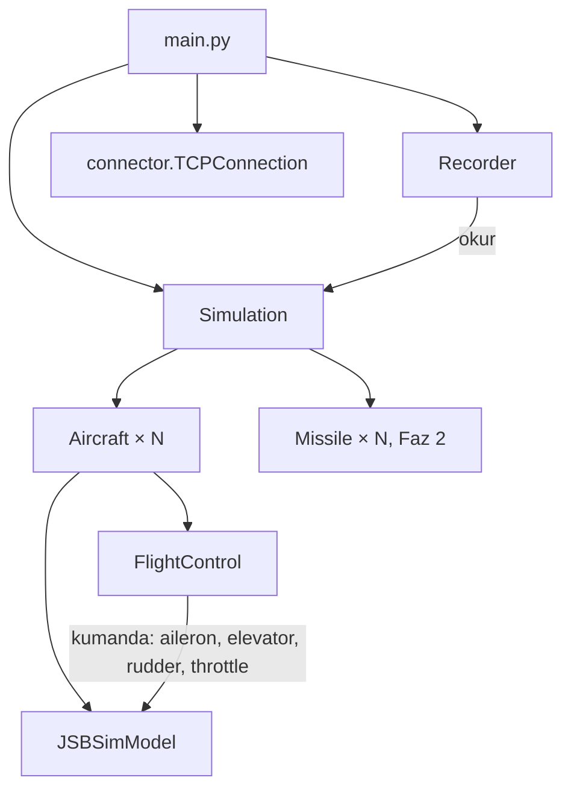

# Simülatör (yeni sim)

BVRGym'den bağımsız Python simülasyonu. Plan ve gerekçeler: [docs/mimari/SIMULASYON_YENILEME_PLANI.md](../../docs/mimari/SIMULASYON_YENILEME_PLANI.md).
Eski `src/sim/` BVRGym'le çalışmaya devam eder; kıyas için korunur.

**Kurallar**
- Her sayı kaynaklıdır (plan §5). Kaynak yoksa uydurulmaz, raporlanır. Kaynak satırın yanına yorum olarak yazılır.
- C++ otopilot (`src/otopilot`) değişmez. TCP mesajları eski sim'le **aynı** biçimdedir.
- Kod okunabilir, sade, modülerdir. Yorumlar Türkçe ve satır sonundadır.

## Çalıştırma

```
python src/simulator/main.py [--name ad] [--altitude m] [--throttle 0..1] [--range NM] [--duration s]
```

Python TCP sunucusudur; C++ `main.exe` istemci olarak bağlanır. Akış eski `src/sim/sim_main.py` ile aynıdır.

## Dosya yapısı

```
src/simulator/
  main.py              giriş: senaryo → Simulation → TCP döngüsü → kayıt
  scenario.py          senaryo okuma, doğrulama, yollar
  scenario.yaml        dünya, bağlantı, uçaklar
  connector.py         TCP + satır başına JSON (eski sim'den aynen)
  simulation.py        Simulation: saat, uçaklar, füzeler, read_state / step / fire
  aircraft.py          Aircraft: kimlik + JSBSimModel + FlightControl + mühimmat
  recorder.py          kayıt (görüntüleyiciyle uyumlu biçim)
  physics/
    jsbsim_model.py    JSBSimModel: F-16'yı yükle, başlat, kumanda yaz, durum oku
    atmosphere.py      ISA (Faz 2, füze için)
  flight_control/      NASA AML uçuş kontrolü (Faz 1b)
  weapons/             füze 3-DOF, arayıcı, tapa (Faz 2–3)
  sensors/             radar, RWR, notch (Faz 5)
  data/                parametre dosyaları (füze, uçak) + kaynak notları
  jsbsim_data/         JSBSim F-16 ve motor XML'leri (BVRGym'den kopya, GPL)
  tests/               pytest birim testleri
  tools/               dış ölçüm betikleri (uçuş testleri, taramalar)
```

## Zamanlama

| Büyüklük | Değer | Kaynak |
|---|---|---|
| JSBSim fizik adımı | 1/120 s | BVRGym `scripts/f16_test.xml` (`dt="0.00833333"`) |
| Bir dış adım (tick) | 10 fizik adımı = 1/12 s | BVRGym `f16_config.py` `Control_time_step=10`, senaryo `sim_time_step: 1` |

Uçuş kontrolü her fizik adımında çalışır; C++ komutu tick başına bir kez gelir.

## Modüller arası bağlantılar



| Arayüz | Sözleşme |
|---|---|
| `Simulation.read_state()` | Eski sim'le aynı sözlük: `tick`, `sim_time_s`, `aircraft[]` (id, name, type, team, health, lat_deg, lon_deg, alt_msl_m, yaw_deg, pitch_deg, roll_deg, tas_mps, mach, velocity_ned_mps), `missiles[]` (id, owner_id, target_id, state, outcome, flight_time_s, kinematics), `flight_commands[]` |
| `Simulation.step(aircraft_commands)` | Komut biçimi eski sim'le aynı: `id`, `heading_deg`, `altitude_m`, `throttle`, isteğe bağlı `g_limit` |
| `Simulation.fire(shooter_id, target_id)` | Hazır füze varsa atar → True. Faz 2'ye kadar füze yok → False. |
| `FlightControl.update(command, model, dt_s)` | Her fizik adımında kumanda girdilerini üretir. AML katmanları (plan §3.2). |
| `JSBSimModel` | SI birimli okuyucular, kumanda yazıcıları; `fdm` kayıt için açıktır |
